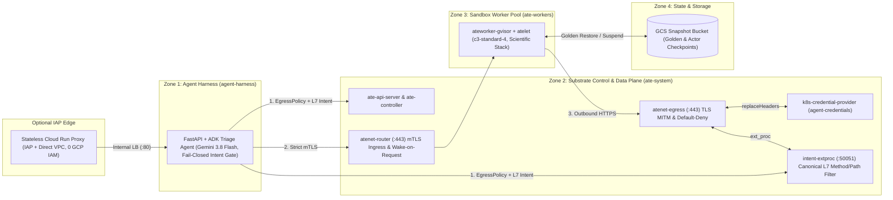

# GKE Agent Substrate — The Secure Runtime Reference Architecture

**Agent Substrate** (`ate-system`, `v1.0.0-rc.3`) is a stateful sandbox runtime
for Kubernetes that decouples an agent's persistent identity and
memory/filesystem state (**Actors**) from underlying compute (**WorkerPools**).
Every actor executes inside a dedicated **gVisor (`runsc`)** user-space kernel
on warm worker pods, restores in **~570ms** from pre-warmed **Golden Snapshots**
(`SNAPSHOT_FIDELITY_MEMORY`) stored in Google Cloud Storage, and routes all
network traffic through identity-aware gateways (**`atenet-router`** for ingress
and **`atenet-egress`** for default-deny egress, out-of-sandbox credential
injection, and pluggable Envoy `ext_proc` L7 HTTP inspection).



## Architecture Components & Trust Zones

| Layer                                                     | Component                                       | Responsibility                                                                                                                                                                                                                                                                          |
| :-------------------------------------------------------- | :---------------------------------------------- | :-------------------------------------------------------------------------------------------------------------------------------------------------------------------------------------------------------------------------------------------------------------------------------------- |
| **Zone 1: Agent Harness (`agent-harness`)**               | **ADK GitHub Triage Agent** (`triage-agent`)    | Powered by **Gemini 3.8 Flash on Vertex AI** (`GOOGLE_GENAI_USE_VERTEXAI=1`). Serves both Mission Control (`/`, `/api/*`, SSE `/api/events`) and ADK Dev UI (`/dev-ui/`), enforces fail-closed `before_tool_callback` intent sync, and calls actors over strict mTLS (`atenet-router`). |
| **Zone 2: Substrate Control & Data Plane (`ate-system`)** | **`ate-api-server` & `ate-controller`**         | Manages `Atespace`, `ActorTemplate`, `Actor`, `EgressPolicy`, and `WorkerPool` (`ate.dev/v1`) reconciliation.                                                                                                                                                                           |
|                                                           | **`atenet-router`**                             | Ingress mTLS gateway (`:443`). Authenticates caller SPIFFE IDs, wakes suspended actors on demand via `atelet`, and streams requests to the actor's container port.                                                                                                                      |
|                                                           | **`atenet-egress` + `k8s-credential-provider`** | Default-deny egress gateway (`:443`). Terminates TLS (`egress-mitm.ate.dev`) and injects secrets (`replaceHeaders`) outside the sandbox from `agent-credentials` (neither `agent-harness` nor `ate-workers` has RBAC access to `agent-credentials`).                                    |
|                                                           | **`intent-extproc`**                            | Pluggable Envoy `ExternalProcessor` (`--experimental-additional-egress-extproc-service=ate-system/intent-extproc:50051`) enforcing canonicalized per-actor HTTP method (`GET`/`HEAD` vs `POST`/`PATCH`/`DELETE`) and URL path prefix policies with SPIFFE audit logging.                |
| **Zone 3: Sandbox Worker Pool (`ate-workers`)**           | **`ateworker-gvisor` + `atelet`**               | Runs on a uniform `c3-standard-4` node pool (`ate.dev/worker-pool=true`, taint `ate.dev/sandboxClass=gvisor:NoSchedule`) hosting gVisor `runsc` sandboxes (`scientific-python`).                                                                                                        |
| **Zone 4: State & Storage**                               | **GCS Snapshot Bucket**                         | Stores immutable **Golden Snapshots** built from `ActorTemplate` (`SNAPSHOT_FIDELITY_MEMORY`) and per-actor pause/resume memory + rootfs checkpoints.                                                                                                                                   |

## Deployment & Validation

Run all commands below from the repository root:

```bash
export TF_VAR_platform_default_project_id="<YOUR_GCP_PROJECT_ID>"
export TF_VAR_platform_default_region="us-central1"
export TF_VAR_cluster_location="us-central1"
export TF_VAR_secure_runtime_github_repo="GoogleCloudPlatform/accelerated-platforms"
export TF_VAR_secure_runtime_github_readonly_token="<YOUR_FINE_GRAINED_READONLY_GITHUB_PAT>"

./platforms/gke/base/use-cases/agent-substrate-secure-runtime/terraform/deploy-standard.sh
./platforms/gke/base/use-cases/agent-substrate-secure-runtime/demo/validate.sh
```

## Running Verification Steps `#1`–`#4` (CLI & Side-by-Side Live UI)

| Step                            | Script from Repo Root                                                                          | What It Verifies on Live GKE + Agent Substrate `v1.0.0-rc.3`                                                                                                                                                                               |
| :------------------------------ | :--------------------------------------------------------------------------------------------- | :----------------------------------------------------------------------------------------------------------------------------------------------------------------------------------------------------------------------------------------- |
| **`#1` Sandbox Boundary**       | `./platforms/gke/base/use-cases/agent-substrate-secure-runtime/demo/part1-sandbox-boundary.sh` | Verifies `Linux 4.19.0-gvisor` user-space syscall interception (`AF_PACKET`, `unshare`, `/proc/kcore`, `/proc/kallsyms`, `/proc/sysrq-trigger`, `/dev/kmsg` all `BLOCKED_BY_GVISOR`).                                                      |
| **`#2` Cold-Start Race**        | `./platforms/gke/base/use-cases/agent-substrate-secure-runtime/demo/part2-cold-start-race.sh`  | Concurrently races an isolated cold Kubernetes `gVisor` Pod in `demo-bench` (`~11.3s`) against an Agent Substrate Golden Snapshot Actor (`~570ms` wake, **~20x faster**; `~210ms` stateful pause/resume, **~54x faster**).                 |
| **`#3` Credentials & Egress**   | `./platforms/gke/base/use-cases/agent-substrate-secure-runtime/demo/part3-intent-egress.sh`    | Applies per-actor `EgressPolicy` (`replaceHeaders`) and `intent-extproc` `READ_ONLY` rules (`200 OK` on `GET /issues/42` with `0` secrets in `os.environ`, `403 Forbidden` on `POST /issues/42/comments`, default-deny on unlisted hosts). |
| **`#4` SPIFFE Audit & Reset**   | `./platforms/gke/base/use-cases/agent-substrate-secure-runtime/demo/part4-audit-quarantine.sh` | Queries the SPIFFE-attributed L7 audit trail (`spiffe://substrate-actor.local/...`), revokes policy, deletes the tainted actor, and restores a fresh actor from the Golden Snapshot.                                                       |

### Interactive Side-by-Side UI (Stateless IAP Cloud Run Proxy or Port-Forward)

To expose both the **Mission Control & Side-by-Side Live Terminal UI** (`/`) and
the **Google ADK Dev UI** (`/dev-ui/?app=secure_runtime_agent`) behind an
**Identity-Aware Proxy (IAP)** Cloud Run URL using Direct VPC Egress to
`triage-agent-svc` (the Cloud Run ServiceAccount holds **zero** GCP/GKE IAM
roles):

```bash
./platforms/gke/base/use-cases/agent-substrate-secure-runtime/demo/deploy-cloudrun-ui.sh
```

Or to access `deploy/triage-agent` directly from a workstation:

```bash
kubectl port-forward -n agent-harness svc/triage-agent-svc 18080:80
```

Open `http://127.0.0.1:18080/` (or the Cloud Run URL) to run `#1`–`#4` on the
left while watching the real-time SSE command/mTLS stream and live `ate-system`
Kubernetes pod logs (`intent-extproc`, `atenet-egress`, `atenet-router`) on the
right.

## Architectural Trade-Offs & Limitations

- **Warm Capacity vs. Cold-Start Latency:** `WorkerPool` (`scientific-gvisor`,
  `replicas: 2` on `c3-standard-4`) reserves standing CPU/RAM capacity so Golden
  Snapshot memory pages restore in `~570ms` rather than waiting `~11s+` for pod
  scheduling, gVisor boot, and cold scientific library imports.
- **Egress TLS Inspection Boundary:** Out-of-sandbox `replaceHeaders` injection
  and L7 HTTP method/path inspection at `atenet-egress` require actors to trust
  the cluster-managed `egress-mitm.ate.dev` CA mounted via `ActorTemplate`
  `systemInfo` (`SSL_CERT_FILE`). Workloads using hardcoded third-party
  certificate pinning cannot use L7 header injection.
- **In-Memory Reference `intent-extproc` Store:** The reference `intent-extproc`
  deployment runs a single replica (`replicas: 1`) backed by an in-memory policy
  map and ring buffer (`maxEvents: 500`) that fails closed (`403` default-deny)
  for unknown actors. Production multi-replica deployments should back the
  policy store with a shared Kubernetes CRD or Redis/PostgreSQL store and export
  audit logs via OpenTelemetry/Cloud Logging (`slog` JSON stdout is already
  emitted for GKE Cloud Logging collection).
