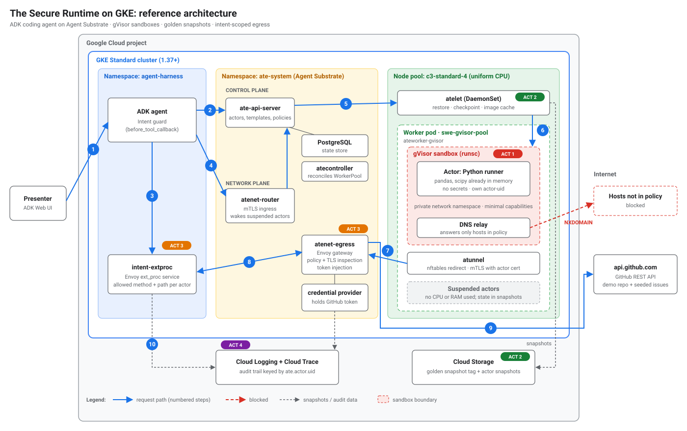

# GKE Agent Substrate — The Secure Runtime Reference Architecture

**Agent Substrate** (`ate-system`) is a stateful sandbox runtime for Kubernetes that decouples an agent's persistent identity and memory/filesystem state (**Actors**) from underlying compute (**WorkerPools**). Every actor executes inside a dedicated **gVisor (`runsc`)** user-space kernel on warm worker pods, restores in **~500ms** from pre-warmed **Golden Snapshots** (`SNAPSHOT_FIDELITY_MEMORY`) stored in Google Cloud Storage, and routes all network traffic through identity-aware gateways (**`atenet-router`** for ingress and **`atenet-egress`** for default-deny egress, out-of-sandbox credential injection, and pluggable Envoy `ext_proc` L7 HTTP inspection).



## Architecture Components & Trust Zones

| Layer | Component | Responsibility |
| :--- | :--- | :--- |
| **Zone 1: Agent Harness (`agent-harness`)** | **ADK GitHub Triage Agent** (`triage-agent`) | Powered by **Gemini on Vertex AI** (`GOOGLE_GENAI_USE_VERTEXAI=1`). Classifies tool intent via `before_tool_callback`, updates per-actor `EgressPolicy`, pushes dynamic HTTP method/path rules to `intent-extproc`, and invokes actors over mTLS through `atenet-router`. |
| **Zone 2: Substrate Control & Data Plane (`ate-system`)** | **`ate-api-server` & `ate-controller`** | Manages `Atespace`, `ActorTemplate`, `Actor`, `EgressPolicy`, and `WorkerPool` reconciliation. |
| | **`atenet-router`** | Ingress mTLS gateway (`:443`). Authenticates caller SPIFFE IDs, wakes suspended actors on demand via `atelet`, and streams requests to the actor's container port. |
| | **`atenet-egress` + `k8s-credential-provider`** | Default-deny egress gateway (`:443`). Terminates TLS (`egress-mitm.ate.dev`) and injects secrets (`replaceHeaders`) outside the sandbox from `agent-credentials`. |
| | **`intent-extproc`** | Pluggable Envoy `ExternalProcessor` (`--experimental-additional-egress-extproc-service=ate-system/intent-extproc:50051`) enforcing dynamic per-actor HTTP method (`GET`/`HEAD` vs `POST`/`PATCH`/`DELETE`) and URL path prefix policies with SPIFFE audit logging. |
| **Zone 3: Sandbox Worker Pool (`ate-workers`)** | **`ateworker-gvisor` + `atelet`** | Runs on a uniform `c3-standard-4` node pool (`ate.dev/worker-pool=true`, taint `ate.dev/sandboxClass=gvisor:NoSchedule`) hosting gVisor `runsc` sandboxes (`scientific-python`). |
| **Zone 4: State & Storage** | **GCS Snapshot Bucket** | Stores immutable **Golden Snapshots** built from `ActorTemplate` (`SNAPSHOT_FIDELITY_MEMORY`) and per-actor pause/resume memory + rootfs checkpoints. |

## Deployment & Validation

```bash
export TF_VAR_platform_default_project_id="<YOUR_GCP_PROJECT_ID>"
export TF_VAR_platform_default_region="us-central1"
export TF_VAR_cluster_location="us-central1"
export TF_VAR_secure_runtime_github_repo="GoogleCloudPlatform/accelerated-platforms"
export TF_VAR_secure_runtime_github_readonly_token="<YOUR_FINE_GRAINED_READONLY_GITHUB_PAT>"

./platforms/gke/base/use-cases/agent-substrate-secure-runtime/terraform/deploy-standard.sh
./platforms/gke/base/use-cases/agent-substrate-secure-runtime/demo/validate.sh
```

## Running the 4-Act Live Demo

| Act | Script | What It Demonstrates |
| :--- | :--- | :--- |
| **Act 1: The Untrusted Boundary** | `./demo/act1-sandbox-boundary.sh` | Verifies `gVisor` (`runsc`) user-space syscall interception (`AF_PACKET`, `unshare`, `/proc/kcore`, `dmesg`). |
| **Act 2: Crushing Cold Starts** | `./demo/act2-cold-start-race.sh` | Races a cold Kubernetes `gVisor` Pod (`~11s`) against an Agent Substrate Golden Snapshot Actor (`~600ms` wake, `~140ms` stateful pause/resume). |
| **Act 3: Dynamic Intent Filtering** | `./demo/act3-intent-egress.sh` | Applies per-actor `EgressPolicy` (`replaceHeaders`) and `intent-extproc` `READ_ONLY` rules (`200 OK` on `GET`, `403 Forbidden` on `POST`, default-deny on unlisted hosts). |
| **Act 4: Audit & Clean Reset** | `./demo/act4-audit-quarantine.sh` | Queries the SPIFFE-attributed L7 audit trail, revokes policy, deletes the tainted actor, and restores a fresh actor from the Golden Snapshot. |
