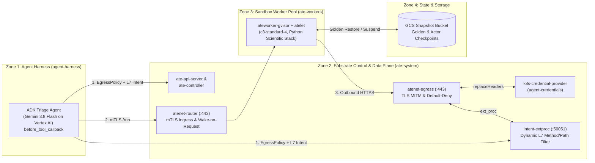

# GKE Agent Substrate — The Secure Runtime Reference Architecture

**Agent Substrate** (`ate-system`, `v1.0.0-rc.2`) is a stateful sandbox runtime
for Kubernetes that decouples an agent's persistent identity and
memory/filesystem state (**Actors**) from underlying compute (**WorkerPools**).
Every actor executes inside a dedicated **gVisor (`runsc`)** user-space kernel
on warm worker pods, restores in **~600ms** from pre-warmed **Golden Snapshots**
(`SNAPSHOT_FIDELITY_MEMORY`) stored in Google Cloud Storage, and routes all
network traffic through identity-aware gateways (**`atenet-router`** for ingress
and **`atenet-egress`** for default-deny egress, out-of-sandbox credential
injection, and pluggable Envoy `ext_proc` L7 HTTP inspection).



## Architecture Components & Trust Zones

| Layer                                                     | Component                                       | Responsibility                                                                                                                                                                                                                                                                      |
| :-------------------------------------------------------- | :---------------------------------------------- | :---------------------------------------------------------------------------------------------------------------------------------------------------------------------------------------------------------------------------------------------------------------------------------- |
| **Zone 1: Agent Harness (`agent-harness`)**               | **ADK GitHub Triage Agent** (`triage-agent`)    | Powered by **Gemini 3.8 Flash on Vertex AI** (`GOOGLE_GENAI_USE_VERTEXAI=1`). Classifies tool intent via `before_tool_callback`, updates per-actor `EgressPolicy`, pushes dynamic HTTP method/path rules to `intent-extproc`, and invokes actors over mTLS through `atenet-router`. |
| **Zone 2: Substrate Control & Data Plane (`ate-system`)** | **`ate-api-server` & `ate-controller`**         | Manages `Atespace`, `ActorTemplate`, `Actor`, `EgressPolicy`, and `WorkerPool` (`ate.dev/v1`) reconciliation.                                                                                                                                                                       |
|                                                           | **`atenet-router`**                             | Ingress mTLS gateway (`:443`). Authenticates caller SPIFFE IDs, wakes suspended actors on demand via `atelet`, and streams requests to the actor's container port.                                                                                                                  |
|                                                           | **`atenet-egress` + `k8s-credential-provider`** | Default-deny egress gateway (`:443`). Terminates TLS (`egress-mitm.ate.dev`) and injects secrets (`replaceHeaders`) outside the sandbox from `agent-credentials`.                                                                                                                   |
|                                                           | **`intent-extproc`**                            | Pluggable Envoy `ExternalProcessor` (`--experimental-additional-egress-extproc-service=ate-system/intent-extproc:50051`) enforcing dynamic per-actor HTTP method (`GET`/`HEAD` vs `POST`/`PATCH`/`DELETE`) and URL path prefix policies with SPIFFE audit logging.                  |
| **Zone 3: Sandbox Worker Pool (`ate-workers`)**           | **`ateworker-gvisor` + `atelet`**               | Runs on a uniform `c3-standard-4` node pool (`ate.dev/worker-pool=true`, taint `ate.dev/sandboxClass=gvisor:NoSchedule`) hosting gVisor `runsc` sandboxes (`scientific-python`).                                                                                                    |
| **Zone 4: State & Storage**                               | **GCS Snapshot Bucket**                         | Stores immutable **Golden Snapshots** built from `ActorTemplate` (`SNAPSHOT_FIDELITY_MEMORY`) and per-actor pause/resume memory + rootfs checkpoints.                                                                                                                               |

## Deployment & Validation

```bash
export TF_VAR_platform_default_project_id="<YOUR_GCP_PROJECT_ID>"
export TF_VAR_platform_default_region="us-central1"
export TF_VAR_cluster_location="us-central1"
export TF_VAR_secure_runtime_github_repo="GoogleCloudPlatform/accelerated-platforms"
export TF_VAR_secure_runtime_github_readonly_token="<YOUR_FINE_GRAINED_READONLY_GITHUB_PAT>"

./platforms/gke/base/use-cases/agent-substrate-secure-runtime/terraform/deploy-standard.sh
./platforms/gke/base/use-cases/agent-substrate-secure-runtime/demo/validate.sh
```

## Running the 4-Act Live Demo (CLI & Interactive ADK Web UI)

| Act                                 | Script                            | What It Demonstrates (GKE 1.37 + Agent Substrate `v1.0.0-rc.2`)                                                                                                                                                                            |
| :---------------------------------- | :-------------------------------- | :----------------------------------------------------------------------------------------------------------------------------------------------------------------------------------------------------------------------------------------- |
| **Act 1: The Untrusted Boundary**   | `./demo/act1-sandbox-boundary.sh` | Verifies `Linux 4.19.0-gvisor` user-space syscall interception (`AF_PACKET`, `unshare`, `/proc/kcore`, `/proc/kallsyms`, `/proc/sysrq-trigger`, `/dev/kmsg` all `BLOCKED_BY_GVISOR` in `~75ms`).                                           |
| **Act 2: Crushing Cold Starts**     | `./demo/act2-cold-start-race.sh`  | Races a cold Kubernetes `gVisor` Pod (`~13.9s`) against an Agent Substrate Golden Snapshot Actor (`~605ms` wake, **23x faster**; `~151ms` stateful pause/resume, **92x faster**).                                                          |
| **Act 3: Dynamic Intent Filtering** | `./demo/act3-intent-egress.sh`    | Applies per-actor `EgressPolicy` (`replaceHeaders`) and `intent-extproc` `READ_ONLY` rules (`200 OK` on `GET /issues/42` with `0` secrets in `os.environ`, `403 Forbidden` on `POST /issues/42/comments`, default-deny on unlisted hosts). |
| **Act 4: Audit & Clean Reset**      | `./demo/act4-audit-quarantine.sh` | Queries the SPIFFE-attributed L7 audit trail (`spiffe://substrate-actor.local/...`), revokes policy (`~126ms`), deletes the tainted actor, and restores a fresh actor from the Golden Snapshot (`~121ms`).                                 |

### Interactive UIs (Cloud Run + IAP or Local Port-Forward)

To host both the **Secure Runtime Mission Control UI** (`/`) and the **Google
ADK Web UI** (`/dev-ui/?app=secure_runtime_agent`) behind an **Identity-Aware
Proxy (IAP)** Cloud Run URL using Direct VPC Egress (so no Cloudtop or
`kubectl port-forward` is needed):

```bash
./platforms/gke/base/use-cases/agent-substrate-secure-runtime/demo/deploy-cloudrun-ui.sh
```

Or to run locally from a workstation with cluster access:

```bash
# 1. Start the Secure Runtime Mission Control UI (http://127.0.0.1:18090/)
python3 ./platforms/gke/base/use-cases/agent-substrate-secure-runtime/demo/ui_server.py &

# 2. Port-forward the Google ADK Web UI (http://127.0.0.1:18080/dev-ui/?app=secure_runtime_agent)
kubectl port-forward -n agent-harness deploy/triage-agent 18080:8080
```

Open `/` to interactively run Acts 1–4 from the **Secure Runtime Mission
Control** dashboard, and open `/dev-ui/?app=secure_runtime_agent` to prompt the
live Gemini 3.8 Flash agent in the **Google ADK Web UI** (e.g., triage GitHub
issue `#42` with `follow_issue_instructions=True` and inspect
`last_intent_classification` in the **State** tab).
