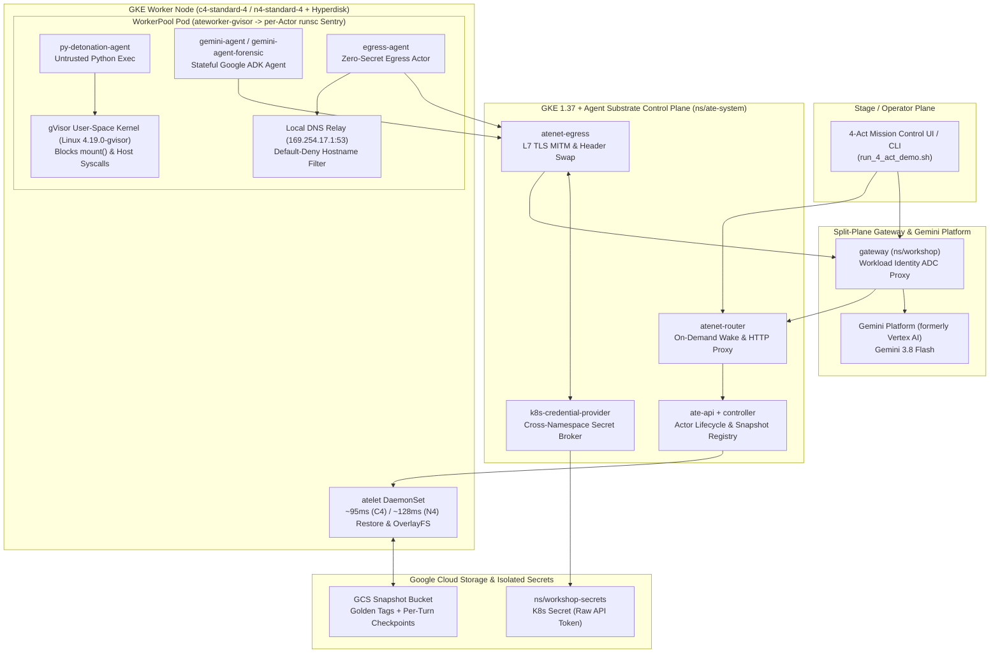

# Secure Runtimes for AI Agents on GKE: Agent Substrate Security & Detonation Reference Architecture

> [!IMPORTANT]  
> 🛡️ **Secure Runtimes for AI Agents on GKE** 🛡️: Autonomous LLM agents that
> execute untrusted code, browse external APIs, and maintain stateful memory
> require hardware-isolated sandboxes, zero-secret egress boundaries, and
> millisecond memory checkpointing. This reference architecture and interactive
> testbed demonstrate **Secure Runtimes for AI Agents** on Google Kubernetes
> Engine (GKE) 1.37 with **GKE Sandbox (`gVisor`)** and **Agent Substrate
> (`v1.0.0` GA)**.
>
> Last Update: 2026-11-09 (YYYY-MM-DD)

This document outlines the reference architecture and interactive 4-Act Red Team
vs. Blue Team security demonstration for building **secure runtimes for AI
agents** on Google Kubernetes Engine (GKE) 1.37 with **Agent Substrate (`v1.0.0`
GA)**, **Google Agent Development Kit (`google-adk`)**, and **Gemini models
(`gemini-3.8-flash`)** on Google Cloud's **Gemini platform (formerly Vertex
AI)**. This implementation is an extension of the
[GKE Base Platform](/docs/platforms/gke/base/README.md) tailored specifically
for multi-layered AI agent sandboxing, zero-secret credential injection, and
millisecond memory snapshot recovery.

Refer to the [Getting Started](#getting-started) section below for instructions
on setting up the infrastructure and running the 4-Act security demonstration.

## What the Architecture Does

The GKE Agent Substrate Security & Detonation architecture provides an
end-to-end defense-in-depth blueprint and live adversarial testbed across four
security boundaries:

Specifically, the architecture enforces:

- **Act 1 — User-Space Kernel Shielding (`gVisor`)**: Isolates untrusted Python
  code execution inside a user-space kernel (`Linux 4.19.0-gvisor`) with zero
  mounted Kubernetes ServiceAccount tokens, zero environment secrets, blocked
  GKE metadata server (`169.254.169.254`) access, and user-space `EPERM`
  blocking of container escape syscalls such as `libc.mount()`.
- **Act 2 — Instant Memory Snapshots & Forensic Cloning**: Separates base
  container startup (**Snapshot #1**: `TAG_SCOPE_PUBLISHED` Golden Tag) from
  per-turn actor state (**Snapshot #2**: `TAG_SCOPE_ATESPACE` tag), enabling
  `~95ms` (C4) / `~128ms` (N4) warm memory restores (`hyperdisk-balanced`) and
  isolated forensic clones (`gemini-agent-forensic`) forked from
  `clean-checkpoint-tag`.
- **Act 3 — Zero-Secret Egress ("The Corporate Mailroom")**: Keeps raw API
  credentials in an isolated Kubernetes namespace (`ns/workshop-secrets`) so the
  sandbox (`egress-agent`) only sends `Authorization: Bearer placeholder`. The
  out-of-sandbox `atenet-egress` proxy verifies the actor's SPIFFE mTLS
  identity, swaps the real token on the wire for allowlisted destinations
  (`httpbin.org`), and blocks unlisted domains (`example.com`) at the local DNS
  relay (`169.254.17.1:53`) before TCP connection establishment.
- **Act 4 — Instant Time-Travel Revert & OpenTelemetry Tracing**: Recovers a
  stateful Google ADK agent (`gemini-agent`) when prompt injection invokes a
  Python tool (`set_approval_policy`) to hijack both in-memory runtime state
  (`APPROVAL_POLICY = "AUTO_APPROVE_ALL"`) and `/data/policy.json` on disk,
  rewinding both back to its verified checkpoint (`REQUIRE_HUMAN_APPROVAL`) in
  milliseconds via `kubectl ate revert` and `kubectl ate --trace resume`.

## Real-World AI Agent CVEs Addressed

| Act       | Security Layer                                                                                | Real-World Vulnerabilities Mitigated                                                                                                        |
| :-------- | :-------------------------------------------------------------------------------------------- | :------------------------------------------------------------------------------------------------------------------------------------------ |
| **Act 1** | **Sandbox Boundary & Kernel Shielding** (`gVisor` + Metadata Block)                           | **OpenClaw `CVE-2026-44112`** (`mount` container escape), **Langflow `CVE-2026-33017`** (unauthenticated RCE + metadata SSRF)               |
| **Act 2** | **Two-Tier Memory Snapshots & Forensic Clone** (`TAG_SCOPE_PUBLISHED` / `TAG_SCOPE_ATESPACE`) | **OpenClaw `CVE-2026-44113`**, **ServiceNow Now Assist `CVE-2026-18885`** (CVSS 10.0 cross-tenant agent pivot), Forensic Quarantine Cloning |
| **Act 3** | **Zero-Secret Egress & Local DNS Relay** (`atenet-egress` + `k8s-credential-provider`)        | **LiteLLM `1.107.0` Supply-Chain Compromise** (`os.environ` scrape), **Clinejection**, **OpenClaw `CVE-2026-44115`**                        |
| **Act 4** | **Time-Travel Memory Revert & Distributed Trace** (`kubectl ate revert` + `--trace`)          | **SpAIware Persistent Memory Poisoning**, **Replit AI Database Wipe**, **OpenClaw `CVE-2026-44118` & `CVE-2026-52024`**                     |

## Core Concepts and Technologies

### Google Kubernetes Engine (GKE) 1.37

- **Native Kubernetes `PodCertificateRequest` & `ClusterTrustBundle`
  (`certificates.k8s.io`)**: Provides hardware-backed SPIFFE identity
  certificates for every actor and distributes the `egress-mitm.ate.dev` CA
  bundle into sandboxes without manual secret mounts.
- **6th/5th-Gen Intel Xeon (`c4-standard-4` / `n4-standard-4`) & Titanium
  `hyperdisk-balanced`**: Decouples storage IOPS (`3,000 IOPS`, `140 MB/s`
  baseline) from disk capacity, enabling `~95ms` (C4) / `~128ms` (N4) local
  memory snapshot restores via `atelet`.
- **Per-Actor `gVisor` (`runsc`) User-Space Sentry**: `ateworker-gvisor` spawns
  an isolated `runsc` user-space kernel per Actor inside warm `WorkerPool` pods,
  intercepting guest syscalls in user space (`Linux 4.19.0-gvisor`) so hostile
  code never directly touches the host Linux kernel (`6.18+`).

### Agent Substrate (`v1.0.0` GA)

- **Actors & ActorTemplates**: Stateful micro-sandboxes packed densely onto
  pre-warmed `WorkerPool` pods (`ateworker-gvisor`) that suspend to Cloud
  Storage when idle (`0` CPU/RAM cost) and wake on demand when HTTP requests hit
  `atenet-router`.
- **EgressPolicy & Credential Provider**: Declarative L7 egress firewall and
  header-replacement engine that injects secrets on the wire outside the
  sandbox.

### Google Agent Development Kit (`google-adk`) & Gemini Models

- **Zero-Secret Sandboxed ADK Runtime**: `gemini-agent` is built with **Google
  Agent Development Kit (`google-adk`)** (`Agent` + `InMemoryRunner`) and holds
  zero Google Cloud credentials inside the `gVisor` sandbox. Outbound model
  requests target the cluster-local split-plane `gateway` (`:8080`) with a
  placeholder token; the out-of-sandbox `gateway` authenticates via GKE Workload
  Identity Application Default Credentials (`google.auth.default`) and proxies
  requests to **Gemini 3.8 Flash** on Google Cloud's **Gemini platform (formerly
  Vertex AI)**.
- **Pre-Warmed ADK Golden Snapshots**: `google-adk` and its `InMemoryRunner`
  session are initialized prior to the `ActorTemplate` Golden Snapshot so actor
  clones and wake-ups skip Python/ADK cold-import overhead completely.

## Getting Started

A complete guide to provisioning the GKE 1.37 cluster, staging the 4 security
demo actors (`py-detonation-agent`, `gemini-agent`, `gemini-agent-forensic`,
`egress-agent`) in atespace `security-demo`, and running the 4-Act CLI and
Mission Control UI demonstration can be found in:

- [Agent Substrate Security & Detonation Reference Implementation](/platforms/gke/base/use-cases/agent-substrate-security-demo/terraform/README.md)
