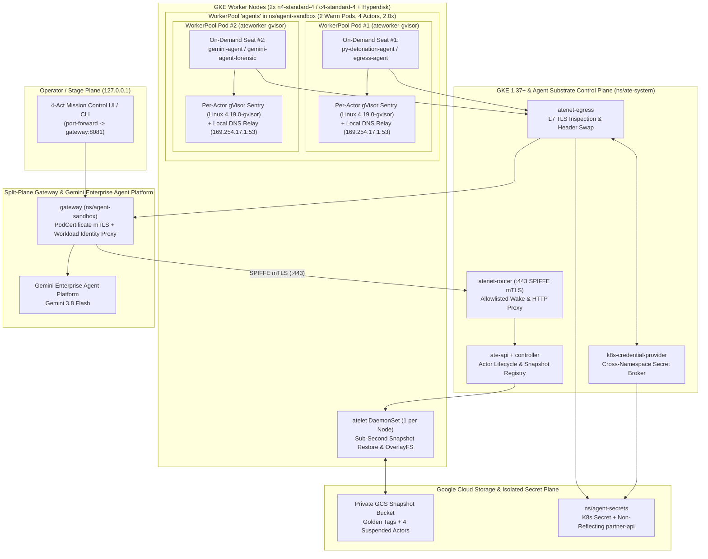

# Secure Runtimes for AI Agents on GKE: Agent Substrate Security & Detonation Reference Architecture

> [!IMPORTANT] > **Secure Runtimes for AI Agents on GKE**: Autonomous LLM agents
> that execute untrusted code, call external APIs, and maintain stateful memory
> require user-space kernel sandboxes, zero-secret egress boundaries, and
> sub-second memory checkpointing. This reference architecture and interactive
> testbed demonstrate **Secure Runtimes for AI Agents** on Google Kubernetes
> Engine (GKE) 1.37+ with **Agent Substrate (`v1.0.0`)** in-pod `gVisor`
> (`ateworker-gvisor`) sandboxing.
>
> Last Update: 2026-11-09 (YYYY-MM-DD)

This document outlines the reference architecture and interactive 4-Act Red Team
vs. Blue Team security demonstration for building **secure runtimes for AI
agents** on Google Kubernetes Engine (GKE) 1.37+ with **Agent Substrate
(`v1.0.0`)**, **Google Agent Development Kit (`google-adk`)**, and **Gemini
models (`gemini-3.8-flash`)** on Google Cloud's **Gemini Enterprise Agent
Platform**. This implementation extends the
[GKE Base Platform](/docs/platforms/gke/base/README.md) with multi-layered AI
agent sandboxing, zero-secret wire-level credential injection, and Cloud Storage
memory snapshot recovery.

Refer to the [Getting Started](#getting-started) section below for instructions
on provisioning the infrastructure and running the 4-Act security demonstration.

## What the Architecture Does

The Agent Substrate Security & Detonation reference architecture provides an
end-to-end defense-in-depth blueprint and live adversarial testbed across four
runtime boundaries:

Specifically, the architecture enforces:

- **Act 1 — User-Space Kernel Shielding (`ateworker-gvisor`)**: Isolates
  untrusted Python code execution inside a per-actor `gVisor` user-space kernel
  (`Linux 4.19.0-gvisor`) with zero mounted Kubernetes ServiceAccount tokens,
  zero secret environment variables, blocked GKE metadata server
  (`169.254.169.254`) routing, absent host `/proc/kcore` and
  `/proc/sysrq-trigger` interfaces, and user-space `EPERM` interception of
  privileged syscalls such as `libc.mount()`.
- **Act 2 — Two-Tier Memory Snapshots & Forensic Cloning**: Separates base
  container initialization (**Snapshot #1**: `TAG_SCOPE_PUBLISHED` Golden Tag)
  from per-conversation actor state (**Snapshot #2**: `TAG_SCOPE_ATESPACE` tag),
  enabling sub-second node-local memory resume (`kind="local"`) and isolated
  forensic clones (`gemini-agent-forensic`) created from `clean-checkpoint-tag`
  with identical post-boot memory state (`bootID`).
- **Act 3 — Zero-Secret Egress ("The Corporate Mailroom")**: Keeps raw API
  credentials in an isolated Kubernetes namespace (`ns/agent-secrets`) so the
  actor (`egress-agent`) only sends `Authorization: Bearer placeholder`. The
  out-of-sandbox `atenet-egress` proxy verifies the worker pod's mTLS identity,
  replaces the header on the wire for allowlisted destinations (`partner-api`,
  which verifies the credential and returns only a SHA-256 fingerprint without
  echoing the secret), and blocks unlisted domains (`example.com`) at the local
  DNS relay (`169.254.17.1:53`) before TCP connection establishment.
- **Act 4 — External Snapshot Revert & OpenTelemetry Tracing**: Recovers a
  stateful Google ADK agent (`gemini-agent`) after prompt injection invokes a
  Python tool (`set_approval_policy`) to mutate both in-memory runtime state
  (`APPROVAL_POLICY = "AUTO_APPROVE_ALL"`) and `/data/policy.json`. Running
  `kubectl ate revert` discards the uncommitted wake session without
  checkpointing and rewinds the actor to its last clean external Cloud Storage
  snapshot (`REQUIRE_HUMAN_APPROVAL`), followed by `kubectl ate --trace resume`
  (`kind="latest"`, sub-second GCS download + restore).

## Representative AI Agent Vulnerability Classes Illustrated

The four acts illustrate architectural mitigations for recurring classes of
autonomous agent vulnerabilities and supply-chain incidents:

| Act       | Runtime Control Demonstrated                                                                  | Representative Vulnerability Classes Illustrated                                                                                                                                                                                                                                                                                                                                                                                        |
| :-------- | :-------------------------------------------------------------------------------------------- | :-------------------------------------------------------------------------------------------------------------------------------------------------------------------------------------------------------------------------------------------------------------------------------------------------------------------------------------------------------------------------------------------------------------------------------------- |
| **Act 1** | **User-Space Syscall Shielding & Metadata Isolation** (`ateworker-gvisor` + link-local block) | Illustrates containment after arbitrary Python RCE such as Langflow [CVE-2025-3248](https://nvd.nist.gov/vuln/detail/CVE-2025-3248) and [CVE-2026-33017](https://nvd.nist.gov/vuln/detail/CVE-2026-33017), and isolates per-actor `/data` overlays against host-filesystem escape classes (contrast with OpenClaw [CVE-2026-44112](https://nvd.nist.gov/vuln/detail/CVE-2026-44112), a TOCTOU symlink swap in a host filesystem bridge) |
| **Act 2** | **Immutable Snapshot Tags & Forensic Cloning** (`TAG_SCOPE_PUBLISHED` / `TAG_SCOPE_ATESPACE`) | Illustrates side-by-side forensic quarantine without halting live traffic when investigating cross-session state tampering or sandbox read escapes such as [CVE-2026-44113](https://nvd.nist.gov/vuln/detail/CVE-2026-44113)                                                                                                                                                                                                            |
| **Act 3** | **Zero-Secret Egress & Local DNS Relay** (`atenet-egress` + `k8s-credential-provider`)        | Mitigates `os.environ` credential harvesting during package supply-chain compromises (such as the [LiteLLM PyPI Compromise](https://docs.litellm.ai/blog/security-update-march-2026)) and restricts outbound exfiltration after command-allowlist bypasses ([CVE-2026-44115](https://nvd.nist.gov/vuln/detail/CVE-2026-44115)) and loopback gateway spoofing ([CVE-2026-44118](https://nvd.nist.gov/vuln/detail/CVE-2026-44118))        |
| **Act 4** | **External Snapshot Revert & Distributed Trace** (`kubectl ate revert` + `--trace`)           | Illustrates deterministic state rollback after persistent agent memory/policy poisoning ([OWASP LLM01: Prompt Injection](https://genai.owasp.org/llmrisk/llm01-prompt-injection/) / [SpAIware](https://embracethered.com/blog/posts/2024/chatgpt-macos-app-persistent-data-exfiltration/))                                                                                                                                              |

## Core Concepts and Technologies

### How Sandboxing Paths on GKE Relate

- **GKE Sandbox (`runtimeClassName: gvisor`)**: Configures whole GKE node pools
  so every Pod scheduled onto those nodes runs inside a pod-level `gVisor`
  sandbox (`1 Pod = 1 sandbox`).
- **Kubernetes Agent Sandbox (`kubernetes-sigs/agent-sandbox`)**: Provides
  Kubernetes CRDs (`Sandbox`, `SandboxWarmPool`) for managing 1:1 warm-pooled
  Pods. This reference architecture reuses its hardened container base image
  (`python-runtime-sandbox:v0.5.6`), not its CRDs.
- **Agent Substrate (`ateworker-gvisor`, used in this architecture)**: Runs on
  standard Container-Optimized OS `runc` nodes (`GKE 1.37+`) and spawns an
  isolated per-Actor `gVisor` (`runsc`) user-space kernel inside pre-warmed
  `WorkerPool` pods. Multiple Actors multiplex across warm pods, suspend RAM and
  `/data` overlays to Cloud Storage at zero idle compute cost, and wake under a
  second.

### Google Kubernetes Engine (GKE) 1.37+ & Agent Substrate (`v1.0.0`)

- **Kubernetes `PodCertificateRequest` & `ClusterTrustBundle`
  (`certificates.k8s.io`)**: Agent Substrate's software signers issue
  short-lived SPIFFE X.509 certificates (`podidentity.podcert.ate.dev/identity`
  and `servicedns.podcert.ate.dev/identity`) identifying **pods** (`gateway` and
  `WorkerPool` pods). `atenet-router:443` admits only client pods whose SPIFFE
  ID matches the namespace `ate.dev/ingress-allow` policy, while
  `ClusterTrustBundle` distributes the `egress-mitm.ate.dev` CA certificate for
  L7 egress inspection.
- **Two-Path Snapshot Restore (`kind="local"` vs. `kind="latest"`)**: Resuming a
  suspended Actor on a node that still holds its local snapshot (`kind="local"`)
  restores directly from node-local `hyperdisk-balanced` storage; resuming after
  `kubectl ate revert` or on a different node (`kind="latest"`) downloads the
  compressed zstd checkpoint from Cloud Storage before restoring `runsc` memory
  (both completing in under a second inside the cluster).
- **Zero-Secret Google ADK Runtime (`google-adk`)**: `gemini-agent` runs
  `google-adk` (`Agent` + `InMemoryRunner`) with zero Google Cloud credentials
  inside `gVisor`. Outbound model calls traverse `atenet-egress` to the
  cluster-local `gateway` (`:8080`), which authenticates via GKE Workload
  Identity Application Default Credentials (`google.auth.default`) to **Gemini
  3.8 Flash** on the **Gemini Enterprise Agent Platform**.

## Limitations & Security Considerations

- **Upstream Destination Behavior in Zero-Secret Egress**: `atenet-egress`
  prevents the sandbox from holding raw credentials in memory or environment
  variables, and blocks traffic to non-allowlisted hosts. However, once a secret
  is injected on the wire to an allowlisted upstream API, if that upstream API
  echoes request headers back in its HTTP response body (for example, diagnostic
  echo services such as `httpbin.org/headers`), the sandbox will receive the
  echoed value. Only allowlist production APIs that do not reflect raw
  `Authorization` headers; Act 3 uses a non-reflecting `partner-api` verifier
  for this reason.
- **Snapshot Bucket Sensitivity**: Cloud Storage snapshots capture full Actor
  memory pages and `/data` overlays. This implementation enforces uniform
  bucket-level access, `public_access_prevention = "enforced"`, and object
  lifecycle expiration; production deployments with regulated data should add
  CMEK encryption and VPC Service Controls.
- **Shared Operator Identity in `kubectl ate`**: CLI operations executed during
  staging and interactive demo runs authenticate via `ate-system/ate-client`
  (emitting a standard shared-identity warning); multi-tenant clusters should
  bind per-team Kubernetes RBAC identities per Atespace.

## Getting Started

Complete instructions for deploying via standalone GKE 1.37+ (`Option A`) or GKE
Base Platform Terraservices (`Option B`), running the 4-Act CLI verification,
launching the Mission Control UI, and tearing down all resources are in:

- [Agent Substrate Security & Detonation Reference Implementation](/platforms/gke/base/use-cases/agent-substrate-security-demo/terraform/README.md)
