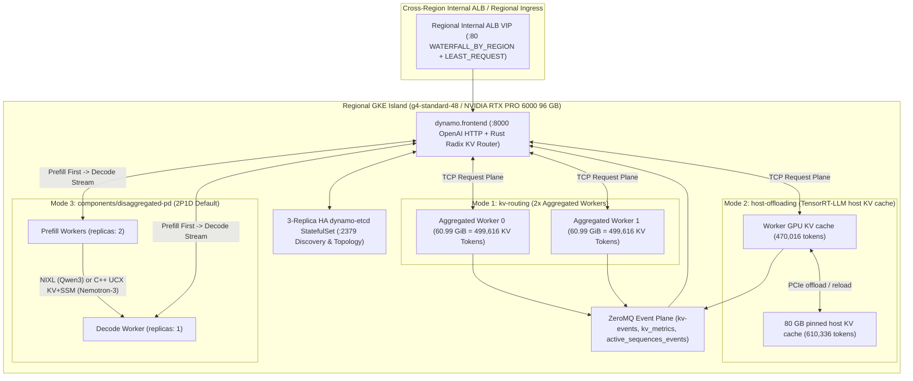
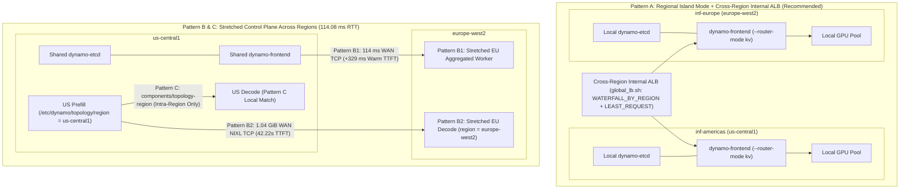

# NVIDIA Dynamo and TensorRT-LLM reference architecture on multi-region GKE

> [!IMPORTANT]
>
> Dynamic Landscape: The field of AI inference is experiencing continuous, rapid
> evolution. This document is regularly updated to reflect the latest products,
> features, and architectural patterns across Google Cloud, NVIDIA Dynamo,
> NVIDIA TensorRT-LLM, and Google Kubernetes Engine (GKE).
>
> Last Update: 2026-11-08 (YYYY-MM-DD)

This spoke guide builds on the
[Multi-region GKE inference foundation](/docs/platforms/gke/base/use-cases/inference-ref-arch/multi-region-gke-inference-foundation.md)
and the
[NVIDIA TensorRT-LLM and Nemotron-3 reference architecture](/docs/platforms/gke/base/use-cases/inference-ref-arch/trtllm-nemotron3-reference-architecture.md)
to deploy **NVIDIA Dynamo (`v1.6.1`)** orchestrating **NVIDIA TensorRT-LLM**
across **NVIDIA RTX PRO 6000 Blackwell Server Edition (`g4-standard-48`, 96 GB
GDDR7, `SM120`)** GPUs.

Refer to the
[Multi-region GKE inference foundation](/docs/platforms/gke/base/use-cases/inference-ref-arch/multi-region-gke-inference-foundation.md)
for capacity discovery, deterministic non-overlapping CIDRs, parallel worktree
provisioning (`provision.sh --parallel`), HNS Cloud Storage staging, and
cross-region internal Application Load Balancing (`global_lb.sh`). For a
copy-paste live demo script, see the companion
[15-minute NVIDIA Dynamo Presenter Beat Sheet](/docs/platforms/gke/base/use-cases/inference-ref-arch/dynamo-trtllm-poc-15min-demo-runbook.md).

---

## 1. Capabilities & why layer NVIDIA Dynamo onto TensorRT-LLM?

Standalone `trtllm-serve` replicas behind a stateless HTTP load balancer face
three bottlenecks under long-context and multi-turn agentic workloads:

1. **Prefix-blind routing wastes HBM and FLOPs (`kv-routing/`)**: Round-robin
   routing sends `8.3K`-token follow-up turns to cold replicas (`789.57 ms`
   `p95` Time to First Token). Dynamo's `--router-mode kv` maintains a Rust
   radix tree over ZeroMQ `kv-events` (`32`-token `xxh3` block hashes), cutting
   `p95` TTFT by **`11.68×`** (`67.61 ms` vs. `789.57 ms`).
2. **Fixed GPU memory evicts active sessions under churn (`host-offloading/`)**:
   Each `g4-standard-48` VM pairs `96 GB` GDDR7 with **`180 GiB` GCE VM memory**
   (`176.9 GiB` Kubernetes node capacity, `175.4 GiB` allocatable). The
   `host-offloading` overlay sets TensorRT-LLM's built-in host KV cache
   (`host_cache_size: 80000000000`, `secondary_offload_min_priority: 35`), so
   blocks evicted from GPU memory move to pinned host memory and load back on a
   prefix hit: a `14,110`-token session evicted from GPU memory came back in
   **`64.1 ms` and `63.8 ms`** Time to First Token versus **`1,457.8 ms` and
   `1,385.2 ms`** cold (`2` runs, `~22×`). Dynamo deprecated its KV Block
   Manager (`--connector kvbm`) in `v1.5.0` and recommends the engine's native
   KV offloading instead.
3. **Colocated prefill bursts stall ongoing token generation
   (`disaggregated-pd/`)**: Four uncached `8.3K`-token prompts landing on a
   2-GPU aggregated `Qwen3-32B` deployment raise ongoing decode `p99`
   Inter-Token Latency (ITL) from `16.68 ms` to `516.30 ms`. Separating
   `--disaggregation-mode prefill` from `--disaggregation-mode decode` tightens
   `Qwen3-32B` burst `p99` ITL by **`28.21×`** (`18.30 ms` vs. `516.30 ms`, with
   a `2.89×` higher burst TTFT trade-off under a fixed `1P+1D` `2`-GPU budget,
   motivating the `2P1D` overlay default) and reaches **`199.15 ms` `p50` TTFT**
   (`4,309` prompt tokens) and **`3.81 ms` `p50` ITL (`261.8 tok/s`)** on hybrid
   Mamba-2 `Nemotron-3` over standard GKE VPC TCP.
4. **Multi-region topology physics (Island Mode vs. Stretched Layer vs.
   `components/topology-region`)**: Empirical `us-central1`, `europe-west2`, and
   `asia-southeast1` benchmarks quantify why **Pattern A (Regional Island Mode +
   cross-region internal ALB)** is the production default (`55.68–60.17 ms` warm
   TTFT, `0 B` steady-state East-West payload) and how
   `components/topology-region` prevents `42.22s` transatlantic KV stalls when
   sharing an `etcd` plane.



---

## 2. Single-base Kustomize composition & KV-state physics

All seven overlays under
[`kubernetes-manifests/online-inference-gpu/dynamo-trtllm/`](/platforms/gke/base/use-cases/inference-ref-arch/kubernetes-manifests/online-inference-gpu/dynamo-trtllm)
compose a single
[`dynamo-trtllm/base`](/platforms/gke/base/use-cases/inference-ref-arch/kubernetes-manifests/online-inference-gpu/dynamo-trtllm/base)
(3-replica HA `dynamo-etcd` `StatefulSet`, `dynamo-frontend`, aggregated worker,
`PodDisruptionBudget`s, `PodMonitoring`, and shared
[`components/graceful-shutdown`](/platforms/gke/base/use-cases/inference-ref-arch/kubernetes-manifests/online-inference-gpu/components/graceful-shutdown))
with
[`components/accelerators/rtx-pro-6000-x1`](/platforms/gke/base/use-cases/inference-ref-arch/kubernetes-manifests/online-inference-gpu/components/accelerators/rtx-pro-6000-x1),
[`dynamo-trtllm/components/runtime-bindings`](/platforms/gke/base/use-cases/inference-ref-arch/kubernetes-manifests/online-inference-gpu/dynamo-trtllm/components/runtime-bindings),
and mode components (`disaggregated-pd`, `pool-relay`, `topology-region`); the
`host-offloading` overlay only adds TensorRT-LLM settings:

| Model ID (`config/huggingface.sh`)                | Architecture                        | Per-Token Attention KV (`FP8`)                                                        | Max KV Tokens on `1× RTX PRO 6000`          | Overlays (`online-inference-gpu/dynamo-trtllm/`) & `APP_LABEL` (`app.kubernetes.io/part-of`)                                                                                                                                                           |
| ------------------------------------------------- | ----------------------------------- | ------------------------------------------------------------------------------------- | ------------------------------------------- | ------------------------------------------------------------------------------------------------------------------------------------------------------------------------------------------------------------------------------------------------------ |
| **`nvidia/qwen3-32b-nvfp4`**                      | `64` GQA layers (`NVFP4` `~19 GiB`) | `64 × 2 × 8 × 128 × 1 B =` **`128.00 KiB/tok`** (`4.00 MiB` / `32`-tok block)         | **`499,616` tokens** (`60.99 GiB` at `.85`) | `kv-routing/rtx-pro-6000-qwen3-32b-nvfp4` (`+ -pool-relay`): `dynamo-kv-rtx6000-qwen3-32b-nvfp4`<br>`host-offloading/...`: `dynamo-host-rtx6000-qwen3-32b-nvfp4`<br>`disaggregated-pd/...` (`+ -topology-region`): `dynamo-pd-rtx6000-qwen3-32b-nvfp4` |
| **`qwen/qwen3-32b-fp8`**                          | `64` GQA layers (`FP8` `~32 GiB`)   | **`128.00 KiB/tok`** (`4.00 MiB` / `32`-tok block)                                    | **`~340,000` tokens** (`0.80` fraction)     | `kv-routing/rtx-pro-6000-qwen3-32b-fp8`: `dynamo-kv-rtx6000-qwen3-32b-fp8`                                                                                                                                                                             |
| **`nvidia/nvidia-nemotron-3-nano-30b-a3b-nvfp4`** | `23` Mamba-2 + `23` MoE + `6` GQA   | `6 × 2 × 2 × 128 × 1 B =` **`3.00 KiB/tok`** raw (`3.04 KiB` paged, **`42.7×` less**) | **`19,799,552` tokens** (`57.42 GiB` pool)  | `disaggregated-pd/rtx-pro-6000-nvidia-nemotron-3-nano-30b-a3b-nvfp4`: `dynamo-pd-rtx6000-nemotron3-30b-nvfp4` (`MAX_SEQ_LEN=65536`, `nemotron_v3` + `qwen3_coder` parsers)                                                                             |

- **Why bounded RAM `gke-gcsfuse-cache` + Guaranteed QoS**:
  [`worker/template/deployment.yaml`](/platforms/gke/base/use-cases/inference-ref-arch/kubernetes-manifests/online-inference-gpu/dynamo-trtllm/worker/template/deployment.yaml)
  bounds `gke-gcsfuse-cache` (`medium: Memory`, `sizeLimit: 24Gi` / `30Gi`
  sidecar default; `22Gi` / `28Gi` on `Nemotron-3`; `36Gi` / `42Gi` on
  `Qwen3-32B-FP8`) and pairs it with `80Gi` (`124Gi` on `host-offloading`) on
  `inference-server`, keeping total Pod memory (`108–154Gi` Guaranteed QoS)
  within `g4-standard-48`'s `175.4 GiB` allocatable RAM without cgroup OOMs.
- **Why `Nemotron-3` excels at non-RDMA VPC P/D**: On `gVNIC` TCP, dense
  `Qwen3-32B` transfers `~1.02 GiB` for an `8,349`-token prompt (`2,510.84 ms`
  TTFT), whereas `Nemotron-3` transfers `42.7×` less attention KV plus fixed
  Mamba-2 state via TensorRT-LLM's C++ `UCX` transceiver
  (`use_kv_cache_manager_v2: false`, `enable_block_reuse: false`,
  `transceiver_runtime: CPP`).

---

## 3. Summary of measured benchmarks on GKE (`g4-standard-48`)

Measured across `us-central1`, `europe-west2`, and `asia-southeast1` on
`g4-standard-48` (`48` vCPUs, `180 GiB` GCE VM memory, `1× RTX PRO 6000 96 GB`)
using
`nvcr.io/nvidia/ai-dynamo/tensorrtllm-runtime:1.6.1@sha256:597d7606c515e7f8ba6a4e0e94d84a26cf1c2c5966d07696b5dbab08e4540f41`:

| Dynamo Capability / Benchmark Scenario                                                                  | Model (`TP=1`)                  | Baseline / Workload Configuration                                             | NVIDIA Dynamo Measured Result                                                          | Key Gain & Architectural Trade-Off                                                          |
| ------------------------------------------------------------------------------------------------------- | ------------------------------- | ----------------------------------------------------------------------------- | -------------------------------------------------------------------------------------- | ------------------------------------------------------------------------------------------- |
| **Mode 1: KV-Aware Prefix Routing** (`2` replicas, `~8,350` prompt tokens)                              | `nvidia/Qwen3-32B-NVFP4`        | `--router-mode round-robin`: **`291.86 ms` mean / `789.57 ms` p95** TTFT      | `--router-mode kv`: **`60.69 ms` mean / `59.47 ms` p50 / `67.61 ms` p95** TTFT         | **`11.68×` faster `p95` TTFT** (`4.81×` faster mean, `0` errors)                            |
| **Mode 1: Concurrent Decode ITL During Follow-Ups**                                                     | `nvidia/Qwen3-32B-NVFP4`        | `--router-mode round-robin`: **`97.87 ms` p95 / `118.06 ms` p99** ITL         | `--router-mode kv`: **`18.19 ms` p95 / `18.67 ms` p99** ITL (`56.4 tok/s`)             | **`5.38×` tighter `p95` ITL** by avoiding redundant prefills                                |
| **Mode 2: Host KV Cache Recall** (`14,110`-tok session, `44` filler sessions > `470,016`-tok GPU cache) | `nvidia/Qwen3-32B-NVFP4`        | Cold prefill: **`1,457.8 ms` / `1,385.2 ms`** TTFT (`2` runs, `europe-west2`) | Recalled from host cache: **`64.1 ms` / `63.8 ms`** TTFT (`14,109` tokens cached)      | **`21.7–22.7×` faster recall**; replaces the KVBM mode, which Dynamo deprecated in `v1.5.0` |
| **Mode 3A: Disaggregated `1P+1D` Decode Isolation** (`4 × 8.3K` burst)                                  | `nvidia/Qwen3-32B-NVFP4` (NIXL) | Aggregated `2`-GPU: **`516.30 ms` p99** ITL; **`2,175.77 ms` mean** TTFT      | Disaggregated `1P+1D`: **`18.30 ms` p99** ITL; **`6,294.71 ms` mean** TTFT             | **`28.21×` tighter `p99` ITL**; trade-off: **`2.89×` higher burst TTFT** on `1` Prefill GPU |
| **Mode 3B: Hybrid Mamba-2 Disaggregated `1P+1D`** (`4,309` prompt tokens)                               | `Nemotron-3-Nano-30B-A3B-NVFP4` | Single-stream uncached `4,309`-token prompt over GKE VPC TCP (`C++ UCX`)      | **`236.01 ms` mean / `199.15 ms` p50 TTFT**, **`3.81 ms` p50 ITL**                     | **`261.8 tok/s`** single-stream decode without RDMA (`enable_block_reuse: false`)           |
| **Mode 3B: Hybrid Mamba-2 Under `4 × 6,366`-Token Burst**                                               | `Nemotron-3-Nano-30B-A3B-NVFP4` | Ongoing decode stream + `4` concurrent `6.4K`-token prefills (`1P+1D`)        | Ongoing decode: **`5.04 ms` p50 / `7.03 ms` p99** ITL; Burst TTFT: **`244.66 ms` p50** | **`192.7 tok/s`** steady decode during concurrent prefill bursts                            |
| **Multi-Region: Island Mode vs. Stretched Aggregated** (`8.1K`-tok warm)                                | `nvidia/Qwen3-32B-NVFP4`        | Stretched US->EU (`114 ms` RTT): **`389.34 ms` mean / `389.34 ms` p50** TTFT  | Regional Islands (`US`/`EU`/`APAC`, local `kv` router): **`55.68–60.17 ms` mean** TTFT | **`6.47×` faster warm TTFT** & **`0 B`** steady-state cross-region payload                  |
| **Multi-Region: WAN P/D vs. `DYN_TOPOLOGY_ENABLED=true`** (`8.5K` tokens)                               | `nvidia/Qwen3-32B-NVFP4` (NIXL) | Unconstrained US->EU WAN P/D: **`42,216.72 ms` (`42.22s`) mean** TTFT         | `components/topology-region` (`region` `required`): **`2,789.48 ms` mean (`2.79s`)**   | **`15.13×` faster TTFT** (`0` cross-Atlantic KV transfers)                                  |

---

## 4. Derived container image & GKE runtime engineering (`v1.6.1`)

Rather than running `pip` downloads or `/tmp` library symlinks at Pod startup
(which break on private GKE clusters without public internet), this architecture
builds a thin derived image in
[`container-images/gpu/dynamo-trtllm/Dockerfile`](/container-images/gpu/dynamo-trtllm/Dockerfile)
via
[`terraform/images/gpu/dynamo_trtllm`](/platforms/gke/base/use-cases/inference-ref-arch/terraform/images/gpu/dynamo_trtllm/cloudbuild.tf)
:

1. **Build-time `/opt/nixl-plugins` merge for `libplugin_POSIX.so` vs.
   `libucp.so.0`**
   ([`ai-dynamo/dynamo#16690`](https://github.com/ai-dynamo/dynamo/issues/16690),
   [`ai-dynamo/dynamo#17227`](https://github.com/ai-dynamo/dynamo/pull/17227)):
   - _Root cause_: Upstream `NIXL_PLUGIN_DIR`
     (`/opt/nvidia/nvda_nixl/lib/x86_64-linux-gnu/plugins`) ships TensorRT-LLM's
     `UCX`/`GDS` plugins but omits `libplugin_POSIX.so` required by
     `KvbmWorker`. Prepending `nixl_cu13.libs` to `LD_LIBRARY_PATH` shadows
     `/usr/local/ucx/lib/libucp.so.0` and breaks
     `libtensorrt_llm_ucx_wrapper.so`.
   - _Build-time fix_: `Dockerfile` symlinks `${NIXL_PLUGIN_DIR}/*` plus
     `nixl_cu13.libs/nixl/libplugin_POSIX.so` into `/opt/nixl-plugins`, sets
     `NIXL_PLUGIN_DIR=/opt/nixl-plugins`, and **appends**
     `/opt/dynamo/venv/lib/python3.12/site-packages/nixl_cu13.libs` to the end
     of `LD_LIBRARY_PATH`. Build-time assertions fail the Cloud Build job once
     upstream ships `libplugin_POSIX.so` directly (removal condition).
2. **Build-time verification of `LD_LIBRARY_PATH` (`/usr/local/nvidia/lib64`) &
   `kvbm` (`1000:0`)**
   ([`ai-dynamo/dynamo#17229`](https://github.com/ai-dynamo/dynamo/pull/17229)):
   - GKE mounts host NVIDIA driver libraries at `/usr/local/nvidia/lib64` after
     build-time `ldconfig`. `Dockerfile` sets `USER 1000:0` (satisfying
     `runAsNonRoot`) and verifies at build time that `/usr/local/nvidia/lib64`
     is present in `LD_LIBRARY_PATH`, `libplugin_POSIX.so` loads via
     `ctypes.CDLL`, and `kvbm` matches `ai-dynamo-runtime` and imports cleanly.
     Items 1 and 2 exist for Dynamo's KV Block Manager, which no overlay uses
     since `host-offloading` replaced `kvbm-offloading`. They stay until the
     image is rebuilt and re-validated without them.

---

## 5. Build the derived image, stage models & deploy Modes 1–3

After provisioning your cluster(s) via `provision.sh` (see the
[foundation quick-start](/docs/platforms/gke/base/use-cases/inference-ref-arch/multi-region-gke-inference-foundation.md#quick-start-multi-region-provisioning-and-teardown)):

### Step 1: Build `gpu/dynamo-trtllm:latest` into Artifact Registry & stage models

`ira_online_gpu_dynamo_trtllm_image_url` defaults automatically to each
platform's regional Artifact Registry image
(`<region>-docker.pkg.dev/${PROJECT_ID}/inf-<platform_name>/gpu/dynamo-trtllm:latest`).
Build it once in `americas` with Cloud Build and mirror it to peer regions for
`GCFS` Image Streaming, then stage weights with `stage_hf_model`:

```shell
source "${ACP_REPO_DIR}/platforms/gke/base/use-cases/inference-ref-arch/terraform/multi-region/helpers.sh"
use_region "americas" "us-central1" 0

AMER_CHECKOUT="$(mr_worktree_dir americas)"
[[ -e "${AMER_CHECKOUT}/.git" ]] || AMER_CHECKOUT="${ACP_REPO_DIR}"
mr_terraform_apply \
  "${AMER_CHECKOUT}/platforms/gke/base/use-cases/inference-ref-arch/terraform/images/gpu/dynamo_trtllm" \
  "${AMER_CHECKOUT}"

mirror_image_to_ar "europe-west2" "europe" \
  "us-central1-docker.pkg.dev/${PROJECT_ID}/inf-americas/gpu/dynamo-trtllm:latest" "gpu/dynamo-trtllm:latest"
mirror_image_to_ar "asia-southeast1" "apac" \
  "us-central1-docker.pkg.dev/${PROJECT_ID}/inf-americas/gpu/dynamo-trtllm:latest" "gpu/dynamo-trtllm:latest"

stage_hf_model "nvidia/Qwen3-32B-NVFP4"
stage_hf_model "nvidia/NVIDIA-Nemotron-3-Nano-30B-A3B-NVFP4"
replicate_hf_model "americas" "europe" "nvidia/Qwen3-32B-NVFP4"
replicate_hf_model "americas" "apac" "nvidia/Qwen3-32B-NVFP4"
```

### Step 2: Deploy Mode 1 (`kv-routing`), Mode 2 (`host-offloading`), or Mode 3 (`disaggregated-pd`)

All modes deploy through the canonical
[`online-inference-gpu/dynamo-trtllm/deployment_apply.sh`](/test/scripts/platforms/gke/base/use-cases/inference-ref-arch/online-inference-gpu/dynamo-trtllm/deployment_apply.sh)
entry point (`ACCELERATOR_TYPE="rtx-pro-6000"`):

```shell
export ACCELERATOR_TYPE="rtx-pro-6000"

# Mode 1: KV-cache-aware prefix routing (2x aggregated RTX PRO 6000 workers)
use_region "americas" "us-central1" 0
DYNAMO_MODE="kv-routing" HF_MODEL_ID="nvidia/qwen3-32b-nvfp4" \
  "${ACP_REPO_DIR}/test/scripts/platforms/gke/base/use-cases/inference-ref-arch/online-inference-gpu/dynamo-trtllm/deployment_apply.sh"

# Mode 2: TensorRT-LLM host KV cache offloading (80 GB pinned host memory)
use_region "europe" "europe-west2" 1
DYNAMO_MODE="host-offloading" HF_MODEL_ID="nvidia/qwen3-32b-nvfp4" \
  "${ACP_REPO_DIR}/test/scripts/platforms/gke/base/use-cases/inference-ref-arch/online-inference-gpu/dynamo-trtllm/deployment_apply.sh"

# Mode 3: Disaggregated Prefill/Decode (defaults to 2P1D = 2 Prefill + 1 Decode GPUs)
use_region "americas" "us-central1" 0
DYNAMO_MODE="disaggregated-pd" HF_MODEL_ID="nvidia/nvidia-nemotron-3-nano-30b-a3b-nvfp4" \
  "${ACP_REPO_DIR}/test/scripts/platforms/gke/base/use-cases/inference-ref-arch/online-inference-gpu/dynamo-trtllm/deployment_apply.sh"
```

> [!NOTE]
>
> **`2P1D` default vs. `1P+1D` fixed-budget benchmark rows**:
> [`components/disaggregated-pd/prefill`](/platforms/gke/base/use-cases/inference-ref-arch/kubernetes-manifests/online-inference-gpu/dynamo-trtllm/components/disaggregated-pd/prefill/kustomization.yaml)
> defaults `dynamo-trtllm-prefill` to `replicas: 2` (`2P1D`, `3` GPUs total) so
> `ROUTER_MODE=kv` on `Qwen3-32B-NVFP4` routes across multiple prefill endpoints
> and bursts do not serialize behind one Prefill GPU. The `1P+1D` rows in
> Section 3 hold total hardware constant at `2` GPUs against `2`-GPU aggregated
> serving to isolate the fixed-budget latency trade-off.

---

## 6. Multi-region GKE architectural trade-offs

Benchmarked across `us-central1` (`10.0.128.0/17`), `europe-west2`
(`10.44.0.0/17`, `114.08 ms` `p50` Pod-to-Pod RTT), and `asia-southeast1` using
`nvidia/Qwen3-32B-NVFP4` (any non-overlapping CIDR plan, including the
`10.64.0.0/17` / `10.65.0.0/17` defaults in the
[foundation CIDR table](/docs/platforms/gke/base/use-cases/inference-ref-arch/multi-region-gke-inference-foundation.md#2-network-modes--deterministic-non-overlapping-cidr-plan),
supports these topologies):



| Multi-Region GKE Pattern & Topology                                                             | Prompt Profile (`Qwen3-32B-NVFP4`)            | Cold TTFT (Mean / p50)         | Warm KV-Hit TTFT (Mean / p50 / p95)             | Decode p50 / p99 ITL       | Cross-Region Payload per Request                    |
| ----------------------------------------------------------------------------------------------- | --------------------------------------------- | ------------------------------ | ----------------------------------------------- | -------------------------- | --------------------------------------------------- |
| **Pattern A: Regional Island (`us-central1` / `europe-west2` / `asia-southeast1`)**             | `8,135`-tok multi-turn (`3` docs × `3` turns) | `679–734 ms` / `660–671 ms`    | **`55.68–60.17 ms`** / **`54.51–59.20 ms`**     | `17.57–17.84` / `18.60 ms` | **`0 B`** steady-state (local `--router-mode kv`)   |
| **Pattern B1: Stretched Aggregated** (`us-central1` Frontend -> `europe-west2` Worker)          | `8,135`-tok multi-turn (`99.7%` cached in EU) | `1,045.17 ms` / `1,001.48 ms`  | **`389.34 ms`** / **`389.34 ms`** / `396.07 ms` | `17.66` / `18.38 ms`       | `~32 KiB` prompt JSON over `114 ms` WAN every turn  |
| **Pattern B2: Unconstrained WAN P/D** (`us-central1` Prefill -> `europe-west2` Decode)          | `8,481` tokens (`1.04 GiB` / `1.11 GB` KV)    | **`42,216.72 ms`** (`42.22s`)  | N/A                                             | `17.79` / `19.33 ms`       | **`1.04 GiB`** raw TCP KV (`~25.1 MiB/s` BDP limit) |
| **Pattern C: Stretched + `components/topology-region`** (`no` local `us-central1` Decode)       | Fail-closed safety gate                       | **Fails closed (`38–79 ms`)**  | N/A                                             | N/A                        | **`0 B`** (`HTTP 500` prevents `42.22s` WAN stall)  |
| **Pattern C: Stretched + `components/topology-region`** (`us-central1` + `europe-west2` Decode) | `8,482` tokens (`5/5` pinned to `US` Decode)  | **`2,789.48 ms`** / `2,787 ms` | N/A                                             | `17.90` / `18.95 ms`       | **`0 B`** across WAN (`15.13×` faster than WAN P/D) |

- **Why Pattern A + `global_lb.sh` wins in production**: Zero cross-region
  `etcd` Raft or ZeroMQ fate-sharing, `0 B` steady-state cross-region transfer
  (see
  [Google Cloud VPC network pricing](https://cloud.google.com/vpc/network-pricing)
  for inter-region egress rates), and automatic health/capacity failover via
  `WATERFALL_BY_REGION` + `LEAST_REQUEST`. On regional failover, Turn 1 pays a
  one-time `~700 ms` local prefill and Turn 2 returns to `55–60 ms` local KV
  hits.
- **Health-check the model, not the frontend**: the load balancer's health check
  must use `/v1/models/<model>/ready`, which answers `503` while the model has
  no usable worker and `404` once its last worker is gone. The frontend's
  `/health` answers `200` with zero workers, so a region that loses its GPUs
  would keep receiving traffic and return `404`. In our validation run
  (`2026-11-08`), scaling the `us-central1` workers to `0` with the frontend
  still up marked both `us-central1` endpoints `UNHEALTHY` within `~35 s`, and
  requests to the `us-central1` VIP kept returning `200` from `europe-west2`
  (`414–422 ms`).
- **Detach a backend before deleting its Services**: `global_lb.sh` keeps each
  region's NEG attached to the backend service. Deleting or replacing an
  attached frontend Service leaves its `ServiceNetworkEndpointGroup` stuck in
  deletion, and the next Service exposed under the same backend name gets no
  endpoints. Re-run `global_lb.sh apply` without that backend (or
  `global_lb.sh destroy`) first, then delete or replace the Service.
- **Declarative Pattern C (`components/topology-region`)**: When sharing an
  `etcd` plane across peered clusters running `disaggregated-pd`, pass
  `DYNAMO_VARIANT_SUFFIX="-topology-region"` to `deployment_apply.sh`.
  [`dynamo-trtllm/components/topology-region`](/platforms/gke/base/use-cases/inference-ref-arch/kubernetes-manifests/online-inference-gpu/dynamo-trtllm/components/topology-region/kustomization.yaml)
  mounts Terraform's `CLUSTER_REGION` at `/etc/dynamo/topology/region` with
  `DYN_TOPOLOGY_ENABLED="true"`, `DYN_KV_TRANSFER_DOMAIN="region"`, and
  `DYN_KV_TRANSFER_ENFORCEMENT="required"`.
- **Experimental / forward-looking `components/pool-relay`
  (`dynamo.kv_dc_relay`)**: Pattern A's `55–60 ms` warm TTFT comes strictly from
  regional islands—neither Cloud Load Balancing nor GKE Multi-Cluster Gateway
  reads Dynamo's gRPC cache summaries today. For custom global router
  prototypes, pass `DYNAMO_VARIANT_SUFFIX="-pool-relay"` to add
  [`dynamo-trtllm/components/pool-relay`](/platforms/gke/base/use-cases/inference-ref-arch/kubernetes-manifests/online-inference-gpu/dynamo-trtllm/components/pool-relay/kustomization.yaml)
  (`python3 -m dynamo.kv_dc_relay`, `:5561` plaintext gRPC `CBI1` Cuckoo Filter
  stream, `:9091/metrics`; keep `ClusterIP`-internal or behind mTLS).

---

## 7. Observability (`PodMonitoring`), troubleshooting & cleanup

Each overlay deploys `PodMonitoring` CRs scraping `:8000/metrics`
(`dynamo_frontend_time_to_first_token_seconds`,
`dynamo_frontend_inter_token_latency_seconds`,
`dynamo_frontend_cached_tokens_sum`), `:9090/metrics`
(`dynamo_component_inflight_requests`, `dynamo_component_kvstats_*`), and
`:9091/metrics` in `pool-relay`. In `host-offloading`, host cache hits show up
as `cached_tokens` in responses and in `dynamo_frontend_cached_tokens_sum`.
Inspect Pods per stack using
`kubectl get pods -l app.kubernetes.io/part-of=<APP_LABEL>`.

For container runtime issues (`libplugin_POSIX.so`, `LD_LIBRARY_PATH`), see
[Section 4](#4-derived-container-image--gke-runtime-engineering-v161). For
`MambaHybridCacheManager is not supported in disaggregated serving mode` on
`Nemotron-3`, verify `use_kv_cache_manager_v2: false` and
`cache_transceiver_config: { backend: UCX, transceiver_runtime: CPP }`; for
`HTTP 500` in `38–79 ms` under `-topology-region`, ensure a `Ready`
`dynamo-trtllm-decode` Pod is running in the same `CLUSTER_REGION`.

Delete an individual Dynamo deployment with
[`dynamo-trtllm/deployment_delete.sh`](/test/scripts/platforms/gke/base/use-cases/inference-ref-arch/online-inference-gpu/dynamo-trtllm/deployment_delete.sh),
or tear down all regional clusters, NEGs, `global_lb`, buckets, and
`shared_network` via `teardown.sh --parallel` in the
[foundation quick-start](/docs/platforms/gke/base/use-cases/inference-ref-arch/multi-region-gke-inference-foundation.md#step-3-tear-down-all-regional-and-shared-multi-region-resources).
