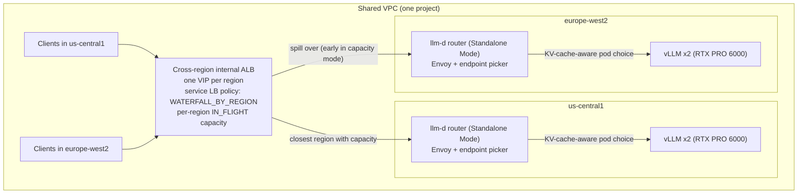
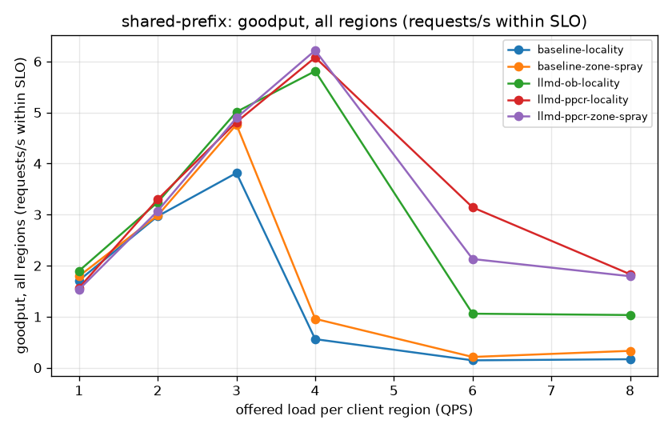
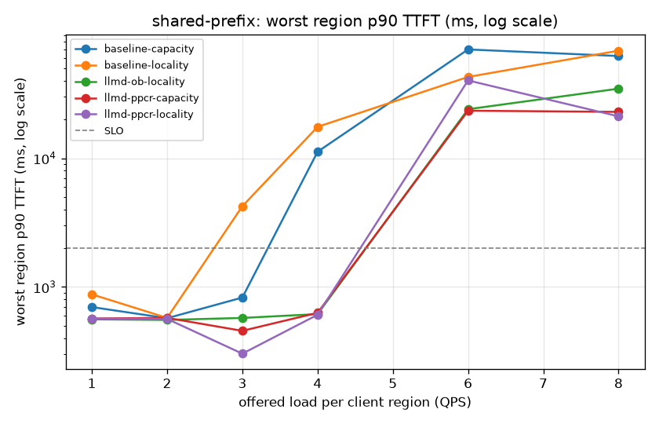
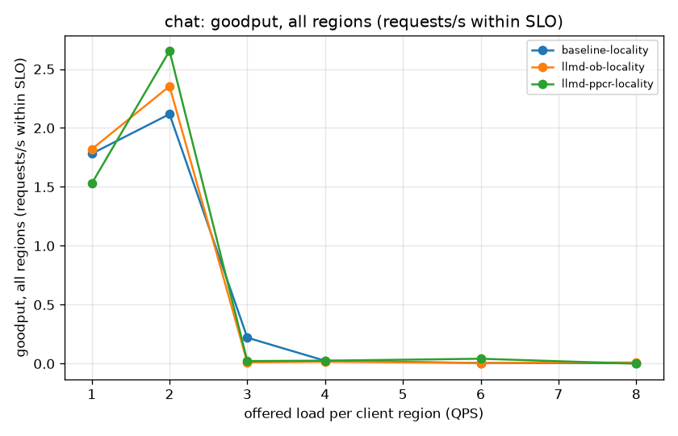
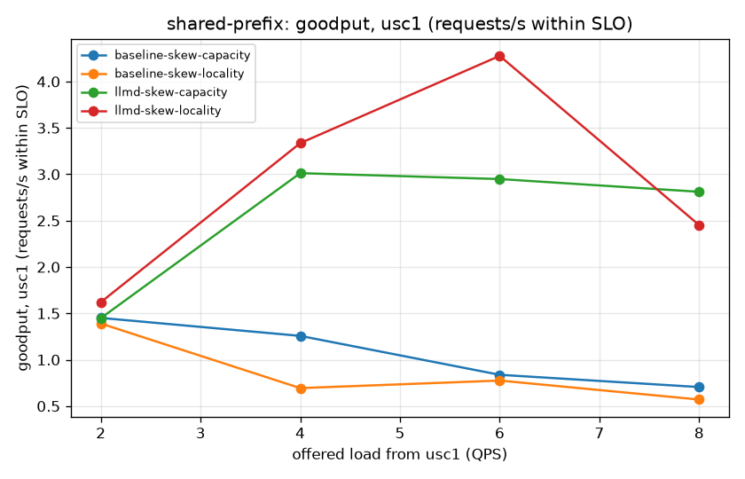
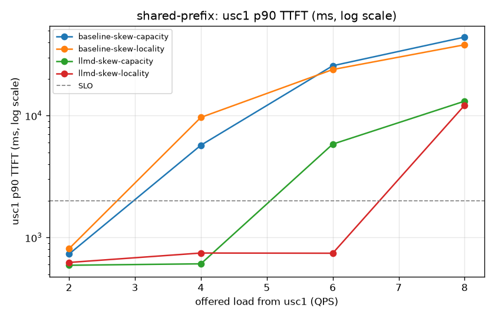

# Multi-region llm-d with a global load balancer

This guide serves one model from GPU pools in several regions behind **one
cross-region load balancer**, and makes each regional pool smarter with
[llm-d](https://llm-d.ai) KV-cache-aware routing. It measures the difference
against plain vLLM deployments in the same regions, for:

- setup from scratch,
- spin-up and ready time,
- the golden signals: latency (TTFT, TPOT, end-to-end), throughput, errors, and
  saturation (goodput within an SLO).

It builds on the shared
[Multi-region GKE inference foundation](/docs/platforms/gke/base/use-cases/inference-ref-arch/multi-region-gke-inference-foundation.md)
and its provisioning and load-balancing layer in
[`terraform/multi-region`](/platforms/gke/base/use-cases/inference-ref-arch/terraform/multi-region/README.md).
The llm-d manifests, routing scripts, and benchmark harness are in
[`examples/llmd-multi-region`](/platforms/gke/base/use-cases/inference-ref-arch/examples/llmd-multi-region/README.md).

> [!NOTE]
>
> The results come from single runs (n=1 per configuration) in one Google Cloud
> project in October 2026. Treat differences smaller than about 20% as noise,
> and expect other numbers with other models, accelerators, regions, and
> versions.

## Summary

On a workload with shared prompt prefixes (system prompts, few-shot examples,
agents), llm-d precise prefix cache routing in each region compares with plain
vLLM behind the same global load balancer and the same GPUs as follows:

|                                                                                       |  Plain vLLM | llm-d (precise prefix cache) |            Change |
| ------------------------------------------------------------------------------------- | ----------: | ---------------------------: | ----------------: |
| Max load per region within SLO (p90 TTFT ≤ 2 s, p90 TPOT ≤ 100 ms)                    |     2–3 QPS |                        4 QPS | **+33% to +100%** |
| Worst-region p90 TTFT at 3 QPS per region (plain vLLM's knee: 0.83 s in a repeat run) |      4.24 s |                       0.30 s |      −64% to −93% |
| Worst-region p90 TTFT at 4 QPS per region                                             |      17.5 s |                       0.61 s |          **−97%** |
| Goodput (requests/s within SLO, both regions) at 4 QPS per region                     |        0.56 |                         6.08 |          **~11×** |
| Output throughput at 8 QPS per region (overload)                                      | 1,699 tok/s |                  2,300 tok/s |          **+35%** |
| Errors                                                                                |           0 |                            0 |                   |

Plain vLLM was measured with `ROUND_ROBIN` endpoint selection within each
region; the example now defaults to `LEAST_REQUEST`
(`MR_BASELINE_LOCALITY_LB_POLICY=ROUND_ROBIN` reproduces the recorded
configuration; see [Fair comparison](#fair-comparison)).

On a control workload **without** prefix sharing (`chat`), llm-d helps only a
little, through load-aware pod selection. Goodput at 2 QPS per region rises from
2.12 to 2.65 requests/s, p90 TTFT falls from 1.24 s to 0.92 s, and the
saturation point is the same.

The **vLLM pods start equally fast** in both arms, about 190 s from container
start to Ready on a warm GPU node. llm-d adds a router (endpoint picker plus
Envoy) per region, which took 2–2.5 minutes to roll out because it needed a new
CPU node. That time can overlap with model server startup.

Under **symmetric two-region load**, llm-d sustains 1.33–2× the load within SLO
of plain vLLM (4 vs. 2–3 QPS per region). When **all the load comes from one
region** (regional skew), llm-d sustains 2–3× the load within SLO (4–6 vs. 2
QPS, with 2 replicas per region).

The **cross-region load balancer keeps about 80–90% of requests in the clients'
region** whatever capacity is configured: neither `RATE` nor `IN_FLIGHT` target
capacity made it spill over meaningfully in our tests (at most 13% in a
15-minute run at 2–4× over capacity), so the "capacity" mode can't rely on
spillover (see [Cross-region load balancing](#cross-region-load-balancing)).
Size each region for its own clients, or steer traffic between regions
explicitly.

The whole environment is reproducible from scratch with one command in about 37
minutes (`deploy-all.sh`, measured on a clean second environment), and is
removed in about 22 minutes (`teardown-all.sh`).

## Architecture



The design has three layers:

- **Regional platforms.** There is one GKE Standard cluster per region, deployed
  with the core platform and inference-ref-arch terraservices via
  `terraform/multi-region/provision.sh --parallel` (`CLUSTER_MODE=standard`,
  `NETWORK_MODE=shared-vpc`), each from its own Git worktree in parallel. All
  clusters join one shared VPC (`terraform/multi-region/shared_network`) with
  non-overlapping ranges (`MR_CIDR_INDEX`), and every region also gets a
  `GLOBAL_MANAGED_PROXY` proxy-only subnet.
- **Regional pools (the deployment layer under test).**
  - Arm A, **plain vLLM**: 2 replicas per region. The load balancer sends
    requests straight to the vLLM pods.
  - Arm B, **llm-d**: the same vLLM pods, plus the llm-d router in
    [Standalone Mode](https://github.com/llm-d/llm-d/tree/main/guides/precise-prefix-cache-routing).
    The endpoint picker (EPP) picks the pod with **precise prefix cache
    routing** (`ppcr`, based on KV cache events from vLLM) or with the
    **optimized baseline** (`ob`, based on an approximate prefix index). Both
    routers select the same pods, so switching between them doesn't redeploy any
    model server. Each regional router runs a single EPP replica
    (`router.proxy.mode: sidecar`, `replicas: 1`) so that its in-memory KV-event
    index covers every vLLM pod in the region. The trade-off: that pod is a
    single point of failure for the region's llm-d arm. While it restarts or is
    rescheduled (node upgrade, preemption, crash), the region's llm-d NEGs have
    no healthy endpoint, the load balancer health check (`/ready`, port 19001)
    sends traffic to the other regions, and active streams through that pod are
    cut. `cluster-autoscaler.kubernetes.io/safe-to-evict: "false"` prevents
    cluster autoscaler consolidation, not node upgrades. With HPA on, its
    load-balancer capacity is set for the HPA maximum from the start
    (`MR_HPA_MAX_REPLICAS / MR_REPLICAS_PER_REGION` times the region capacity),
    while plain vLLM's grows with its ready pods (so below full scale-out, an
    llm-d region accepts up to that factor more in-progress requests before
    spilling over). The router keeps the upstream chart's Envoy timeouts: the
    route timeout is 86400 s, and the 1000 s `ext_proc` `message_timeout` limits
    each message exchange with the endpoint picker rather than the stream, so
    long streams are bounded by the load balancer's `MR_BACKEND_TIMEOUT_SEC`
    (3600 s).
- **Global load balancer.** One cross-region internal Application Load Balancer
  (`terraform/multi-region/global_lb`, applied via `scripts/set-route.sh` and
  `global_lb.sh`) has a private VIP in each region. It uses one global backend
  service per arm, whose backends are the GKE standalone NEGs
  (`<prefix>-<key>-<backend>`, exposed via `expose_service_neg` / `mr_neg_name`)
  of that arm in every region. A service load balancing policy selects the
  cross-region behavior:

  | Mode         | Policy                                                                                                    | Behavior                                                                                                                                                                                                                                                                                  |
  | ------------ | --------------------------------------------------------------------------------------------------------- | ----------------------------------------------------------------------------------------------------------------------------------------------------------------------------------------------------------------------------------------------------------------------------------------- |
  | `locality`   | `WATERFALL_BY_REGION`, region capacity `MR_LB_REGION_CAPACITY_INFLIGHT` (default 32 in-progress requests) | Closest region first; spill over when it reaches its capacity.                                                                                                                                                                                                                            |
  | `capacity`   | `WATERFALL_BY_REGION`, low region capacity `MR_LB_CAPACITY_MODE_INFLIGHT` (default 8)                     | Intended to spill over early, so that the load of one region is spread over every region's GPUs, trading cross-region latency for utilization. **In our tests the load balancer didn't follow the configured capacity; see [Cross-region load balancing](#cross-region-load-balancing).** |
  | `zone-spray` | `SPRAY_TO_REGION`                                                                                         | Like `locality`, but each proxy spreads requests over every zone of the chosen region. It does **not** spread traffic across regions.                                                                                                                                                     |
  | `preferred`  | `WATERFALL_BY_REGION` + `PREFERRED` backends                                                              | Fill one region (for example, the one with the most or cheapest capacity) before any other.                                                                                                                                                                                               |

> [!NOTE]
>
> `SPRAY_TO_REGION` is easy to mistake for a cross-region spray. It changes only
> how each proxy picks **zones** inside the region that the load balancer chose;
> region choice is still closest-first with spillover (see
> [service load balancing policies](https://cloud.google.com/load-balancing/docs/service-lb-policy#spray-to-region)).
> The cross-region "spray to world" algorithm isn't supported for load
> balancing. The load balancer request logs (`bench/lb_traffic_split.py`)
> confirm it: with `SPRAY_TO_REGION`, 2–4% of requests crossed regions under
> symmetric load.

Capacity is measured with balancing mode `IN_FLIGHT` (in-progress requests, with
traffic duration `LONG`), which the load balancing documentation recommends for
requests that take more than a second, like LLM completions.
`MR_LB_BALANCING_MODE=RATE` (requests per second; `MR_LB_REGION_CAPACITY_QPS`
and `MR_LB_CAPACITY_MODE_QPS`) is the alternative. `IN_FLIGHT` needs the
`google-beta` provider 7.41.0 or later; 7.6.0 rejects it.

> [!WARNING]
>
> The Terraform load balancer attaches the zonal NEGs that exist when
> `set-route.sh` runs. GKE creates a standalone NEG in a zone only when the
> cluster has nodes there. A Pod that the HPA or the GPU ComputeClass later
> places in a new zone is Ready but gets no traffic until you re-run
> `set-route.sh` with the same arguments. For `llmd` this only matters if the
> router Pod moves; the router reaches model servers in every zone.

### Fair comparison

Both arms run the **same pod spec**: the pinned llm-d v1.0.0 GPU vLLM model
server recipe (`guides/precise-prefix-cache-routing/modelserver/gpu/vllm/gke`).
That includes the same image (`vllm/vllm-openai:v0.31.0`, pinned by digest), the
same probes, the same graceful shutdown, and the same resources. They also use
the same accelerator (1× RTX PRO 6000 per replica), the same model
(`Qwen/Qwen3-32B`, BF16, `--max-model-len=32768`,
`--gpu-memory-utilization=0.90`, `--block-size=64`, prefix caching on), the same
Run:ai streaming from the regional bucket, and the same number of replicas.

The only differences are the two vLLM flags that llm-d needs
(`--enable-scale-out` and `--kv-events-config`), and whether the regional router
sits in front of the pods. Both arms use the same global load balancer, load
balancing policy, and region capacity.

> [!NOTE]
>
> In the recorded October 2026 runs (`exp-20261030b`, `skew-20261030a`), the
> `baseline` backend service used `locality_lb_policy = "ROUND_ROBIN"` within a
> region's NEG endpoints, and client Jobs started Stage 0 independently after
> node provisioning and image pull (producing 63–158 s of cross-region Stage 0
> start skew). The example's configuration now defaults `baseline` to
> `LEAST_REQUEST` (`terraform/multi-region/global_lb`, `scripts/set-route.sh`;
> export `MR_BASELINE_LOCALITY_LB_POLICY=ROUND_ROBIN` to reproduce the recorded
> runs) so future reproductions compare prefix+load-aware EPP routing against
> active-request L7 balancing rather than blind round-robin, and
> `run-benchmark.sh` coordinates a cross-region Stage 0 start barrier
> (`MR_BENCH_SYNC_START=auto`, on whenever more than one client region runs) so
> client regions start Stage 0 within seconds of each other (later stages can
> still drift by per-stage drain). The recorded runs also used the earlier seed
> scheme: `llmd-ob-locality` reused the `chat` seeds of the preceding run on the
> same pods, and the `*-capacity` runs used seeds 142 (plain vLLM) and 242
> (llm-d).

### Why not the GKE multi-cluster Inference Gateway (yet)

The GKE **multi-cluster Inference Gateway** is the natural product for this
pattern. It exports each regional `InferencePool` to the fleet and imports it as
a `GCPInferencePoolImport` behind a `gke-l7-cross-regional-internal-managed-mc`
Gateway, so that the load balancer calls each region's EPP directly. The example
implements it as an alternative (`MR_GLOBAL_LB=mc-gateway`: `terraform/fleet`,
`deploy-fleet.sh`, `deploy-gateway.sh`, `manifests/gateway`). In our tests,
however:

1. The multi-cluster Ingress P4SA also needs `roles/gkehub.gatewayAdmin` when
   the member clusters have no public control plane endpoint. The core platform
   creates such clusters. Without the role, every membership reports
   `Lost connection`. This role isn't in the multi-cluster Gateway prerequisites
   docs, so the example's fleet module grants it.
2. On GKE 1.37 (RAPID, Gateway API v1.6.0) config clusters, the
   `gke-l7-cross-regional-internal-managed-mc` GatewayClass isn't installed. On
   1.36 it is.
3. The multi-cluster Gateway controller never reconciled any Gateway (neither
   `rilb-mc` nor cross-regional), on either version. It stayed in a restart
   loop, re-applying GatewayClasses and CRDs on every fleet member cluster.

The fleet features were disabled again, and the issue was reported to Google
Cloud. The Terraform-managed load balancer uses the same cross-region internal
ALB data plane, is fully supported, and exposes more knobs (per-region
`IN_FLIGHT` or `RATE` capacity, `SPRAY_TO_REGION`, preferred backends). It also
doesn't change project-wide fleet settings, which matters in shared projects.

## Security and isolation

- **No public endpoints.** Nodes and control planes are private, and `kubectl`
  uses the IAM-authenticated DNS endpoint. The load balancer is internal and is
  reachable only from inside the VPC network. Clients and benchmark Jobs run
  inside the clusters.
- **No secrets in the repository or in the cluster.** The Hugging Face token is
  read from a local file into Secret Manager, and is only used by the model
  download Job. vLLM and the benchmark client pods stream weights,
  configuration, and tokenizer artifacts from the regional bucket with Workload
  Identity, so the llm-d recipes' `HF_TOKEN` references are removed.
- **Everything is pinned.**
  - llm-d commit `378b42d` (v1.0.0) for the Kustomize bases and router values.
  - Router Helm charts `v1.0.0`, with OCI digests verified before rendering.
  - Endpoint picker, Envoy, vLLM, inference-perf, and curl images, by digest.
  - llm-d `main` is never referenced: upstream changes such as `Deployment` →
    `DisaggregatedSet` silently break overlays that track it.
- **Attribution and cleanup.** Clusters are labelled `created_by`,
  `acp_environment`, and `acp_example`. `teardown-all.sh` removes the load
  balancer, the arms, the benchmark bucket, the fleet features, the regions (in
  parallel), and the network. Results stay in a 30-day-retention bucket with
  public access prevention.
- **Optional IAP-protected front door** (prototype, off by default). A global
  external ALB with IAP and a Google-managed certificate in front of an Envoy
  that forwards to the internal VIP, for demos only. See
  `manifests/front-door/README.md`.

## Reproduce

Prerequisites: `gcloud`, `kubectl`, `kustomize`, `helm` v3, `terraform` >= 1.8,
`jq`, `python3` (with `PyYAML`), `git`, `envsubst`, `curl`, `sponge`, `flock`; a
Hugging Face read token in `~/hftoken`; GPU quota for 2× RTX PRO 6000 per region
when the arms run back to back (as here), or 4× when they run at the same time.

`mr.env` defaults to 3 regions (`usc1 euw2 ase1`) and enables HPA for scale-out;
pin `MR_REGION_KEYS="usc1 euw2"` to reproduce this two-region guide.
`run-experiment.sh` and `run-skew-experiment.sh` automatically disable HPA
(`MR_HPA_ENABLED=false`, unless `--with-hpa` is passed) so every arm is measured
at a fixed 2 replicas per region.

```bash
cd platforms/gke/base/use-cases/inference-ref-arch/examples/llmd-multi-region
export MR_PROJECT_ID="<project>"            # every setting is in mr.env
export MR_REGION_KEYS="usc1 euw2"           # pin the two-region topology
export MR_RUN_ID="setup-$(date -u +%Y%m%dT%H%M%SZ)"

scripts/deploy-all.sh                       # network, regions (parallel), bench infra, models (parallel)

export MR_RUN_ID="exp-$(date -u +%Y%m%dT%H%M%SZ)"
scripts/run-experiment.sh                   # baseline arm, then llm-d arm; locality and capacity modes

export MR_RUN_ID="skew-$(date -u +%Y%m%dT%H%M%SZ)"
scripts/run-skew-experiment.sh --modes "locality capacity"   # all load from usc1

scripts/teardown-all.sh
```

The published regional-skew table below ran with `RATE` capacity 3 QPS and
`zone-spray`
(`MR_LB_BALANCING_MODE=RATE scripts/run-skew-experiment.sh --region-capacity-qps 3 --modes "locality zone-spray"`).

Each run writes the following outside the repository (`${MR_WORK_DIR}/results`):

- `timings/<run>.jsonl`: one record per stage. Summarize it with
  `bench/setup_report.py`.
- `startup/<run>/<arm>/<region>/`: pods, nodes, events, vLLM logs, and markers.
  Summarize them with `bench/startup_report.py`.
- `runs/<run>/<arm>/<workload>/<client>/`: inference-perf reports and run
  metadata (pinned images, chart digests, Git commit).
- `analysis/<run>/`: `report.md`, CSVs, and charts from `bench/analyze.py`.

### Workloads and load

The client load generator is
[inference-perf](https://github.com/kubernetes-sigs/inference-perf) v0.7.0. Each
client region runs one Job, which calls its own region's VIP.

| Workload        | Data                                                                                                           | Why                                                                                                                                                                                                                                                                                                                                               |
| --------------- | -------------------------------------------------------------------------------------------------------------- | ------------------------------------------------------------------------------------------------------------------------------------------------------------------------------------------------------------------------------------------------------------------------------------------------------------------------------------------------- |
| `shared-prefix` | 64 groups × 64 prompts; 2,048-token shared system prompt, 256-token question, 256 output tokens (`ignore_eos`) | Shared prefixes, as in chat assistants with system prompts, RAG templates, and agents. One region's prefixes take 131k tokens (about 32 GiB) of KV cache. That's more than one replica holds (86,848 tokens, 21.2 GiB, as vLLM reported at startup), but less than two replicas hold. Routing that keeps a prefix on the same replica should win. |
| `chat`          | random input (mean 2,304 tokens, sd 512), 256 output tokens                                                    | Control, with no deliberate sharing.                                                                                                                                                                                                                                                                                                              |

The load is Poisson arrivals at 1, 2, 3, 4, 6, and 8 QPS per client region, 60
seconds per stage, with streaming completions. Each `(arm_slot, workload)` pair
uses a distinct deterministic seed offset (matching seeds across arms for the
same workload while separating runs on already-warmed pods) so that every run
starts with a cold prefix cache.

## Results

### Setup from scratch

Both arms share the platform. The example was set up from scratch twice, with
regions in parallel. The second run was a hands-off reproducibility check in a
separate environment (`MR_ENVIRONMENT_NAME=mr2`, its own VPC, clusters, buckets,
and state) in the same project, next to the first environment, verifying
multi-environment isolation in the shared foundation.

| Stage                                                                                  |                         Run 1 | Run 2 (clean) | Notes                                                                                                                                                                                                                                  |
| -------------------------------------------------------------------------------------- | ----------------------------: | ------------: | -------------------------------------------------------------------------------------------------------------------------------------------------------------------------------------------------------------------------------------- |
| Shared VPC, global proxy-only subnets, firewall                                        |                          0:45 |          0:49 |                                                                                                                                                                                                                                        |
| Regional platform (GKE Standard, core terraservices, inference-ref-arch), first region |                         22:22 |         17:21 |                                                                                                                                                                                                                                        |
| Regional platform, second region                                                       |                 16:15 (retry) |         25:21 | Run 1: `n4-standard-4` stockout in every zone; the system node pool failed after 35 min and was retried with `e2-standard-4` by hand. Run 2: one automatic retry after a transient API server error while the cluster was reconciling. |
| `online_gpu`, bucket IAM, secret, kubeconfig, labels (per region)                      | 0:12–0:20 (`online_gpu` only) |     0:27–0:40 |                                                                                                                                                                                                                                        |
| Benchmark infrastructure (bucket, IAM)                                                 |                         ~0:20 |          0:30 |                                                                                                                                                                                                                                        |
| Model staging, Hugging Face → regional bucket (Qwen3-32B, 61 GiB)                      |                     8:15–9:06 |     7:41–9:46 | Includes provisioning a download node.                                                                                                                                                                                                 |
| **`deploy-all.sh` total (wall clock)**                                                 |           – (manual recovery) |     **37:09** | No manual steps.                                                                                                                                                                                                                       |
| Global load balancer, first creation                                                   |                          4:12 |             – | Created by the first `deploy-arm.sh`. Then 1:16–2:08 to re-point it at another arm.                                                                                                                                                    |

`teardown-all.sh` then removed the `mr2` environment in **22:04** (regions in
parallel: 15:37 and 19:04), leaving only its Terraform state bucket, as
documented. A check for clusters, networks, NEGs, service accounts, and buckets
with the environment's prefix found nothing else. The first environment kept
serving traffic throughout.

From an empty project to the first request served in both regions therefore
takes about **50–55 minutes**: 37 minutes of setup, 4 minutes for the load
balancer, and 9 (plain vLLM) to 12 (llm-d) minutes for an arm on new GPU nodes,
assuming GPU capacity is available.

The two arms differ only in the per-region pool:

| Step (per region)                              | Plain vLLM |                                   llm-d |
| ---------------------------------------------- | ---------: | --------------------------------------: |
| Apply model server manifests                   |      5–7 s |                                   6–7 s |
| Router (EPP + Envoy) rollout                   |          – |                1:58–2:27 (new CPU node) |
| vLLM pod start → Ready (median, warm GPU node) |      190 s |                               190–216 s |
| Apply → all model server pods Ready            |  195–197 s | 197 s (warm node); 319 s (new GPU node) |
| Apply → first OK through the global VIP        |  532–533 s |                               643–731 s |

The "first OK" row includes this run's serial orchestration (regions one after
the other, then load balancer programming), so it's an upper bound. The vLLM
startup breaks down the same way in both arms:

- Run:ai streaming of the weights from the regional bucket (61 GiB): 18–21 s.
- `torch.compile`: ~27 s.
- CUDA graph capture: ~50 s.
- Engine initialization in total: ~136 s.

### Golden signals: shared-prefix




Both regions are combined in this table: goodput and throughput are summed, and
TTFT and TPOT are the worst region's p90 (full 6-stage sweep at 1, 2, 3, 4, 6,
and 8 QPS per region).

| QPS per region | Arm                     | Goodput (rps) | Output tok/s | Worst p90 TTFT | Worst p90 TPOT |
| -------------: | ----------------------- | ------------: | -----------: | -------------: | -------------: |
|              1 | plain vLLM              |          1.71 |          474 |         0.88 s |        65.3 ms |
|              1 | llm-d ppcr              |          1.57 |          429 |         0.57 s |        61.9 ms |
|              1 | llm-d ob                |          1.90 |          480 |         0.56 s |        66.9 ms |
|              2 | plain vLLM              |          2.97 |          837 |         0.58 s |        68.9 ms |
|              2 | llm-d ppcr              |          3.30 |          935 |         0.57 s |        65.9 ms |
|              2 | llm-d ob                |          3.24 |          823 |         0.55 s |        65.9 ms |
|              3 | plain vLLM              |          3.82 |        1,312 |         4.24 s |       106.7 ms |
|              3 | llm-d ppcr              |          4.81 |        1,324 |         0.30 s |        72.3 ms |
|              3 | llm-d ob                |          5.01 |        1,330 |         0.57 s |        73.3 ms |
|              4 | plain vLLM              |          0.56 |        1,490 |         17.5 s |       113.2 ms |
|              4 | llm-d ppcr              |          6.08 |        1,731 |         0.61 s |        81.0 ms |
|              4 | llm-d ob                |          5.81 |        1,632 |         0.62 s |        84.7 ms |
|              6 | plain vLLM              |          0.15 |        1,475 |         42.8 s |       120.6 ms |
|              6 | llm-d ppcr              |          3.14 |        1,955 |         40.2 s |       113.2 ms |
|              6 | llm-d ppcr (`capacity`) |          2.13 |        2,137 |         23.4 s |       115.8 ms |
|              6 | llm-d ob                |          1.06 |        1,998 |         24.0 s |       113.4 ms |
|              8 | plain vLLM              |          0.17 |        1,699 |         68.4 s |       125.0 ms |
|              8 | llm-d ppcr              |          1.83 |        2,300 |         21.1 s |       111.5 ms |
|              8 | llm-d ob                |          1.03 |        2,489 |         34.7 s |       118.0 ms |

Plain vLLM was measured with `ROUND_ROBIN` endpoint selection within each
region; the example now defaults to `LEAST_REQUEST`
(`MR_BASELINE_LOCALITY_LB_POLICY=ROUND_ROBIN` reproduces the recorded
configuration; see [Fair comparison](#fair-comparison)).

Plain vLLM's load balancing across replicas makes every replica cache every
prefix, and the prefixes don't fit, so the replicas thrash and recompute
prefill. llm-d keeps each prefix group on one replica, which keeps TTFT flat
until about 4 QPS per region and moves the saturation point out. At 6 QPS per
region (past saturation), `llmd-ppcr-locality` delivered 3.14 rps of goodput
overall: `euw2` stayed at 6.10 s p90 TTFT (2.58 rps), but `usc1` queued up to
40.2 s (0.56 rps), worse than `llm-d ob` (24.0 s worst region) at the same rate.
In the paired `zone-spray` run (recorded as `llmd-ppcr-capacity`), the worst
region reached 23.4 s (`euw2` 4.32 s, `usc1` 23.4 s). This single run doesn't
show why `usc1` queued more than `euw2`; the two client regions' stages were
also 90 s apart (see [Fair comparison](#fair-comparison)). At 4 QPS and below,
precise (KV-event) and approximate prefix routing perform about the same; past
saturation, precise routing kept more goodput (3.14 vs. 1.06 rps at 6 QPS, 1.83
vs. 1.03 rps at 8 QPS) but had the worse tail at 6 QPS.

### Golden signals: chat (no shared prefixes)



| QPS per region | Arm        | Goodput (rps) | Worst p90 TTFT | Worst p90 TPOT |
| -------------: | ---------- | ------------: | -------------: | -------------: |
|              1 | plain vLLM |          1.78 |         0.79 s |        72.2 ms |
|              1 | llm-d ppcr |          1.53 |         0.64 s |        71.7 ms |
|              2 | plain vLLM |          2.12 |         1.24 s |       112.8 ms |
|              2 | llm-d ppcr |          2.65 |         0.92 s |       103.7 ms |
|              2 | llm-d ob   |          2.35 |         0.95 s |       107.9 ms |
|              3 | all arms   |        ≤ 0.22 |         > 17 s |       > 120 ms |

Both arms saturate at about 2 QPS per region. Without prefix reuse, llm-d's
advantage comes only from load-aware pod selection. The 1 QPS difference is
within noise.

### Cross-region load balancing

**Symmetric load** (both client regions at the same rate). The runs recorded as
`*-capacity` in `exp-20261030b` used `SPRAY_TO_REGION`, before the mode
correction described in [Architecture](#architecture), so functionally they
measure `zone-spray` behavior (the chart legends retain their recorded
`*-capacity` directory names). The load balancer logs show that only 2–4% of
their requests crossed regions, the same as `locality`. Read the pairs as repeat
runs with slightly different zone spreading, which gives an idea of the
run-to-run noise:

- llm-d: goodput 6.08 (`locality`) vs 6.22 (`zone-spray`, recorded as
  `llmd-ppcr-capacity`) requests/s at 4 QPS per region. Repeatable.
- Plain vLLM: worst p90 TTFT 4.24 s (`locality`) vs 0.83 s (`zone-spray`,
  recorded as `baseline-capacity`) at 3 QPS per region. Plain vLLM sits on its
  saturation knee at 3 QPS, where small differences in which replica gets which
  prefix change the tail a lot. The conclusions above use 2 and 4 QPS, where the
  arms are clearly apart.

**Regional skew** (all load from clients in us-central1, so cross-region
behavior matters; region capacity `MR_LB_REGION_CAPACITY_QPS=3`). Each arm has 2
replicas in each region; with `locality` the 2 us-central1 replicas take the
load until the load balancer spills over to europe-west2.

| Arm        | Mode                             | Max QPS within SLO | Goodput at 4 / 6 QPS | p90 TTFT at 4 / 6 QPS | Served in europe-west2 |
| ---------- | -------------------------------- | -----------------: | -------------------: | --------------------: | ---------------------: |
| Plain vLLM | `locality`                       |                  2 |          0.69 / 0.78 |        9.7 s / 23.9 s |                  20.5% |
| Plain vLLM | `zone-spray` (`*-skew-capacity`) |                  2 |          1.26 / 0.84 |        5.7 s / 25.6 s |                  16.7% |
| llm-d ppcr | `locality`                       |                  6 |          3.34 / 4.28 |       0.75 s / 0.74 s |                  20.4% |
| llm-d ppcr | `zone-spray` (`*-skew-capacity`) |                  4 |          3.01 / 2.95 |        0.61 s / 5.8 s |                  18.6% |




The `zone-spray` runs ran before the mode correction and are recorded as
`*-skew-capacity` in the raw results and chart legends; the chart titles reflect
the single client region (`usc1`). The "served in europe-west2" column is over
the whole run (2, 4, 6, and 8 QPS stages of 60 s each), from the load balancer
request logs (`bench/lb_traffic_split.py`).

- llm-d's advantage holds when one region takes all the load: 2–3× the load
  within SLO (4–6 vs. 2 QPS), and about 5× the goodput at 4–6 QPS in `locality`
  mode (4.8–5.5×; 2.4–3.5× in `zone-spray`).
- About 20% of the requests were served in europe-west2 in every run, whatever
  the arm, the mode, or how overloaded us-central1 was. The next experiment
  checks whether that is capacity-based spillover at all.

**Does the load balancer follow the configured capacity?** To isolate the load
balancer, we ran plain vLLM with **1 replica per region**, steady load of 1 QPS
from us-central1 only (well within one replica's capacity, so health checks stay
green; 8–11 requests in progress, as the load balancer reported), for 5 minutes
per setting, and counted where requests went in the load balancer logs:

| Run | Balancing mode | Region capacity                         | us-central1 load vs. its capacity |                                  Served in europe-west2 |
| --- | -------------- | --------------------------------------- | --------------------------------: | ------------------------------------------------------: |
| A   | `RATE`         | 1.5 QPS (`locality`)                    |                              0.7× |                                                    8.3% |
| A   | `RATE`         | 0.5 QPS (`capacity`)                    |                                2× |                                                    8.0% |
| B   | `IN_FLIGHT`    | 32 requests (`locality`)                |                             ~0.3× |                                                   11.0% |
| B   | `IN_FLIGHT`    | 4 requests (`capacity`)                 |                              2–3× |                                                    9.0% |
| C   | `IN_FLIGHT`    | 4 requests (`capacity`), **15 minutes** |                              2–4× | 12.7% (8% in the first 5 minutes, 15–28% in the last 5) |

The load balancer's own metrics agreed with the configuration:
`network.googleapis.com/loadbalancer/backend/configured_in_flight_requests` was
4 for each region's NEG, while `in_flight_requests` was 8–11 in `us-central1`
(2–2.75× its configured limit of 4) and only 0–2 in `europe-west2` (0–50% of its
configured limit of 4, leaving spare regional headroom unused). Even so, it kept
about 90% of the requests in `us-central1`. No health check transitions were
logged during these runs (health check logging is on in
`terraform/multi-region/global_lb`). The ramp runs of a second skew experiment
(1 replica per region, 1–4 QPS, `RATE` capacity 1.5 vs. 0.5 QPS) also matched:
21.2% vs. 22.5%.

**Conclusion.** With this load balancer (cross-region internal Application Load
Balancer, GKE standalone zonal NEGs, `WATERFALL_BY_REGION`), the configured
target capacity didn't measurably move traffic between regions within 5 minutes,
and only slowly over 15 minutes (12.7% overall, drifting up to 15–28% near the
end, far from the ~50% that proportional overfilling would give); 8–11% (steady
load) to 17–22% (ramps into overload) crossed regions whatever the capacity. The
target capacity "isn't a circuit breaker", as the backend service documentation
says, but we expected proportional spillover once `us-central1` exceeded its
target capacity while `europe-west2` remained below target. That hasn't been
explained yet. Until then:

- Treat `locality` as the behavior you get: requests stay in the clients'
  region. Size each region for its own clients' peak (llm-d raises that peak by
  1.33–2× under symmetric load and 2–3× under single-region skew on prefix-heavy
  traffic, which is the bigger lever), and add an HPA per region.
- For **capacity-optimized** routing across regions, steer explicitly instead of
  relying on spillover: point a share of the clients at the other region's VIP
  (for example, Cloud DNS weighted round robin records for the internal VIPs),
  try `preferred` backends for the region with spare capacity (not tested here;
  it relies on the same capacity accounting), or use the GKE multi-cluster
  Inference Gateway with KV cache utilization as a custom metric once it works
  in your project (see
  [Why not the GKE multi-cluster Inference Gateway (yet)](#why-not-the-gke-multi-cluster-inference-gateway-yet)).

## Findings and fixes

The work found and fixed the following issues, which matter for anyone who
reproduces this:

| Area                  | Finding                                                                                                                                                                                                                                                                                                              | Fix in this change                                                                                                                                                                                                                                                                                                      |
| --------------------- | -------------------------------------------------------------------------------------------------------------------------------------------------------------------------------------------------------------------------------------------------------------------------------------------------------------------- | ----------------------------------------------------------------------------------------------------------------------------------------------------------------------------------------------------------------------------------------------------------------------------------------------------------------------- |
| llm-d pins            | When this work started, the repo's GPU llm-d bases, Helm values, and gateway recipes tracked `llm-d/llm-d` `main`, and the upstream move to `DisaggregatedSet` broke the TPU P/D overlay in CI. PR #588 has since pinned the repo's bases to `v1.0.0`.                                                               | Everything pinned to commit `378b42d` (v1.0.0). Use the **commit** SHA: the annotated tag object SHA (`db7d005`) doesn't work for raw URLs.                                                                                                                                                                             |
| llm-d PPCR            | When this work started, the repo's GPU PPCR overlays replaced vLLM's arguments without `--enable-scale-out` and without the `replay_endpoint`. llm-d v1.0's `token-producer` then gets 404 on `/v1/*/render` and **silently routes without cache information**. PR #588 has since added both to the repo's overlays. | The example overlay adds both flags and serves `Qwen/Qwen3-32B`, the model name that the router's tokenizer configuration uses.                                                                                                                                                                                         |
| Run:ai streamer IAM   | `--load-format=runai_streamer` with `gs://` needs `storage.buckets.get`. `online_gpu` only grants the Cloud Storage FUSE object role, so vLLM failed with 403.                                                                                                                                                       | The namespace KSA is granted `roles/storage.legacyBucketReader` on the regional bucket.                                                                                                                                                                                                                                 |
| Capacity              | `n4-standard-4` stockout in all zones of one region blocked the system node pool for 35 minutes. The create operation can't be cancelled, and the cluster can't be deleted while it runs.                                                                                                                            | `MR_SYSTEM_MACHINE_TYPE_DEFAULT` (`TF_VAR_cluster_system_node_pool_machine_type`, defaulting to `e2-standard-4`).                                                                                                                                                                                                       |
| Capacity              | G4 (RTX PRO 6000) on-demand stockout in some zones.                                                                                                                                                                                                                                                                  | Compute class priority fallback; nodes arrived after 4–8 minutes.                                                                                                                                                                                                                                                       |
| Capacity              | Releasing GPUs between arms is fragile. The cluster autoscaler removed the empty G4 node about 40 s after the arm's pods were gone, and then the region was stocked out in every G4 zone for over 20 minutes, which failed the next arm's rollout.                                                                   | `delete-arm.sh --hold-gpus` keeps the nodes with placeholder pods (`manifests/common/gpu-hold`), and `deploy-arm.sh` releases them right before it applies the next arm. `run-experiment.sh` and `run-skew-experiment.sh` hold between arms and release after the last one. Use reservations for anything longer-lived. |
| Load balancer         | `SPRAY_TO_REGION` only spreads requests over the zones of the chosen region; it isn't a cross-region spray.                                                                                                                                                                                                          | `capacity` is `WATERFALL_BY_REGION` with a low region capacity; `zone-spray` is kept as a separate mode.                                                                                                                                                                                                                |
| Core scripts          | `fleet_membership` waits only 60 s for cluster operations, and the autoscaler's first `RESIZE_CLUSTER` often takes longer.                                                                                                                                                                                           | `terraform/multi-region/provision.sh` retries the idempotent core deploy.                                                                                                                                                                                                                                               |
| Core scripts          | Re-running with rewritten `platform.auto.tfvars` dropped `platform_custom_role_unique_suffix`, so terraservices bound a non-existent custom role (`…gcsfuse.user.null`).                                                                                                                                             | `platform_custom_role_unique_suffix` is preserved.                                                                                                                                                                                                                                                                      |
| Networking            | `REGIONAL_MANAGED_PROXY` and `GLOBAL_MANAGED_PROXY` proxy-only subnets **can** coexist in one region of a VPC. This was tested, and contradicts a warning in the multi-cluster Inference Gateway setup page.                                                                                                         | Both are created.                                                                                                                                                                                                                                                                                                       |
| Multi-cluster Gateway | See [Why not the GKE multi-cluster Inference Gateway (yet)](#why-not-the-gke-multi-cluster-inference-gateway-yet).                                                                                                                                                                                                   | `roles/gkehub.gatewayAdmin` granted; Terraform load balancer is the default.                                                                                                                                                                                                                                            |

## Next steps

- **Three regions, HPA scale-out, and Pod snapshots:** see
  [Three-region llm-d with HPA scale-out and GKE Pod snapshots](llmd-multi-region-scale-out.md),
  which also has the design recommendations for a multi-cluster optimized
  inference architecture.
- **P/D disaggregation (phase 2).** In this repo it exists only on TPU v6e. On
  GPU it needs NIXL, ideally over RDMA (A3 Ultra or A4 with `gke-rdma`). It
  gains little for a 32B model on one GPU. Upstream now runs P/D as a
  `DisaggregatedSet` (needs the LeaderWorkerSet and DisaggregatedSet CRDs). A
  good next step is a larger model (for example, Llama 3.3 70B or a MoE) on
  H100/H200 nodes with RDMA, using the same harness and load balancer.
- **Calibrate `peakPrefillThroughput`** for RTX PRO 6000 with TP=1. The default
  (15,926) was calibrated for H100 with TP=2. Use the llm-d calibration recipe
  and set it with `MR_LLMD_PEAK_PREFILL_THROUGHPUT`.
- **Cross-region capacity spillover**: once target capacity moves traffic
  between regions as documented, re-run `run-skew-experiment.sh`.
- **Multi-cluster Inference Gateway**: retry when the controller issue is
  resolved, preferably in a dedicated project. The custom-metrics balancing
  (`gke.named_metrics.kv-cache`) is wired
  (`manifests/common/autoscaling-metric`).
- **Autoscaling and startup**: done in the three-region guide. The HPA scales on
  `vllm:num_requests_waiting` and `vllm:num_requests_running`, and GKE Pod
  snapshots cut a new replica's start from about 4 minutes to 26–41 s.
