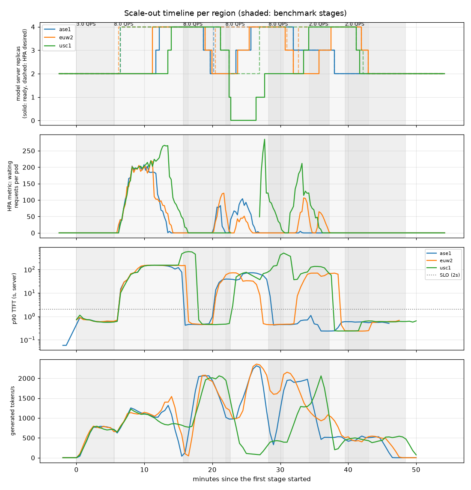
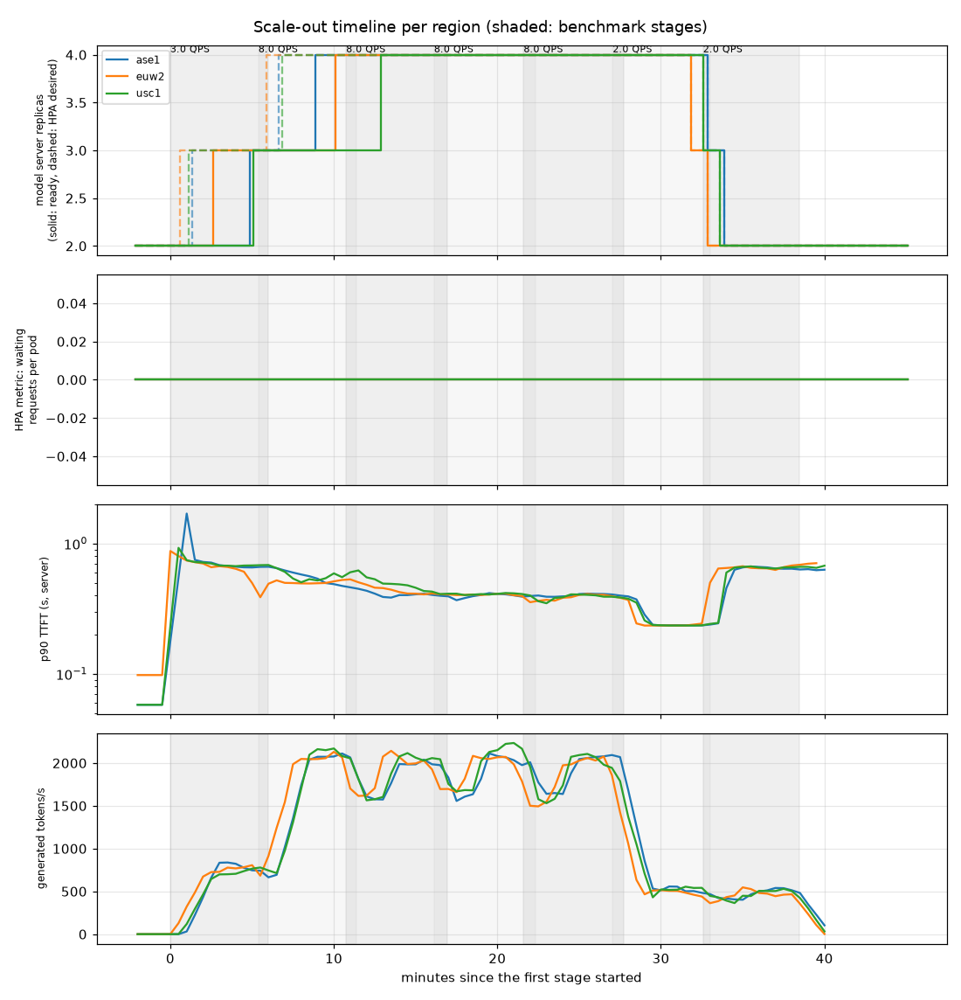

# Three-region llm-d with HPA scale-out and GKE Pod snapshots

This guide extends
[Multi-region llm-d with a global load balancer](llmd-multi-region-global-load-balancing.md)
(built on the
[Multi-region GKE inference foundation](/docs/platforms/gke/base/use-cases/inference-ref-arch/multi-region-gke-inference-foundation.md)
and
[`terraform/multi-region`](/platforms/gke/base/use-cases/inference-ref-arch/terraform/multi-region/README.md))
to a third, APAC region, gives every region a Horizontal Pod Autoscaler (HPA),
and drives each region to twice its provisioned capacity. It measures the golden
signals while the HPA scales out, compares cold scale-out with scale-out from
[GKE Pod snapshots](https://cloud.google.com/kubernetes-engine/docs/concepts/pod-snapshots),
and ends with design recommendations for a multi-cluster optimized inference
architecture.

> [!NOTE]
>
> The results come from single runs (n=1 per configuration) in one Google Cloud
> project in November 2026. Expect other numbers with other models,
> accelerators, regions, and versions.

## What was deployed

|                       | us-central1 (`usc1`)                                      | europe-west2 (`euw2`) | asia-southeast1 (`ase1`)                                              |
| --------------------- | --------------------------------------------------------- | --------------------- | --------------------------------------------------------------------- |
| Cluster               | GKE Standard 1.37.1, private                              | same                  | same, added to the running environment                                |
| RTX PRO 6000 capacity | on-demand                                                 | on-demand             | **no on-demand quota** in the test project, so flex-start or **Spot** |
| GPU compute class     | platform default: on-demand → flex-start → Spot           | same                  | `llm-mr-gpu-obtainable`: flex-start → Spot → on-demand                |
| Model servers         | `Qwen/Qwen3-32B`, 1 × RTX PRO 6000 per replica, HPA 2 → 4 | same                  | same                                                                  |
| Router                | llm-d router (Envoy + endpoint picker) per region         | same                  | same                                                                  |

One cross-region internal Application Load Balancer (Terraform-managed) has a
VIP in each region and keeps each region's clients in their region (`locality`).

**Adding the APAC region** to the running environment took **30:54**, with no
manual steps:

- shared network (global proxy-only subnet, firewall): 0:33,
- regional platform (GKE cluster, core terraservices): 20:56,
- `online_gpu`, IAM, kubeconfig, labels: 0:48,
- model staging from Hugging Face into the Singapore bucket: 8:21.

On the first scale-out, the platform's default compute class couldn't get a GPU
in asia-southeast1. Each on-demand priority failed with `QuotaExceeded` and
backed off for 5 minutes before the class reached flex-start, and flex-start was
in a capacity cooldown. The Deployment exceeded its 10-minute progress deadline.
The region-specific class `llm-mr-gpu-obtainable` starts with the capacity that
uses preemptible quota (flex-start, then Spot). With it, **Spot G4 nodes arrived
in 1.5–2 minutes**, which is as fast as on-demand in the other regions.

### Autoscaling

The HPA scales the model server Deployment of each region between 2 and 4
replicas (`MR_REPLICAS_PER_REGION`, `MR_HPA_MAX_REPLICAS`), on vLLM metrics from
GKE automatic application monitoring served by the Custom Metrics Stackdriver
Adapter:

| Metric                      | Target per pod | Role                                                                         |
| --------------------------- | -------------: | ---------------------------------------------------------------------------- |
| `vllm:num_requests_waiting` |              5 | Scale out as soon as requests queue.                                         |
| `vllm:num_requests_running` |             25 | Hold the replicas while they're busy. Added after the first run (see below). |

Scale-up has no stabilization window. Scale-down waits 5 minutes and removes 1
replica per minute.

## Experiment

Clients in every region send the `shared-prefix` workload to their region's VIP:
Poisson arrivals, 5-minute stages, streaming completions.

| Stages | QPS per region | Purpose                                                                     |
| ------ | -------------: | --------------------------------------------------------------------------- |
| 1      |              3 | Warm-up, within the capacity of 2 replicas                                  |
| 4      |          **8** | Hammer: about twice the capacity of 2 replicas, so that the HPA scales to 4 |
| 2      |              2 | Cool-down, to observe the scale-in                                          |

`scripts/run-scale-experiment.sh` runs it. `bench/record_scaling.py` records the
HPA, Deployment, pod, and GPU node state every 15 s, and `bench/scale_report.py`
combines that with the client-side metrics and the server-side metrics from
Managed Service for Prometheus.

## Reproduce

Prerequisites match the
[two-region guide](llmd-multi-region-global-load-balancing.md#reproduce), with
all three default regions enabled (`MR_REGION_KEYS="usc1 euw2 ase1"` in
`mr.env`) and GPU quota for up to `MR_HPA_MAX_REPLICAS` (4) GPUs per region.

```bash
cd platforms/gke/base/use-cases/inference-ref-arch/examples/llmd-multi-region
export MR_PROJECT_ID="<project>"
export MR_PYTHON="<python3 with PyYAML>"

# 1. Deploy all three regions, benchmark infrastructure, and staged models.
export MR_RUN_ID="setup-$(date -u +%Y%m%dT%H%M%SZ)"
scripts/deploy-all.sh

# 2. Run A — cold scale-out (llm-d ppcr, HPA 2 -> 4).
export MR_POD_SNAPSHOTS_ENABLED=false
export MR_RUN_ID="scale-cold-$(date -u +%Y%m%dT%H%M%SZ)"
scripts/run-scale-experiment.sh --backend ppcr

# 3. Enable Pod snapshots on each regional cluster (creates snapshot buckets
#    and enables the GKE Pod snapshots feature).
export MR_POD_SNAPSHOTS_ENABLED=true
ACP_DEPLOY_CORE_PLATFORM=false scripts/deploy-all.sh --regions-only

# 4. Run B — PodSnapshot scale-out (bootstraps 1 cold gVisor pod per region,
#    checkpoints it, restores remaining replicas, and runs the 7-stage sweep).
export MR_RUN_ID="scale-podsnapshot-$(date -u +%Y%m%dT%H%M%SZ)"
scripts/run-scale-experiment.sh --backend ob

# 5. Tear down when finished.
scripts/teardown-all.sh
```

`run-scale-experiment.sh` writes the autoscaling trace to
`${MR_WORK_DIR}/results/scale/<run>/recorder.jsonl` and invokes
`bench/scale_report.py` to generate `${MR_WORK_DIR}/results/analysis/<run>/`
(`report.md`, `stages.csv`, `pods.csv`, and `gmp.json`). Run A now includes the
two-metric HPA (`vllm:num_requests_running`), `safe-to-evict`, and base
`PodDisruptionBudget` fixes described below, so re-running it keeps 4 replicas
steady at 8 QPS rather than reproducing the scale-in and eviction failures of
the recorded initial cold run.

## Results: cold scale-out



**Scale-out works, and 4 replicas carry twice the load within the SLO.** 40–55
seconds after the hammer started, every region's HPA asked for 4 replicas. Once
all 4 replicas were up, a region served 8 QPS within the SLO:

- asia-southeast1 (Spot): p90 TTFT 435 ms, goodput 6.76 requests/s.
- us-central1: p90 TTFT 387 ms, goodput 7.21 requests/s.

During the warm-up, 2 replicas served 3 QPS at a p90 TTFT of about 600 ms.

**Each new replica took about 5 minutes.** For the 16 replicas created during
the run:

|                                                                       |  min | median |   max |
| --------------------------------------------------------------------- | ---: | -----: | ----: |
| Waiting for a GPU node (0 when a node was free)                       | 0:00 |   1:03 |  3:01 |
| Scheduled → Ready (vLLM start: weights, `torch.compile`, CUDA graphs) | 3:10 |   3:54 |  5:01 |
| Created → Ready                                                       | 3:10 |   5:01 |  7:31 |
| Created → first request served                                        | 3:29 |   5:42 | 10:45 |

GPU nodes arrived in about 1 minute in europe-west2 and 1.5–2 minutes in
asia-southeast1 (Spot). In us-central1 they took 2.5–3 minutes. The vLLM start
took 3:10 on an existing node and 3:45–4:40 on a new one.

During the 4 minutes it took to get to 4 replicas, the 2 existing replicas
queued hundreds of requests. The p90 TTFT of the first hammer stage was 102–154
s, and its goodput was 1.05 requests/s over all regions.

**Two problems made it worse, and both are fixed now:**

1. **The HPA scaled in under full load.** Once the 4 replicas had drained the
   queue, `vllm:num_requests_waiting` stayed near 0. After the 5-minute
   stabilization window, the HPA removed 2 replicas, although the load was still
   8 QPS. The queue then built up again, and the HPA scaled out again with cold
   replicas, which took about 5 minutes. This happened in every region; see the
   dips in the timeline.
   - The fix is the second metric, `vllm:num_requests_running`. With a target of
     25 per pod, it keeps 4 replicas at 8 QPS (about 24 running per pod) and
     lets the region scale in to 2 at 2–3 QPS.
2. **The cluster autoscaler evicted serving replicas.** In us-central1, right
   after the HPA scaled in, the cluster autoscaler drained both remaining
   replicas' nodes to consolidate them ("deleting pod for node scale down"). The
   region had **no ready replica for about 4 minutes**: the endpoint picker
   returned 1,836 `503 failed to find endpoint candidates`, and 45 streams were
   cut off.
   - The fix: model server pods carry
     `cluster-autoscaler.kubernetes.io/safe-to-evict: "false"`, and a
     PodDisruptionBudget (`manifests/model-server/base/pdb.tpl.yaml`) keeps at
     least one replica across both cold and snapshot deployments. Note that
     `safe-to-evict: "false"` prevents voluntary cluster-autoscaler
     consolidation; involuntary GCE Spot or Flex-Start preemptions can still
     reclaim a node and rely on the HPA and fast Pod snapshot restores to
     replace the replica. `safe-to-evict: "false"` also has two trade-offs:
     after a scale-in, the cluster autoscaler can't consolidate a partly used
     node (which matters only if `MR_GPU_MACHINE_TYPE` has more GPUs than
     `MR_GPU_COUNT`), and if you enable ComputeClass active migration
     (`spec.activeMigration.optimizeRulePriority`, which
     `manifests/common/compute-class-gpu-obtainable.tpl.yaml` doesn't set),
     replicas that fell back to Spot aren't moved back to flex-start or
     on-demand capacity.

In the first hammer stage, asia-southeast1 also had 160 truncated streams and 12
connection resets, for requests that had waited in the queue for up to 2
minutes. That stage had no scale-in, and the cause wasn't identified.

## Results: Pod snapshots and the fixed HPA

The second run used the same load with these changes:

- **GKE Pod snapshots for the model servers.** In each region, the first replica
  started cold in GKE Sandbox (gVisor) and was checkpointed once vLLM was
  healthy. Every later replica, including the ones that the HPA added, was
  restored from that region's snapshot instead of loading and compiling the
  model (`MR_POD_SNAPSHOTS_ENABLED=true`; see
  [How Pod snapshots are set up](#how-pod-snapshots-are-set-up)).
- **The fixed HPA:** the running-requests metric, plus `safe-to-evict` and a
  PodDisruptionBudget.
- **The optimized baseline router (`ob`)** instead of precise prefix cache
  routing, which Pod snapshots don't support yet (recommendation 2 below).



**No request queued, and every hammer stage met the SLO.** The running-requests
metric moved every region from 2 to 3 desired replicas during the warm-up (at
0:36–1:21), and from 3 to 4 desired replicas at 5:51–6:51 as the hammer began.
`ase1` and `euw2` reached 4 ready replicas at 8:51 and 10:06, while `usc1`'s
fourth pod waited 5:37 for a new GPU node and reached Ready at 12:51—serving all
of Hammer Stage 1 on 3 ready replicas while keeping client p90 TTFT at 602 ms.
`vllm:num_requests_waiting` stayed at 0 for the whole run, server-side p90 TTFT
stayed well below the 2 s dotted SLO line on the timeline, and the HPA didn't
scale in until the cool-down (Panel 2 in the recorded chart shows only the
`waiting` line because the November 2026 `recorder.jsonl` predated recording
`hpa_running_average`; new recordings plot both `waiting` and a dotted `running`
series).

| All regions combined (24 QPS offered)           | Cold, queue metric only | Pod snapshots, both metrics |
| ----------------------------------------------- | ----------------------: | --------------------------: |
| Hammer stage 1: goodput (requests/s within SLO) |                    1.05 |                   **21.70** |
| Hammer stage 1: worst-region p90 TTFT           |                 153.5 s |                  **0.60 s** |
| Hammer stages 2–4: goodput                      |              6.30–16.30 |             **22.09–22.46** |
| Hammer stages 2–4: worst-region p90 TTFT        |            38.7–161.0 s |             **0.30–0.38 s** |
| Output tokens/s at 4 replicas per region        |             5,277–5,489 |                 6,111–6,211 |
| Errors during the hammer (of 28,800 requests)   |                   2,228 |                       **4** |

**A restored replica was Ready about 7× sooner.** For the replicas that the HPA
added:

|                                |         Cold (first run) | Restored from a Pod snapshot (second run) |
| ------------------------------ | -----------------------: | ----------------------------------------: |
| Scheduled → Ready              |  3:10–5:01 (median 3:54) |                             **0:26–0:41** |
| Waiting for a GPU node         |  0:00–3:01 (median 1:03) |                                 1:29–5:37 |
| Created → first request served | 3:29–10:45 (median 5:42) |                                 2:29–6:52 |

With Pod snapshots, **the GPU node is now the slow part**: a restored replica
was Ready 26–41 s after it was scheduled, and served its first request 60–95 s
after it was scheduled. GKE reported
`Successfully restored the pod from PodSnapshot`, and the restored replicas
logged no model loading.

**Snapshots per region:** the checkpoint of the first replica took about 30 s
after vLLM was healthy (the replica is paused meanwhile). The snapshot was
available for restores up to about 5 minutes later. A snapshot of Qwen3-32B took
66 GiB in the regional bucket. The cold source replica took 3:51 to become Ready
under gVisor, about the same as without gVisor; the Run:ai streamer took 40–58 s
instead of 18–21 s.

Read the comparison with care: the two runs differ in Pod snapshots, the HPA
metrics, and the router. The per-replica start times show the effect of Pod
snapshots alone. The golden signals show all three changes together: the
proactive running-requests metric avoided the queue, and the fast restores and
the absence of scale-in at full load and of evictions kept it away. At the 3 QPS
warm-up, inter-token latency was about 10% higher than in the cold run (p90 TPOT
80–84 ms vs. 73–76 ms), which is consistent with some gVisor overhead.

### How Pod snapshots are set up

`MR_POD_SNAPSHOTS_ENABLED=true` turns it on for the llm-d arm:

- `deploy-all.sh` passes `ENABLE_POD_SNAPSHOTS=true` to
  `terraform/multi-region/provision.sh`, which sets
  `ira_online_gpu_pod_snapshots_enabled` so the `online_gpu` terraservice
  creates a regional snapshot bucket (hierarchical namespace, no soft delete)
  and its IAM grants, and then enables the cluster feature
  (`gcloud beta container clusters update --enable-pod-snapshots`, 6–11 minutes
  per cluster).
- `deploy-arm.sh` applies a `PodSnapshotStorageConfig` and a `PodSnapshotPolicy`
  (`triggerConfig.type: workload`, `postCheckpoint: resume`) from the
  declarative `manifests/model-server/llmd-podsnapshot` Kustomize overlay
  (alongside the base `PodDisruptionBudget` in
  `manifests/model-server/base/pdb.tpl.yaml`), which patches the model server
  Deployment to be sandbox-ready:
  - `runtimeClassName: gvisor`,
  - a cooperative entrypoint wrapper that writes `/proc/gvisor/checkpoint` once
    vLLM is healthy and forwards `SIGTERM`/`SIGINT` cleanly to vLLM,
  - no liveness probe (the source replica pauses while it checkpoints),
  - a 140Gi memory limit (included in the pod-template hash),
  - no pod-specific values in the container spec.
- Without an available snapshot, it bootstraps: it starts 1 replica, waits for
  the snapshot, then scales to `MR_REPLICAS_PER_REGION` (and applies the HPA
  when enabled), whose replicas are restored. It stores a hash of the final pod
  template on the policy and deletes old snapshots when the pod spec changes.

Two findings from setting it up:

- **GKE restores a container only if its arguments are identical to the snapshot
  source's.** The llm-d recipe puts `$(POD_IP)` into vLLM's KV events topic
  argument, so every replica's arguments differed. The restore failed with
  `OCI runtime restore failed: starting sub-container`. In snapshot mode, the
  `llmd-podsnapshot` overlay omits the KV events argument and deletes the pod IP
  variables, which disables precise prefix cache routing (see
  [llm-d/llm-d#3015](https://github.com/llm-d/llm-d/issues/3015)).
- **GKE's fallback to a cold start didn't work after that failure.** It reported
  `falling back to a cold start of pod`, and then the container couldn't start
  (`cannot start container in state stopped`), which left the replica in
  CrashLoopBackOff. This was reported to Google Cloud.

G4 / RTX PRO 6000 isn't on the documented Pod snapshot GPU list, and GKE Sandbox
on it is in Preview. It worked on GKE 1.37.1 (driver 580) with vLLM v0.31.0, on
on-demand nodes in us-central1 and europe-west2 and on Spot nodes in
asia-southeast1. (Some GKE Standard 1.36 node images turn on gVisor core tagging
on GPU sandbox nodes, and sandboxed pods then fail with
`FailedCreatePodSandBox`; see
[Pods fail with `FailedCreatePodSandBox`](../online-inference-gpu/vllm-with-podsnapshots.md#pods-fail-with-failedcreatepodsandbox).
That guide's `gvisor-disable-core-tags` DaemonSet targets only the platform GPU
compute classes, so add `llm-mr-gpu-obtainable`
(`${MR_NAMESPACE}-gpu-obtainable`, used in `asia-southeast1`) to its node
affinity before you apply it. GKE 1.37.1 didn't need it.)

## Design recommendations for a multi-cluster optimized inference architecture

These recommendations come from this guide, the two-region guide, and the fixes
made while running them.

### Regional pools: make each GPU count

1. **Route with llm-d in every region.** On traffic with shared prefixes (system
   prompts, RAG templates, agents), llm-d's prefix-aware routing gave 1.33–2×
   the load within SLO of plain vLLM under symmetric load (and 2–3× under
   single-region skew) on the same GPUs, and about 11× the goodput at the load
   where plain vLLM saturates. That's the largest capacity lever, and it costs
   one CPU router per region.
2. **Pick the router to match the scale-out mechanism.** Precise prefix cache
   routing needs a per-pod identity in vLLM's KV events. GKE Pod snapshots
   restore every replica with the source pod's memory, and GKE requires
   identical container arguments, so the events can't name the right pod. With
   Pod snapshots, use the approximate-prefix router (`ob`, optimized baseline),
   which performed about the same at this scale (goodput 5.81 vs. 6.08
   requests/s at 4 QPS per region). Precise routing and snapshots together need
   llm-d to take the pod identity from the subscriber endpoint instead of the
   topic ([llm-d/llm-d#3015](https://github.com/llm-d/llm-d/issues/3015)).
3. **Pin everything** (llm-d commit, chart digests, image digests), and keep the
   model server spec identical across arms and regions apart from the regional
   bucket. Upstream `main` changes, such as `Deployment` → `DisaggregatedSet`,
   break overlays that track it.

### Autoscaling: scale before the queue, and never thrash

4. **Scale out on the queue, and hold on the work.** Use two per-pod HPA
   metrics: `vllm:num_requests_waiting` (target about 5) to react as soon as
   requests queue, and `vllm:num_requests_running` (target at the per-replica
   concurrency of your SLO; 25 here) to keep replicas while they're busy. With
   only the queue metric, the HPA scaled in at full load and cold-started the
   replicas again 5 minutes later. With both metrics, the HPA added replicas
   from the running metric before any request queued.
5. **Protect serving replicas from the cluster autoscaler.** Use
   `cluster-autoscaler.kubernetes.io/safe-to-evict: "false"` and a
   PodDisruptionBudget. Otherwise voluntary node consolidation can take a region
   to zero ready replicas (while involuntary Spot preemptions still rely on HPA
   replacement and Pod snapshot restores).
6. **Scale in slowly** (5-minute stabilization, 1 replica per minute). A
   scale-in costs a warm prefix cache and cuts off in-flight streams longer than
   vLLM's shutdown timeout.
7. **Budget the scale-out time, and shrink the part you control.**
   - Cold, a new replica took about 5 minutes: 1–3 minutes for the GPU node,
     then about 4 minutes for vLLM to load and compile.
   - GKE Pod snapshots cut the vLLM part to 26–41 s until Ready, and 1–1.5
     minutes until the first request was served (see above).
   - The GPU node wait remains. Keep headroom for that (a higher minimum, or
     buffer capacity: the example's `gpu-hold` placeholder pods, matching
     `runtimeClassName: gvisor` when snapshots are active), or use reservations.

### Capacity: farm GPUs where they are

8. **Use several regions to get GPUs, and a compute class per region.**
   - Quotas differ by region and by project: the test project had on-demand RTX
     PRO 6000 quota in the US and EU regions, and none in APAC.
   - A region without on-demand quota should start with the capacity that uses
     preemptible quota (flex-start, then Spot). Waiting for on-demand to fail
     with `QuotaExceeded` costs 5 minutes per priority.
   - Spot G4 arrived in 1.5–2 minutes in asia-southeast1, as fast as on-demand
     elsewhere.
   - Expect stockouts: G4 ran out in every zone of one region for over an hour
     during this work.
9. **Treat Spot as worth it, and design for preemption.**
   - The HPA and the Deployment replace a preempted replica. With Pod snapshots,
     the replacement serves within 1–1.5 minutes of getting a node.
   - Keep at least the minimum replicas on capacity that isn't preemptible where
     you can.
10. **Make the deployment survive slow capacity.**
    - Set `progressDeadlineSeconds` well above the GPU wait (3600 here). The
      default 10 minutes failed the rollout during the APAC quota backoff.
    - Hold GPU nodes between deployments (`delete-arm.sh --hold-gpus`). The
      autoscaler removed an empty G4 node about 40 seconds after its pod was
      gone, and getting it back took over an hour during a stockout.

### Global layer: locality first, explicit overflow

11. **Keep each region's clients in their region** (`locality`), and size each
    region with its HPA for its own peak. The cross-region internal Application
    Load Balancer kept 80–90% of the traffic local whatever target capacity was
    configured (`RATE` or `IN_FLIGHT`). It didn't spill over meaningfully even
    at 2–4× the configured capacity, so don't rely on it for overflow.
12. **For cross-region overflow, steer explicitly.** Options:
    - weighted DNS to the regional VIPs,
    - `preferred` backends (untested),
    - the GKE multi-cluster Inference Gateway with KV cache utilization as a
      custom metric, once it works in your project. It was blocked here; see the
      two-region guide.
13. **Measure the split.** `bench/lb_traffic_split.py` reads the load balancer
    request logs to show which region served each region's clients.

> [!WARNING]
>
> The Terraform load balancer attaches the zonal NEGs that exist when
> `set-route.sh` runs. GKE creates a standalone NEG in a zone only when the
> cluster has nodes there. A Pod that the HPA or the GPU ComputeClass later
> places in a new zone is Ready but gets no traffic until you re-run
> `set-route.sh` with the same arguments. For `llmd` this only matters if the
> router Pod moves; the router reaches model servers in every zone.

### Operations

14. **Observe from the server and the client.**
    - GKE automatic application monitoring already scrapes vLLM. Don't add a
      second PodMonitoring for the same pods: the duplicate series per pod break
      the HPA's per-pod metric.
    - Record the HPA, pods, and GPU nodes during load tests
      (`bench/record_scaling.py`). Time series explain the stage averages.
15. **Phase 2: P/D disaggregation** for larger models on RDMA GPUs (A3 Ultra,
    A4), with the same harness, HPA, and global layer.
