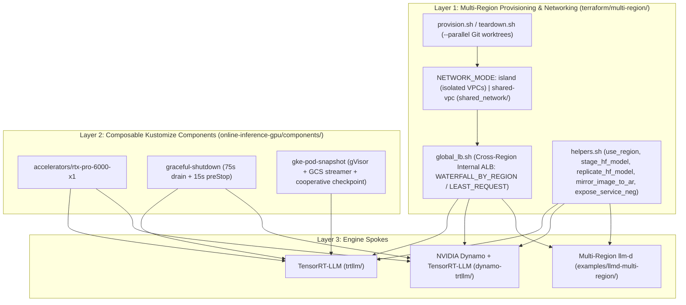

# Multi-region GKE inference foundation

> [!IMPORTANT]
>
> Dynamic Landscape: The field of AI inference is experiencing continuous, rapid
> evolution. This document is regularly updated to reflect the latest products,
> features, and architectural patterns across Google Cloud and Google Kubernetes
> Engine (GKE).
>
> Last Update: 2026-11-05 (YYYY-MM-DD)

This document is the shared multi-region infrastructure and lifecycle guide for
the
[GKE Inference reference architecture](/docs/platforms/gke/base/use-cases/inference-ref-arch/README.md).
It serves as the common foundation for the engine-specific reference
architectures and 15-minute live demo runbooks:

- **Spoke 1 — Standalone NVIDIA TensorRT-LLM (`trtllm/`)**:
  [NVIDIA TensorRT-LLM and Nemotron-3 reference architecture on multi-region GKE](/docs/platforms/gke/base/use-cases/inference-ref-arch/trtllm-nemotron3-reference-architecture.md)
  and its
  [15-minute Presenter Beat Sheet](/docs/platforms/gke/base/use-cases/inference-ref-arch/trtllm-poc-15min-demo-runbook.md).
- **Spoke 2 — Orchestrated NVIDIA Dynamo + TensorRT-LLM (`dynamo-trtllm/`)**:
  KV-cache-aware prefix routing, PCIe Gen5 host-DRAM KV offloading, and
  disaggregated Prefill/Decode serving
  (`dynamo-trtllm-reference-architecture.md`).
- **Spoke 3 — Multi-Region `llm-d` (`examples/llmd-multi-region/`)**: Endpoint
  Picker (EPP) routing, cross-region internal Application Load Balancer
  policies, and HPA + Pod snapshot scale-out.

All multi-region automation lives in
[`platforms/gke/base/use-cases/inference-ref-arch/terraform/multi-region/`](/platforms/gke/base/use-cases/inference-ref-arch/terraform/multi-region/README.md),
and shared workload building blocks live under
[`kubernetes-manifests/online-inference-gpu/components/`](/platforms/gke/base/use-cases/inference-ref-arch/kubernetes-manifests/online-inference-gpu/components).



---

## 1. Pre-flight capacity discovery & consumption diversity

Single-GPU (`TP=1`) inference replicas on **`g4-standard-48`** (`48` vCPUs,
`180 GiB` GCE VM memory / `176.9 GiB` Kubernetes node capacity / `175.4 GiB`
allocatable, `~43.8 GiB` ephemeral boot-disk storage, and
`1× NVIDIA RTX PRO 6000 Blackwell Server Edition` with `96 GB` GDDR7 /
`94.97 GiB` physical VRAM) avoid multi-GPU placement bottlenecks and allow each
regional cluster to consume whichever capacity pool is available.

Before running Terraform, audit zonal accelerator availability across your
candidate regions (see the
[AI inference proof-of-concept (PoC) and capacity-finding guide](/docs/platforms/gke/base/use-cases/inference-ref-arch/poc-capacity-and-rapid-deployment-guide.md)
for quota and Fluid Compute ring planning):

```shell
export PROJECT_ID="<YOUR_PROJECT_ID>"

gcloud compute accelerator-types list \
  --project="${PROJECT_ID}" \
  --filter="name=nvidia-rtx-pro-6000 AND zone:(us-central1-* europe-west2-* asia-southeast1-*)" \
  --format="table(name,zone.basename(),description)"
```

GKE's `gpu-rtx-pro-6000-96gb-x1` `ComputeClass` cascades automatically across
`Standard` (On-Demand), Dynamic Workload Scheduler (`FLEX_START`), and `Spot`
pools per region.

> [!TIP]
>
> **Declarative `activeMigration` control**: Built-in `ComputeClass` manifests
> default to `activeMigration.optimizeRulePriority: true`, replacing lower-tier
> (`FLEX_START` or `Spot`) nodes when higher-priority capacity opens. During
> benchmarks or one-shot `hf-model-to-gcs` Jobs (`backoffLimit: 0`), pass
> `ACTIVE_MIGRATION_ENABLED="false"` to `provision.sh` (its default) so
> `cluster_custom_compute_class_active_migration_enabled = false` renders
> `optimizeRulePriority: false` declaratively in Terraform without out-of-band
> `kubectl patch` drift.

---

## 2. Network modes & deterministic non-overlapping CIDR plan

[`terraform/multi-region/provision.sh`](/platforms/gke/base/use-cases/inference-ref-arch/terraform/multi-region/provision.sh)
supports two network topologies via `NETWORK_MODE` and two cluster modes via
`CLUSTER_MODE` (`autopilot`, the default for TensorRT-LLM and Dynamo, or
`standard`, used by `examples/llmd-multi-region/`):

| `NETWORK_MODE` | VPC Topology                                                                    | Cross-Region Pod / Proxy Connectivity                                                                | Cross-Region Internal ALB (`global_lb.sh`) |
| -------------- | ------------------------------------------------------------------------------- | ---------------------------------------------------------------------------------------------------- | ------------------------------------------ |
| `island`       | One isolated VPC per regional platform (`core/networking`), default             | None (zero cross-region fate-sharing; VPCs can be peered later because CIDRs do not overlap)         | No                                         |
| `shared-vpc`   | Single multi-region VPC (`<prefix>-<env>-vpc`) provisioned by `shared_network/` | Regional nodes, Pods, and `GLOBAL_MANAGED_PROXY` subnets reach backends on ports `8000, 8081, 19001` | **Yes**                                    |

Each target argument `<platform_name>:<region>[:<cidr_index>]` receives
deterministic RFC1918 ranges outside Google Cloud's `10.128.0.0/9` auto-mode
range via `mr_set_cidrs_for_index` in
[`helpers.sh`](/platforms/gke/base/use-cases/inference-ref-arch/terraform/multi-region/helpers.sh):

| Range                                        | Formula                | Index `0` (`americas`) | Index `1` (`europe`) | Index `2` (`apac`) |
| -------------------------------------------- | ---------------------- | ---------------------- | -------------------- | ------------------ |
| Node subnet                                  | `10.(16+4i).0.0/20`    | `10.16.0.0/20`         | `10.20.0.0/20`       | `10.24.0.0/20`     |
| `REGIONAL_MANAGED_PROXY` subnet              | `10.(16+4i).16.0/23`   | `10.16.16.0/23`        | `10.20.16.0/23`      | `10.24.16.0/23`    |
| `GLOBAL_MANAGED_PROXY` subnet (`shared-vpc`) | `10.(16+4i).18.0/23`   | `10.16.18.0/23`        | `10.20.18.0/23`      | `10.24.18.0/23`    |
| Control plane (`master_ipv4_cidr_block`)     | `172.16.0.(16+16i)/28` | `172.16.0.16/28`       | `172.16.0.32/28`     | `172.16.0.48/28`   |
| Pod secondary range                          | `10.(64+i).0.0/17`     | `10.64.0.0/17`         | `10.65.0.0/17`       | `10.66.0.0/17`     |
| Services secondary range                     | `10.96.(4i).0/22`      | `10.96.0.0/22`         | `10.96.4.0/22`       | `10.96.8.0/22`     |

> [!IMPORTANT]
>
> **Explicit CIDR indices for subset runs**: `cidr_index` defaults to the
> target's position (`0, 1, 2, ...`). When re-running or tearing down a subset
> of regions (for example only Europe), pass its original index explicitly
> (`"europe:europe-west2:1"`). `provision.sh` verifies existing subnet CIDRs and
> fails closed rather than replacing a live subnet and cluster.

---

## 3. Parallel worktree provisioning & state hygiene

With `--parallel`, `provision.sh` and `teardown.sh` execute every regional
platform concurrently inside an isolated Git worktree under
`${MR_WORK_DIR}/worktrees/<platform_name>` (default
`${HOME}/.acp-multi-region/<project>-<prefix>-<environment>`), bringing a
3-continent deployment down to single-region wall-clock time (`~20–25 minutes`):

- **Zero tracked-file or kubeconfig mutation**: Per-region configuration is
  passed exclusively via `TF_VAR_*` with `TF_VAR_terraform_write_tfvars=false`.
  Per-cluster credentials live at
  `platforms/gke/base/kubernetes/kubeconfig/${PROJECT_ID}-<prefix>-<platform_name>`;
  `${HOME}/.kube/config` is never overwritten.
- **Interactive shell targeting (`use_region`)**: Source `helpers.sh` and call
  `use_region <platform_name> <region> [<cidr_index>]` to export `KUBECONFIG`
  and regional `TF_VAR_*` variables in your current shell.

---

## 4. Container delivery (`GCFS` Image Streaming) & HNS model staging

### Artifact Registry image delivery (`3.885s` GCFS pull vs. `182.9s` external pull)

GKE Image Streaming (`GCFS`) streams container layers on demand in seconds, but
**only from Artifact Registry in the same project or organization**—never
directly from `nvcr.io`. Two patterns are supported:

1. **Server-side digest-pinned mirroring (`MIRROR_IMAGES` /
   `mirror_image_to_ar`)**: Copies an upstream digest-pinned image into each
   region's Artifact Registry repository using Cloud Build and a digest-pinned
   `crane` image (no local Docker daemon or disk space required).
2. **Cloud Build derived images (`terraform/images/gpu/*`)**: For images that
   require build-time plugin composition (such as `images/gpu/dynamo_trtllm`,
   which merges NIXL's `libplugin_POSIX.so` into `/opt/nixl-plugins` at build
   time so private GKE nodes need zero runtime `pip` downloads or `/tmp` shims),
   build once with Terraform into regional Artifact Registry and optionally
   mirror to peer regions with `mirror_image_to_ar`.

### Canonical Hugging Face staging & cross-region HNS Cloud Storage replication

Stage model weights once into your primary region's Hierarchical Namespace (HNS)
Cloud Storage bucket via `stage_hf_model` (which invokes the canonical
[`model-download/huggingface/download_apply.sh`](/test/scripts/platforms/gke/base/use-cases/inference-ref-arch/model-download/huggingface/download_apply.sh),
`download_wait.sh`, and `download_delete.sh` scripts and waits on
`job/${HF_MODEL_ID_HASH}-hf-model-to-gcs`), then replicate server-side to peer
regions with `replicate_hf_model`:

```shell
source "${ACP_REPO_DIR}/platforms/gke/base/use-cases/inference-ref-arch/terraform/multi-region/helpers.sh"
use_region "americas" "us-central1" 0

stage_hf_model "nvidia/NVIDIA-Nemotron-3-Nano-30B-A3B-NVFP4"
replicate_hf_model "americas" "europe" "nvidia/NVIDIA-Nemotron-3-Nano-30B-A3B-NVFP4"
replicate_hf_model "americas" "apac" "nvidia/NVIDIA-Nemotron-3-Nano-30B-A3B-NVFP4"
```

---

## 5. Cross-region internal Application Load Balancer (`global_lb.sh`)

When provisioned with `NETWORK_MODE="shared-vpc"`,
[`terraform/multi-region/global_lb.sh`](/platforms/gke/base/use-cases/inference-ref-arch/terraform/multi-region/global_lb.sh)
fronts any engine's regional Kubernetes `Service` (`trtllm-*`,
`dynamo-frontend-*`, or the `llm-d` router) with a single cross-region internal
Application Load Balancer and one private HTTP VIP (TCP port `80`, for example
`http://<vip>/v1/chat/completions`, forwarding to backend port `8000`) per
registered region:

1. **Once regional frontend Pods are scheduled, expose each regional frontend
   `Service` as a standalone NEG** (on GKE Autopilot, standalone zonal NEGs are
   created only in zones that currently have nodes):

   ```shell
   source "${ACP_REPO_DIR}/platforms/gke/base/use-cases/inference-ref-arch/terraform/multi-region/helpers.sh"
   for TARGET in "americas:us-central1:0" "europe:europe-west2:1" "apac:asia-southeast1:2"; do
     IFS=: read -r platform_name region idx <<<"${TARGET}"
     use_region "${platform_name}" "${region}" "${idx}"
     expose_service_neg "${platform_name}" "inf-${platform_name}-online-gpu" "<service_name>" "8000" "<backend_key>"
   done
   ```

2. **Apply the global backend policy (`WATERFALL_BY_REGION` + `LEAST_REQUEST` by
   default)**:

   ```shell
   cat > /tmp/backends.json << 'EOF'
   {
     "<backend_key>": {
       "health_check_path": "/health",
       "health_check_port": 8000,
       "max_in_flight_requests_per_endpoint": 16
     }
   }
   EOF

   NETWORK_MODE="shared-vpc" \
     "${ACP_REPO_DIR}/platforms/gke/base/use-cases/inference-ref-arch/terraform/multi-region/global_lb.sh" \
     apply --backends /tmp/backends.json --active "<backend_key>"

   NETWORK_MODE="shared-vpc" \
     "${ACP_REPO_DIR}/platforms/gke/base/use-cases/inference-ref-arch/terraform/multi-region/global_lb.sh" vips
   ```

   Traffic entering any regional VIP (`http://<vip>/v1/chat/completions`) stays
   in the closest healthy region until endpoints reach
   `max_in_flight_requests_per_endpoint` (or fail health checks) and then spills
   over automatically to the next closest region. Allow `~3–6 minutes` after the
   initial `global_lb.sh apply` for global Envoy proxy tables to finish
   programming across regional `GLOBAL_MANAGED_PROXY` subnets.

---

## 6. Composable workload components: Graceful shutdown & GKE Pod snapshots

Workloads under `online-inference-gpu/` share three orthogonal Kustomize
`Component` building blocks:

- **[`components/accelerators/rtx-pro-6000-x1`](/platforms/gke/base/use-cases/inference-ref-arch/kubernetes-manifests/online-inference-gpu/components/accelerators/rtx-pro-6000-x1)**:
  Attaches `cloud.google.com/compute-class: gpu-rtx-pro-6000-96gb-x1` and
  `nvidia.com/gpu: 1` strictly to `Deployment` objects labeled
  `app.kubernetes.io/component: model-server`.
- **[`components/graceful-shutdown`](/platforms/gke/base/use-cases/inference-ref-arch/kubernetes-manifests/online-inference-gpu/components/graceful-shutdown)**:
  Configures `terminationGracePeriodSeconds: 75` and a `15s` `preStop` drain
  hook so Service NEGs and load-balancer health checks stop sending new requests
  before the model server receives `SIGTERM`.
- **[`components/gke-pod-snapshot`](/platforms/gke/base/use-cases/inference-ref-arch/kubernetes-manifests/online-inference-gpu/components/gke-pod-snapshot)**:
  Transforms a single-GPU deployment into a GKE Sandbox (`gvisor`) `PodSnapshot`
  workload (`ENABLE_POD_SNAPSHOTS="true"`). On cold start,
  `checkpoint-wrapper.sh` streams weights from Cloud Storage into RAM-backed
  `/model` via `gcs_model_streamer.py`, waits for `/health`, executes one
  `/v1/chat/completions` warm-up request so lazy GPU kernels are compiled,
  deletes the staged `.safetensors` files from `/model`, and triggers
  `/proc/gvisor/checkpoint` (`postCheckpoint: resume`).
  - **HPA-aware snapshot scale-out**: Because `-podsnapshot` overlays retain the
    base `HorizontalPodAutoscaler`, scale out by raising the HPA's `minReplicas`
    (manual `kubectl scale` is reverted by the HPA controller within `~15s`).
    [`online-inference-gpu/measure_restore.sh`](/test/scripts/platforms/gke/base/use-cases/inference-ref-arch/online-inference-gpu/measure_restore.sh)
    automates this
    (`APP=<deployment_name> SERVED_MODEL_NAME=<model_id> measure_restore.sh 2`)
    and restores the original `minReplicas` on exit.

---

## Quick-start multi-region provisioning and teardown

All companion 15-minute Presenter Beat Sheets reference this section for **Part
1 (Pre-Demo Provisioning)** and **Part 3 (Post-Demo Teardown)**.

### Step 1: Clone repository & install checksum-verified CLI tools

[`bootstrap_tools.sh`](/platforms/gke/base/use-cases/inference-ref-arch/terraform/multi-region/bootstrap_tools.sh)
installs SHA-256 verified `terraform` (`1.14.8`), `kustomize` (`v5.8.3`), `jq`,
`sponge`, and `envsubst` into `${HOME}/.local/bin`:

```shell
if [[ -f "platforms/gke/base/use-cases/inference-ref-arch/terraform/deploy-ap.sh" ]]; then
  ACP_REPO_DIR="$(pwd)"
else
  ACP_REPO_DIR="${HOME}/accelerated-platforms"
  [[ -d "${ACP_REPO_DIR}" ]] || git clone https://github.com/GoogleCloudPlatform/accelerated-platforms.git "${ACP_REPO_DIR}"
  cd "${ACP_REPO_DIR}"
fi
export ACP_REPO_DIR
export PATH="${HOME}/bin:${HOME}/.local/bin:${HOME}/google-cloud-sdk/bin:${PATH}"

"${ACP_REPO_DIR}/platforms/gke/base/use-cases/inference-ref-arch/terraform/multi-region/bootstrap_tools.sh"
```

### Step 2: Provision regional GKE clusters in parallel (`~20–25 min`)

Set `NETWORK_MODE="shared-vpc"` when testing cross-region internal ALB failover
(or `"island"` for standalone VPCs) and `ENABLE_POD_SNAPSHOTS="true"` when
deploying `-podsnapshot` overlays:

```shell
export PROJECT_ID="<YOUR_PROJECT_ID>"
export HF_TOKEN="<YOUR_HUGGINGFACE_READ_TOKEN>"
export NETWORK_MODE="shared-vpc"

RING_TARGETS=(
  "americas:us-central1:0"
  "europe:europe-west2:1"
  "apac:asia-southeast1:2"
)

ENABLE_POD_SNAPSHOTS="true" \
ACTIVE_MIGRATION_ENABLED="false" \
MIRROR_IMAGES="${MIRROR_IMAGES:-}" \
  "${ACP_REPO_DIR}/platforms/gke/base/use-cases/inference-ref-arch/terraform/multi-region/provision.sh" \
  --parallel "${RING_TARGETS[@]}"
```

### Step 3: Tear down all regional and shared multi-region resources

[`teardown.sh`](/platforms/gke/base/use-cases/inference-ref-arch/terraform/multi-region/teardown.sh)
deletes `PodSnapshot` CRs, standalone NEGs, HNS buckets, `global_lb`,
`online_gpu`, regional GKE clusters, Artifact Registry repositories, and (when
removing the final registered platform) `shared_network`:

```shell
NETWORK_MODE="${NETWORK_MODE:-shared-vpc}" \
  "${ACP_REPO_DIR}/platforms/gke/base/use-cases/inference-ref-arch/terraform/multi-region/teardown.sh" \
  --parallel \
  "americas:us-central1:0" \
  "europe:europe-west2:1" \
  "apac:asia-southeast1:2"
```
