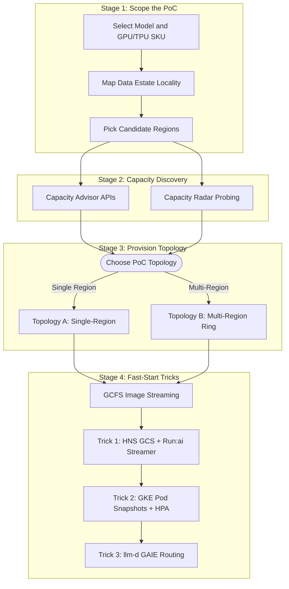
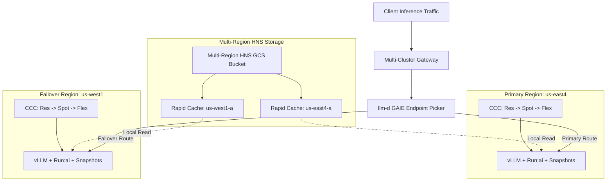

# AI inference proof-of-concept (PoC) and capacity-finding guide

> [!IMPORTANT]
>
> 🚀 Dynamic Landscape 🚀: The field of AI inference is experiencing continuous,
> rapid evolution. This document is regularly updated to reflect the latest
> products, features, and architectural patterns, ensuring it remains current
> with the advancements in AI, Google Cloud and Google Kubernetes Engine.
>
> Last Update: 2026-10-26 (YYYY-MM-DD)

This guide provides an end-to-end **Proof of Concept (PoC) playbook** for
bringing up production-grade AI inference deployments on Google Kubernetes
Engine (GKE) as quickly and reliably as possible. It builds on top of the
[GKE Inference reference architecture](/docs/platforms/gke/base/use-cases/inference-ref-arch/README.md),
the
[Fast-start inference reference architecture](/docs/platforms/gke/base/use-cases/inference-ref-arch/online-inference-gpu/vllm-fast-start-reference-architecture.md),
and the
[GKE Pod snapshots inference reference architecture](/docs/platforms/gke/base/use-cases/inference-ref-arch/online-inference-gpu/vllm-podsnapshots-reference-architecture.md).
For a copy-paste presenter script and talk track that provisions this stack from
scratch, see the companion
[15-minute live demo runbook](/docs/platforms/gke/base/use-cases/inference-ref-arch/poc-15min-demo-runbook.md).

## Purpose: Why inference PoCs stall and how to shorten time to value

When teams set out to run an AI inference PoC on GKE, the biggest delays rarely
come from Kubernetes manifests or model server flags. Instead, time-to-value is
dominated by three practical bottlenecks:

1. **Regional accelerator stock-outs and quota mismatches**: By default, single
   region configurations (such as `platform_default_region = "us-east4"`) target
   one region. If that region is experiencing temporary GPU or TPU stock-outs—or
   if the project lacks regional quota for the chosen consumption model—pods sit
   `Pending` with `ZONE_RESOURCE_POOL_EXHAUSTED` or `GCE quota exceeded` after
   you have already waited 15 to 20 minutes for cluster provisioning.
2. **Data gravity and cross-region storage friction**: Enterprise data estates
   already live in specific regions across **Cloud Storage (GCS)**, **Persistent
   Disk (PD) / Hyperdisk**, or **Google Cloud Managed Lustre**. Picking compute
   regions without accounting for where model weights, fine-tuned checkpoints,
   and evaluation datasets reside introduces slow weight transfers or
   cross-region egress costs.
3. **Compounding cold-start delays on every scale-out or preemption**: A
   conventional GPU replica spends several minutes pulling a multi-gigabyte
   container image, staging tens of gigabytes of weights onto local disk,
   loading tensors into GPU memory, and running `torch.compile` and CUDA graph
   capture. When using cost-optimized Spot VMs or Dynamic Workload Scheduler
   (DWS) Flex-Start nodes, every preemption or node recycle repeats this entire
   penalty unless fast-start and fast-restore primitives are enabled.

This guide solves all three problems by combining **pre-flight capacity
discovery and multi-region Fluid Compute** with every **fast-start and
fast-restore technique** in Accelerated Platforms:



### Summary of acceleration techniques in this repository

| Bottleneck                         | Accelerated Platforms Technique                                                                                                            | Measured Impact                                                                                                                                                             | Where It Is Configured                                                                                                                                                                                                                                |
| ---------------------------------- | ------------------------------------------------------------------------------------------------------------------------------------------ | --------------------------------------------------------------------------------------------------------------------------------------------------------------------------- | ----------------------------------------------------------------------------------------------------------------------------------------------------------------------------------------------------------------------------------------------------- |
| **Finding regional capacity**      | **Capacity Advisor APIs** + **[Capacity Radar](https://github.com/MG-Cafe/capacity_radar)** (passive advisory + active multi-zone probing) | Identifies zones with immediate Spot, DWS Flex-Start, DWS Calendar, or On-Demand obtainability before provisioning GKE                                                      | [Stage 2](#stage-2-discover-and-secure-capacity-before-you-deploy)                                                                                                                                                                                    |
| **Single-region stock-outs**       | **Custom Compute Classes (CCC)** + **Multi-Region Fluid Compute Ring**                                                                     | Automatically cascades across Reservations, On-Demand, DWS Flex-Start (7d/1d), and Spot VMs; fails over across regions via Multi-Cluster Gateway                            | [`platforms/gke/base/core/custom_compute_class`](/platforms/gke/base/core/custom_compute_class/templates/manifests/gpu)                                                                                                                               |
| **GPU node provisioning**          | **GKE Autopilot Fast-Starting Nodes** (eligible on `G2` L4 and `G4` RTX PRO 6000 on-demand/reserved nodes)                                 | Uses pre-initialized hardware on a best-effort basis at no extra cost to cut the 1–3 minute node bring-up window                                                            | Enabled automatically on compatible GKE Autopilot clusters                                                                                                                                                                                            |
| **Container image pull**           | **Google Container File System (GCFS) Image Streaming** (`imageStreaming.enabled: true`)                                                   | Reduces multi-gigabyte vLLM image pull from **~4 minutes to 1.3–2.3 seconds** on new nodes                                                                                  | Enabled in all GPU `ComputeClass` templates                                                                                                                                                                                                           |
| **Object storage QPS & egress**    | **Hierarchical Namespace (HNS) Cloud Storage** + **Zonal Rapid Cache** (`anywhere_cache`) + **`gcsfusecsi-serving` profile**               | Up to 8× higher initial QPS; **10.5–12.5s** per replica at 6× concurrent scale-out with **97–100% cache hit rate**; eliminates cross-region egress on cache hit             | [`huggingface/initialize/storage.tf`](/platforms/gke/base/core/huggingface/initialize/storage.tf) and `terraform/online_gpu/storage.tf`                                                                                                               |
| **Model weight loading**           | **NVIDIA Run:ai Model Streamer** (`--load-format=runai_streamer` direct from `gs://` to GPU VRAM) + **RAM-Backed GCS FUSE Prefetch**       | Streams **Gemma 3 27B** (`51.19 GiB`) in **9.1–19.2s** and **Gemma 4 31B** (`58.99 GiB`) in **11.1–25.7s** on RTX PRO 6000 and **20.1–25.8s** on H100 with zero disk        | [`online-inference-gpu/vllm-runai`](/platforms/gke/base/use-cases/inference-ref-arch/kubernetes-manifests/online-inference-gpu/vllm-runai)                                                                                                            |
| **Engine init & CUDA graphs**      | **GKE Pod Snapshots** (`runtimeClassName: gvisor` + cooperative `/proc/gvisor/checkpoint` trigger)                                         | Skips weight loading, `torch.compile`, and CUDA graph capture (`LOADING=0`); restores in **28.2s (L4)**, **54.8s (H100)**, and **80.4–84.0s (G4)** (up to **5.74×** faster) | [`vllm-podsnapshot-fast-restore`](/platforms/gke/base/use-cases/inference-ref-arch/kubernetes-manifests/online-inference-gpu/vllm-podsnapshot-fast-restore)                                                                                           |
| **Reactive autoscaling & routing** | **Queue-Depth HPA (`vllm:num_requests_waiting`)** + **`llm-d` Well-Lit Paths (GAIE `InferencePool` + EPP Router)**                         | Scales immediately when requests queue in vLLM; routes traffic based on live KV-cache utilization, prefix cache hits, and predicted latency                                 | [`vllm-runai/base/hpa.yaml`](/platforms/gke/base/use-cases/inference-ref-arch/kubernetes-manifests/online-inference-gpu/vllm-runai/base/hpa.yaml) and [`llmd`](/docs/platforms/gke/base/use-cases/inference-ref-arch/llmd/llmd-vllm-with-hf-model.md) |

---

## Stage 1: Scope your PoC hardware and align with your data estate

Before querying capacity or running Terraform, map your target model to the
appropriate accelerator SKU and identify the regions where your data estate
already resides.

### Step 1.1: Map your model to accelerator SKUs and Custom Compute Classes

The GKE Base Platform pre-installs Custom Compute Classes that encode fallback
priorities across consumption models. Choose the accelerator family that fits
your model's VRAM footprint and concurrency targets:

| Target Model Tier & Example Workloads                   | Accelerator Family                       | Machine Type(s)                    | Built-in `ComputeClass` Name                      | Consumption Models Supported                        | Fast-Start & Snapshot Capabilities                                                   |
| ------------------------------------------------------- | ---------------------------------------- | ---------------------------------- | ------------------------------------------------- | --------------------------------------------------- | ------------------------------------------------------------------------------------ |
| **Gemma 2 9B**, **Gemma 3 4B / 12B** (8B–12B class)     | **NVIDIA L4 (24 GB)**                    | `g2-standard-4` to `96`            | `gpu-l4-24gb-s4-x1` .. `gpu-l4-24gb-x8`           | On-Demand, Reservation, DWS Flex-Start, Spot        | Autopilot Fast-Starting Nodes eligible; Pod snapshots (`TP=1`) restores in **28.2s** |
| **Gemma 3 27B**, **Gemma 4 31B** (27B–35B single-GPU)   | **NVIDIA RTX PRO 6000 (96 GB)**          | `g4-standard-48` (1 GPU)           | `gpu-rtx-pro-6000-96gb-x1` (and `x2`, `x4`, `x8`) | On-Demand, Reservation, DWS Flex-Start, Spot        | Autopilot Fast-Starting Nodes eligible; Run:ai Streamer (**9–25s**); Pod snapshots   |
| **Gemma 2 9B**, **Gemma 3 27B**, **Gemma 4 31B**        | **NVIDIA H100 (80 GB)**                  | `a3-highgpu-1g` (1 GPU)            | `gpu-h100-80gb-high-x1`                           | On-Demand, Reservation, DWS Calendar/Flex, Spot     | Run:ai Streamer (**20–25s**); Pod snapshots (`TP=1`) restores in **36–56s**          |
| **Multi-GPU Tensor Parallel (`TP=2` / `TP=4`)**         | **NVIDIA H100 (4 × 80 GB)**              | `a3-highgpu-4g` (4 GPUs)           | `gpu-h100-80gb-high-x4`                           | On-Demand, Reservation, DWS Calendar/Flex, Spot     | Run:ai Streamer + `llm-d` well-lit paths (`TP=4`)                                    |
| **Multi-Replica Bin-Packed Gemma Fleet or Large MoE**   | **NVIDIA H100 High / Mega (8 × 80 GB)**  | `a3-highgpu-8g` / `a3-megagpu-8g`  | `gpu-h100-80gb-high-x8` / `gpu-h100-80gb-mega-x8` | On-Demand, Reservation, DWS Calendar/Flex, Spot     | Use `a3-megagpu-8g` (1600 Gbps vs. 800 Gbps east-west) when scaling multi-node       |
| **Ultra-Large Frontier Models (100B–400B+ parameters)** | **NVIDIA H200 (8 × 141 GB)** or **B200** | `a3-ultragpu-8g` / `a4-highgpu-8g` | `gpu-h200-141gb-ultra-x8`                         | Reservation, DWS Calendar (`DENSE`), DWS Flex, Spot | High HBM capacity per node; pair with Run:ai Streamer and `llm-d`                    |
| **Gemma 2 / Gemma 3 / Gemma 4 on Cloud TPU**            | **Cloud TPU v6e (Trillium)**             | `ct6e-standard-4t` / `8t`          | `tpu-v6e-2x2` / `tpu-v6e-2x4`                     | On-Demand, DWS Calendar, DWS Flex (Queued), Spot    | vLLM on TPU and `llm-d` P/D disaggregation well-lit paths                            |

> [!TIP]
>
> **Single-GPU sweet spot for rapid PoCs**: If your model fits in 80–96 GB of
> VRAM (such as **Gemma 4 31B** or **Gemma 3 27B**), targeting a single **NVIDIA
> RTX PRO 6000 96GB (`g4-standard-48`)** or single **NVIDIA H100 80GB
> (`a3-highgpu-1g`)** gives you the highest probability of immediate capacity
> obtainability and unlocks **GKE Pod snapshots** (which require
> `--tensor-parallel-size=1`).

### Step 1.2: Design a "Ring Around the World" around your data estate

Rather than betting your PoC on a single region, define a **Capacity Ring** of 2
to 4 regions where you can farm capacity elastically. GPU and TPU availability
fluctuates throughout the day with regional business hours and batch training
schedules; a ring lets you place workloads wherever obtainability is highest and
Spot preemption rates are lowest.

#### Example regional rings

- **Americas Ring**: `us-central1` $\leftrightarrow$ `us-east4`
  $\leftrightarrow$ `us-west1` $\leftrightarrow$ `us-south1`
- **Europe Ring**: `europe-west4` $\leftrightarrow$ `europe-west1`
  $\leftrightarrow$ `europe-west9`
- **Asia-Pacific Ring**: `asia-southeast1` $\leftrightarrow$ `asia-northeast1`
  $\leftrightarrow$ `asia-east1`
- **Global Follow-the-Sun Ring**: `us-central1` $\leftrightarrow$ `europe-west4`
  $\leftrightarrow$ `asia-southeast1`

#### Aligning your ring with existing data estates (GCS, PD/Hyperdisk, Managed Lustre)

Your choice of primary and secondary regions in the ring should be anchored by
where your enterprise data estate lives—whether model checkpoints, adapters, or
evaluation datasets are stored in **Cloud Storage**, **Persistent Disk /
Hyperdisk**, or **Google Cloud Managed Lustre**:

| Data Estate Source                                         | Data Gravity Scope                                                           | How to Architect for a Multi-Region Capacity Ring                                                                                                                                                                                                     | Recommended Loader in GKE                                                                                                                                      |
| ---------------------------------------------------------- | ---------------------------------------------------------------------------- | ----------------------------------------------------------------------------------------------------------------------------------------------------------------------------------------------------------------------------------------------------- | -------------------------------------------------------------------------------------------------------------------------------------------------------------- |
| **Google Cloud Storage (GCS)**                             | Regional, Dual-Region (`NAM4`, `EUR4`), or Multi-Region (`US`, `EU`, `ASIA`) | Create a **Multi-Region or Dual-Region bucket with Hierarchical Namespace (HNS)** enabled (`huggingface_hub_models_bucket_location = "US"`), and enable **Zonal Rapid Cache** (`anywhere_cache`) in each compute zone of your ring.                   | **NVIDIA Run:ai Model Streamer** (`--load-format=runai_streamer` over `gs://`) or **GKE Cloud Storage FUSE Profiles** (`storageClassName: gcsfusecsi-serving`) |
| **Persistent Disk (PD) / Hyperdisk ML**                    | Zonal or Regional                                                            | Use **Hyperdisk ML** (`ReadOnlyMany` multi-attach across up to thousands of nodes at up to 1.2 TB/s) in your **Primary Anchor Zone**. For overflow regions in your ring, export checkpoints to a Multi-Region GCS bucket with Zonal Rapid Cache.      | Direct block mount in the anchor zone; **Run:ai Model Streamer** + **GKE Pod Snapshots** in overflow ring regions                                              |
| **Google Cloud Managed Lustre** (or Parallel File Systems) | Zonal                                                                        | Make the Lustre zone your **Primary Ring Anchor** so GKE pods in that zone mount Lustre directly at hundreds of GB/s for zero-copy evaluation of newly trained checkpoints. Tier promoted checkpoints to Multi-Region GCS + Rapid Cache for the ring. | CSI Lustre mount in the primary zone; **Run:ai Model Streamer** or `gcsfusecsi-serving` in secondary ring regions when the Lustre zone is out of GPU capacity  |

> [!NOTE]
>
> **How Zonal Rapid Cache eliminates the multi-region storage penalty**: When
> you store weights in a multi-region Cloud Storage bucket (for example, `US`)
> and enable **Rapid Cache** (formerly Anywhere Cache) in the specific compute
> zones where your GPU nodes run (such as `us-east4-a` and `us-west1-a`), the
> first read miss ingests the model shards into a zonal SSD-backed cache.
> Subsequent replica scale-outs read from the local zone cache at up to 2.5 TB/s
> with a **>90–99% cache hit rate**, avoiding cross-region data transfer charges
> until the model weights are refreshed.

---

## Stage 2: Discover and secure capacity before you deploy

Never wait 20 minutes for a GKE cluster to provision before checking whether
your target region has accelerators available. Use a two-pronged approach:

1. **Approach A (Native Google Cloud Advisory & Quota Pre-Flight)**: Check
   hardware availability, project quotas, Spot obtainability, preemption rates,
   and pricing across your candidate ring using `gcloud`, the Google Cloud
   Console, and the Compute Engine Capacity Advisory REST APIs.
2. **Approach B (Automated Probing & Reservation Hunting with Capacity Radar)**:
   Use **[Capacity Radar](https://github.com/MG-Cafe/capacity_radar)** to sweep
   all regions in your ring simultaneously and actively probe or reserve
   capacity across consumption models (`on_demand`, `dws_calendar`, `dws_flex`,
   `spot`).

### Approach A: Native Google Cloud capacity discovery (`gcloud`, Console, and REST APIs)

#### 1. Run a multi-region offering and quota pre-flight check

Run the following script in Cloud Shell to verify which zones in your candidate
ring offer your target GPU and whether your project has sufficient regional
quota (including the `C4_CPUS` or `C3_CPUS` quota required by the
[`model-download` compute class](/platforms/gke/base/core/custom_compute_class/templates/manifests/cpu/custom-compute-model-download.yaml)):

```shell
export PROJECT_ID="<YOUR_PROJECT_ID>"
# Define your candidate "Ring Around the World" regions
export CANDIDATE_REGIONS=("us-central1" "us-east4" "us-west1" "europe-west4" "asia-southeast1")
# Example accelerator: nvidia-rtx-pro-6000, nvidia-h100-80gb, nvidia-h100-mega-80gb, nvidia-l4
export TARGET_ACCELERATOR="nvidia-rtx-pro-6000"

for REGION in "${CANDIDATE_REGIONS[@]}"; do
  echo "=========================================================="
  echo "Region: ${REGION}"
  echo "----------------------------------------------------------"
  echo "Zones offering ${TARGET_ACCELERATOR}:"
  gcloud compute accelerator-types list \
    --project="${PROJECT_ID}" \
    --filter="name:${TARGET_ACCELERATOR} AND zone ~ ${REGION}-" \
    --format="  value(zone.basename())" \
    --sort-by=zone

  echo "Regional GPU and host CPU quotas (METRIC / LIMIT / USAGE):"
  gcloud compute regions describe "${REGION}" \
    --project="${PROJECT_ID}" \
    --format="json" |
    jq -r '.quotas[] | select((.metric | test("GPUS|^(G4|A3|C4|C3)_CPUS$")) and .limit > 0) | "  \(.metric)\t\(.limit)\t\(.usage)"'
done

echo "=========================================================="
echo "Dimensional GPU Family Quotas (NVIDIA_RTX_PRO_6000, NVIDIA_H100, NVIDIA_H200, NVIDIA_B200):"
echo "----------------------------------------------------------"
gcloud alpha quotas info list \
  --project="${PROJECT_ID}" \
  --service="compute.googleapis.com" \
  --filter="metric ~ gpus_per_gpu_family" \
  --format="yaml(metric,dimensionsInfos)"
```

> [!IMPORTANT]
>
> **Also check dimensional GPU family quotas**: Newer accelerator families (RTX
> PRO 6000, H100, H200, B200) are also governed by dimensional Cloud Quotas
> (`compute.googleapis.com/gpus_per_gpu_family` and
> `compute.googleapis.com/preemptible_gpus_per_gpu_family` scoped by
> `gpu_family` and `region`), which the region-level quota list does not fully
> reflect. Always run the `gcloud alpha quotas info list` command above to
> confirm your regional `gpu_family` limit before deploying.

#### 2. Evaluate regional price vs. preemption trade-offs in Capacity Advisor

Before provisioning clusters, open Google Cloud Console's
**[Capacity Advisor](https://console.cloud.google.com/compute/capacityAdvisor)**
or the interactive chat interface in
**[Compute Advisor](https://console.cloud.google.com/compute/advisor/)** to
compare zonal obtainability, historical Spot preemption rates, and hourly Spot
pricing across your ring.

As demonstrated in the
[Fluid Compute reference guide](https://discuss.google.dev/t/how-to-build-an-elastic-scalable-llm-inference-platform-on-gke-using-fluid-compute/388108),
comparing two regions in an Americas ring (`us-east4` vs. `us-west1`) for an A3
Mega (`a3-megagpu-8g`, 8 × H100) Spot footprint reveals complementary
characteristics:

| Region         | Zonal Capacity Availability                 | Historical Spot Preemption Rate | Example Spot Price (`a3-megagpu-8g`) | Role in a "Ring Around the World" Architecture                                                |
| -------------- | ------------------------------------------- | ------------------------------- | ------------------------------------ | --------------------------------------------------------------------------------------------- |
| **`us-east4`** | `us-east4-a` (High), `us-east4-c` (High)    | **6 – 10%** _(Moderate)_        | **`$21.70` / hr**                    | **Cost-Optimized Primary Fleet**: ~59% lower hourly cost, ideal for primary serving traffic   |
| **`us-west1`** | `us-west1-a` (High), `us-west1-b` (Limited) | **0 – 5%** _(Very Low)_         | **`$53.35` / hr**                    | **High-Stability Backup Fleet**: Low preemption risk, ideal for elastic cross-region failover |

By combining a cost-optimized primary region with a high-stability secondary
region in your ring, you capture Spot cost savings while insulating your PoC and
serving SLOs from regional preemptions.

#### 3. Query the Compute Engine Capacity & Calendar Advisory APIs directly

You can also query Google Cloud's Capacity Advisory endpoints programmatically
from your shell across your candidate ring:

- **Spot VM Capacity Advisory API (`advice/capacity`)** — returns per-zone
  `obtainability` scores (`0.0` to `1.0`) and `uptimeScore` (preemption risk):

  ```shell
  export PROJECT_ID="<YOUR_PROJECT_ID>"
  export MACHINE_TYPE="a3-highgpu-1g" # e.g., a3-highgpu-1g, a3-highgpu-8g, g4-standard-48

  for REGION in us-central1 us-east4 us-west1 europe-west4; do
    echo "=== Spot Advisory: ${REGION} (${MACHINE_TYPE}) ==="
    curl --silent -X POST \
      -H "Authorization: Bearer $(gcloud auth print-access-token)" \
      -H "Content-Type: application/json" \
      "https://compute.googleapis.com/compute/alpha/projects/${PROJECT_ID}/regions/${REGION}/advice/capacity" \
      -d '{
        "distributionPolicy": {"targetShape": "ANY_SINGLE_ZONE"},
        "instanceFlexibilityPolicy": {
          "instanceSelections": {
            "selection-1": {"machineTypes": ["'"${MACHINE_TYPE}"'"]}
          }
        },
        "instanceProperties": {
          "scheduling": {"provisioningModel": "SPOT"}
        },
        "size": 1
      }' | jq -r '.recommendations[]? | .scores as $s | .shards[]? | "  Zone: \(.zone | split("/")[-1]) | Obtainability: \($s.obtainability // "N/A") | UptimeScore: \($s.uptimeScore // "N/A")"'
  done
  ```

  > [!NOTE]
  >
  > For `G2` (`g2-standard-*` with `nvidia-l4`) and `N1` (`nvidia-tesla-t4`)
  > machine types, include
  > `"guestAccelerators": [{"acceleratorType": "nvidia-l4", "acceleratorCount": 1}]`
  > inside `instanceProperties` so the API checks GPU availability rather than
  > host CPU availability alone.

- **DWS Calendar Mode Advisory (`advice/calendarMode`)** — finds optimal zones
  and future reservation windows for `A3`, `A4`, and `TPU v5e/v5p/v6e` capacity:

  ```shell
  gcloud beta compute advice calendar-mode \
    --project="${PROJECT_ID}" \
    --region="us-central1" \
    --machine-type="a3-highgpu-8g" \
    --vm-count=1 \
    --start-time="$(date -u -d '+1 day' +%Y-%m-%dT00:00:00Z)" \
    --end-time="$(date -u -d '+8 days' +%Y-%m-%dT00:00:00Z)" \
    --format=json
  ```

---

### Approach B: Automated multi-region probing and reservation hunting with Capacity Radar

Advisory APIs provide statistical scores (and some endpoints such as DWS
Flex-Start wait-time advisory require Preview project allow-listing). When you
want an authoritative answer—or want to **automatically hunt for and lock in
capacity across multiple regions and consumption models**—use
**[Capacity Radar](https://github.com/MG-Cafe/capacity_radar)**.

Capacity Radar is an open-source tool built for Google Cloud GPU and TPU
workloads that provides two core capabilities:

1. **Multi-Region Capacity Advisories (Read-Only)**:
   - **Spot VM Advisory**: Queries obtainability and preemption risk across all
     candidate regions in parallel.
   - **DWS Calendar Advisory & Split-Plan Finder (`calendar-plan`)**: Queries
     Calendar Mode availability at **100%, 75%, 50%, 25%, and 1-VM levels** in
     parallel to show how a multi-node request can be split across smaller
     reservations or zones when a single contiguous block is unavailable.
   - **DWS Flex-Start Advisory** _(Preview for allow-listed projects)_:
     Estimates queue wait duration (`estimatedWaitDuration`) per zone shard.
2. **Priority-Based Active Scan & Deploy (`hunter.py`)**:
   - Attempts real allocations across candidate zones in **Sequential** or
     **Parallel** mode following a customizable priority chain (`on_demand`
     reservation $\rightarrow$ `dws_calendar` future reservation $\rightarrow$
     `dws_flex` $\rightarrow$ `spot`), polls the Compute Engine or TPU zone
     operations until `DONE`, and returns the exact zone and consumption model
     where capacity was secured.

#### Three ways to use Capacity Radar in your PoC workflow

You can run Capacity Radar from its **portable CLI**, its **interactive Web UI**
(locally or on Cloud Run), or as an **AI Agent Skill** alongside the skills in
this repository.

##### Option 1: Run the Capacity Radar CLI in Cloud Shell (Recommended for fast PoCs)

1. Clone Capacity Radar alongside `accelerated-platforms` and install its
   lightweight Python dependencies:

   ```shell
   git clone https://github.com/MG-Cafe/capacity_radar.git "${HOME}/capacity_radar"
   pip install -r "${HOME}/capacity_radar/backend/requirements.txt"
   ```

2. Verify authentication, project access, and supported zones for your target
   chip:

   ```shell
   export PROJECT_ID="<YOUR_PROJECT_ID>"
   export CR_CLI="${HOME}/capacity_radar/skills/capacity-radar/scripts/capacity_radar.py"

   # Verify ADC credentials and Compute Engine API status
   python3 "${CR_CLI}" auth check --project "${PROJECT_ID}"

   # List all supported GPU/TPU chips and machine types
   python3 "${CR_CLI}" catalog chips

   # List all zones offering your target machine type (e.g., g4-standard-48 or a3-highgpu-1g)
   python3 "${CR_CLI}" catalog zones --machine-type g4-standard-48
   ```

3. Sweep your "Ring Around the World" regions with read-only advisories:

   ```shell
   # 1. Multi-region Spot obtainability and preemption risk sweep
   python3 "${CR_CLI}" advise spot \
     --project "${PROJECT_ID}" \
     --machine-type g4-standard-48 \
     --regions us-central1,us-east4,europe-west4,asia-south2

   # 2. DWS Calendar availability + automatic Split-Plan (100%, 75%, 50%, 25%, 1 VM)
   # Note: DWS Calendar Mode supports A3 (a3-*), A4 (a4-*), and Cloud TPU families.
   python3 "${CR_CLI}" advise calendar-plan \
     --project "${PROJECT_ID}" \
     --machine-type a3-highgpu-8g \
     --vm-count 4 \
     --start-date "$(date -u -d '+1 day' +%Y-%m-%d)" \
     --flexibility-days 2 \
     --duration-days 7 \
     --regions us-central1,us-east4,us-west1,europe-west4

   # 3. DWS Flex-Start queue wait-time estimate (for Preview allow-listed projects;
   # DWS Flex-Start VM provisioning itself works on all projects without allow-listing)
   python3 "${CR_CLI}" advise flex \
     --project "${PROJECT_ID}" \
     --machine-type g4-standard-48 \
     --size 2 \
     --max-run-hours 24 \
     --regions us-central1,us-east4,europe-west4
   ```

   **Example output from `advise spot` (`g4-standard-48` / NVIDIA RTX
   PRO 6000)**: Running the command above reveals when the repository's default
   region (`us-east4`) is experiencing a temporary Spot stock-out while peer
   regions in the ring have high availability:

   | Region (`advise spot`) | Zones Returned                              | `spotAvailability` | `preemptionRate` | `obtainability` | `uptimeScore` (`estimatedUptime`) | PoC Placement Decision                                                        |
   | ---------------------- | ------------------------------------------- | ------------------ | ---------------- | --------------- | --------------------------------- | ----------------------------------------------------------------------------- |
   | **`us-east4`**         | `us-east4-a`, `us-east4-b`, `us-east4-c`    | `VERY_LOW`         | `HIGH`           | **`0.1`**       | `0.2` (`60s`)                     | **Avoid for this PoC window** (default region would stall in `Pending`)       |
   | **`us-central1`**      | `us-central1-b`, `us-central1-c` (`-a` low) | **`HIGH`**         | **`LOW`**        | **`0.9`**       | **`0.9`** (`86400s`)              | **Selected Primary Region** (paired with 32-GPU `NVIDIA_RTX_PRO_6000` quota)  |
   | **`europe-west4`**     | `europe-west4-a`, `europe-west4-c`          | **`HIGH`**         | **`LOW`**        | **`0.9`**       | **`0.9`** (`86400s`)              | **High-Availability Ring Peer** (request regional GPU family quota if needed) |
   | **`asia-south2`**      | `asia-south2-a`, `asia-south2-b`, `-c`      | **`HIGH`**         | **`LOW`**        | **`0.9`**       | **`0.9`** (`86400s`)              | **APAC Ring Peer**                                                            |

4. **Active Probing / Reservation Hunting (`deploy`)**: How you use `deploy`
   depends on whether you want to **reserve capacity for GKE** or **probe live
   Spot/Flex availability**:

   - **Workflow A — Reserve capacity for GKE Custom Compute Classes**: Run a
     priority scan with `on_demand` (immediate On-Demand Reservation) and/or
     `dws_calendar`. When Capacity Radar secures an On-Demand Reservation in a
     winning zone, **keep the reservation**! The Custom Compute Classes in
     `accelerated-platforms` specify `reservations.affinity: AnyBestEffort` as
     their top active rule (and include a Specific Reservation block), so your
     GKE cluster in that region will automatically consume the reservation to
     schedule your vLLM nodes.

     ```shell
     # Preview the deployment plan first (without --yes, no resources are created)
     python3 "${CR_CLI}" deploy \
       --project "${PROJECT_ID}" \
       --machine-type a3-highgpu-1g \
       --vm-count 2 \
       --priority on_demand:us-central1-a,us-central1-b,us-east4-a,us-east4-c,europe-west4-b \
       --name-prefix poc-ira

     # Add --yes once you are ready to lock in the reservation
     ```

   - **Workflow B — Active Spot / Flex-Start probe to pick your GKE region**: If
     your PoC relies on Spot VMs or DWS Flex-Start (or if Advisory APIs are not
     allow-listed on your project), run `deploy` with `--vm-count 1` and
     `--parallel` across candidate zones to see which zone provisions a real GPU
     VM first:

     ```shell
     python3 "${CR_CLI}" deploy \
       --project "${PROJECT_ID}" \
       --machine-type g4-standard-48 \
       --vm-count 1 \
       --priority spot:us-central1-a,us-east4-a,us-west1-a,europe-west4-b \
       --priority dws_flex:us-central1-a,us-east4-a,europe-west4-b \
       --parallel \
       --name-prefix poc-probe \
       --yes
     ```

     Once the output JSON reports `"status": "success"` and identifies the
     winning `zone` and `region` (for example, `europe-west4-b`), **delete the
     standalone probe VM** so it does not consume your GPU quota, and deploy
     your GKE cluster into that winning region:

     ```shell
     gcloud compute instances delete <PROBE_VM_NAME> \
       --zone="<WINNING_ZONE>" \
       --project="${PROJECT_ID}" \
       --quiet
     ```

##### Option 2: Run the Capacity Radar Web UI (Local or Cloud Run)

For interactive visual exploration across GPU/TPU families, start the FastAPI +
React application locally in Cloud Shell (with Web Preview on port `8000`) or
deploy it to Cloud Run in bring-your-own-credentials mode (`AUTH_MODE=user`,
where the Cloud Run service account holds zero IAM permissions and each user
pastes their own `gcloud auth print-access-token`):

```shell
cd "${HOME}/capacity_radar/frontend" && npm install && npm run build
cd "${HOME}/capacity_radar/backend" && python3 main.py
```

##### Option 3: Combine the Capacity Radar Agent Skill with Accelerated Platforms Skills

Both `capacity_radar` and `accelerated-platforms` ship with AI Agent Skills
(`SKILL.md`) designed for agentic IDEs (such as Google Antigravity, Gemini CLI,
or Claude Code):

- **`capacity_radar/skills/capacity-radar/SKILL.md`**: Authenticates, discovers
  GPU/TPU SKUs, runs multi-region advisories, and executes priority-based
  capacity hunts.
- **[`skills/gke-inference-stack-deploy/SKILL.MD`](/skills/gke-inference-stack-deploy/SKILL.MD)**:
  Configures `platform.auto.tfvars` and `cluster.auto.tfvars` and deploys the
  GKE Base Platform and `online_gpu` / `online_tpu` terraservices.
- **[`skills/llm-d-deploy-stack/SKILL.MD`](/skills/llm-d-deploy-stack/SKILL.MD)**,
  **[`skills/llm-d-workload-tuner/SKILL.MD`](/skills/llm-d-workload-tuner/SKILL.MD)**,
  and
  **[`skills/llm-d-benchmarking/SKILL.MD`](/skills/llm-d-benchmarking/SKILL.MD)**:
  Deploys, tunes, and benchmarks `llm-d` well-lit inference paths on the
  provisioned cluster.

Installing `capacity_radar/skills/capacity-radar` alongside the skills in this
repository allows your agent to find the region with the best GPU capacity and
immediately provision the GKE inference stack into that region in a single
conversation.

---

## Stage 3: Provision the GKE Inference Platform in your winning region(s)

Once Stage 2 identifies your target region(s) and zone(s), choose between two
deployment topologies:

- **[Topology A: Single-Region Fluid Compute PoC](#topology-a-single-region-fluid-compute-poc-fastest-setup)**:
  Deploy one regional GKE cluster in the highest-obtainability region, using
  Custom Compute Classes to cascade across Reservations, On-Demand, DWS
  Flex-Start, and Spot VMs across all zones in that region.
- **[Topology B: Multi-Region "Ring Around the World" Fluid Compute Fleet](#topology-b-multi-region-ring-around-the-world-fluid-compute-fleet)**:
  Deploy two or more regional GKE clusters across your ring (for example, a
  cost-optimized primary region + a low-preemption failover region) sharing a
  Multi-Region Cloud Storage bucket with Zonal Rapid Cache and fronted by a
  Multi-Cluster GKE Inference Gateway with `llm-d` Endpoint Picker routing.

### Topology A: Single-region Fluid Compute PoC (Fastest setup)

1. Set the repository path and your winning region and zones from Stage 2:

   ```shell
   export ACP_REPO_DIR="$(pwd)"
   export PROJECT_ID="<YOUR_PROJECT_ID>"
   export WINNING_REGION="<WINNING_REGION>" # e.g., europe-west4, us-central1, us-east4
   export PLATFORM_NAME="poc"
   ```

2. Configure the platform and cluster Terraform variables to use your winning
   region instead of the default `us-east4`:

   ```shell
   cat <<EOF > "${ACP_REPO_DIR}/platforms/gke/base/_shared_config/platform.auto.tfvars"
   platform_default_project_id = "${PROJECT_ID}"
   platform_default_region     = "${WINNING_REGION}"
   platform_name               = "${PLATFORM_NAME}"
   EOF

   # cluster.auto.tfvars is generated by core/initialize (and container_cluster_ap
   # sets cluster_autopilot_enabled = true in it), so update only its
   # cluster_region line in place (a fresh checkout has no such line yet).
   sed -i "s/^\(cluster_region[[:blank:]]*=\).*/\1 \"${WINNING_REGION}\"/" \
     "${ACP_REPO_DIR}/platforms/gke/base/_shared_config/cluster.auto.tfvars"

   # If this checkout already deployed another region, point core/initialize at
   # this region's Terraform state (if it exists) instead of the previous
   # region's; otherwise remove backend.tf so core/deploy.sh creates the bucket.
   CORE_INIT_DIR="${ACP_REPO_DIR}/platforms/gke/base/core/initialize"
   TF_STATE_BUCKET="${PROJECT_ID}-inf-${PLATFORM_NAME}-terraform"
   rm -rf "${CORE_INIT_DIR}/.terraform" "${CORE_INIT_DIR}/terraform.tfstate"*
   if gcloud storage ls "gs://${TF_STATE_BUCKET}/terraform/core/initialize/default.tfstate" >/dev/null 2>&1; then
     sed "s/^\([[:blank:]]*bucket[[:blank:]]*=\).*$/\1 \"${TF_STATE_BUCKET}\"/" \
       "${CORE_INIT_DIR}/backend.tf.bucket" >"${CORE_INIT_DIR}/backend.tf"
   else
     rm -f "${CORE_INIT_DIR}/backend.tf"
   fi
   ```

3. _(Optional)_ If you secured a **named Specific Reservation** with Capacity
   Radar in Stage 2:

   - By default, the Custom Compute Classes in
     [`platforms/gke/base/core/custom_compute_class/templates/manifests/gpu`](/platforms/gke/base/core/custom_compute_class/templates/manifests/gpu)
     use `reservations.affinity: AnyBestEffort` as their first active priority,
     which automatically consumes any matching unattached reservation in the
     zone.
   - If you created a `Specific` reservation
     (`--reservation-affinity=specific`), uncomment the top priority rule in the
     corresponding template (for example,
     [`custom-compute-gpu-h100-80gb-high-x1.yaml`](/platforms/gke/base/core/custom_compute_class/templates/manifests/gpu/h100-80gb/custom-compute-gpu-h100-80gb-high-x1.yaml#L28-L41))
     and set `name: <YOUR_RESERVATION_NAME>` before deploying.

4. Deploy the GKE Inference reference implementation (Autopilot is recommended
   for most PoCs and enables **Fast-Starting Nodes** for eligible `G2` L4 and
   `G4` RTX PRO 6000 workloads; use Standard if you need custom node-level
   DaemonSets or explicit Kubelet graceful shutdown configs):

   - **GKE Autopilot**:

     ```shell
     "${ACP_REPO_DIR}/platforms/gke/base/use-cases/inference-ref-arch/terraform/deploy-ap.sh"
     ```

   - **GKE Standard**:

     ```shell
     "${ACP_REPO_DIR}/platforms/gke/base/use-cases/inference-ref-arch/terraform/deploy-standard.sh"
     ```

5. _(Optional)_ Configure **Zonal Rapid Cache** in the winning GPU zones before
   applying `terraform/online_gpu` (recommended if you will scale out to 4+
   concurrent replicas or use a multi-region bucket):

   ```shell
   # Replace with the winning zone(s) in your region from Stage 2
   export RAPID_CACHE_ZONES='["'"${WINNING_REGION}"'-a", "'"${WINNING_REGION}"'-b"]'
   sed -i "/^ira_online_gpu_rapid_cache_zones[[:blank:]]*=/{h;s|=.*|= ${RAPID_CACHE_ZONES}|};\${x;/^$/{s|.*|ira_online_gpu_rapid_cache_zones = ${RAPID_CACHE_ZONES}|;H};x}" \
     "${ACP_REPO_DIR}/platforms/gke/base/use-cases/inference-ref-arch/terraform/_shared_config/inference-ref-arch.auto.tfvars"
   ```

6. Deploy the `online_gpu` (and/or `online_tpu`) terraservice (passing
   `-var="ira_online_gpu_pod_snapshots_enabled=true"` if you plan to use GKE Pod
   snapshots so Terraform creates the dedicated `*-pod-snapshots` HNS bucket
   with soft delete disabled and grants `roles/storage.objectUser` to the
   workload service account and GKE service agent):

   ```shell
   export TF_PLUGIN_CACHE_DIR="${ACP_REPO_DIR}/.terraform.d/plugin-cache"
   cd "${ACP_REPO_DIR}/platforms/gke/base/use-cases/inference-ref-arch/terraform/online_gpu" && \
   rm -rf .terraform/ terraform.tfstate* && \
   terraform init && \
   terraform plan -input=false -var="ira_online_gpu_pod_snapshots_enabled=true" -out=tfplan && \
   terraform apply -input=false tfplan && \
   rm tfplan
   ```

---

### Topology B: Multi-region "Ring Around the World" Fluid Compute fleet

When a single region cannot satisfy your capacity needs—or when you want to run
primarily on low-cost Spot VMs in a cheaper region (such as `us-east4`) with
automatic, zero-downtime failover to a low-preemption backup region (such as
`us-west1` or `europe-west4`)—combine the
[Fluid Compute multi-cluster pattern](https://discuss.google.dev/t/how-to-build-an-elastic-scalable-llm-inference-platform-on-gke-using-fluid-compute/388108)
with Accelerated Platforms:



#### Key primitives of the Multi-Region Ring

1. **Shared Multi-Region HNS Bucket + Zonal Rapid Caches**:

   - In `platforms/gke/base/_shared_config/huggingface.auto.tfvars`, set
     `huggingface_hub_models_bucket_location = "US"` (or `"EU"`, `"ASIA"`) when
     deploying the first cluster in your ring so the Hierarchical Namespace
     model bucket is created as a multi-region bucket.
   - When deploying subsequent clusters in the ring (using a distinct
     `platform_name` per region, such as `americas` and `europe`), set
     `huggingface_hub_models_bucket_name` to point to the existing shared
     multi-region bucket, and set `ira_online_gpu_rapid_cache_zones` to each
     cluster's local GPU zones.
   - Alternatively, if you mount the bucket via Cloud Storage FUSE instead of
     the Run:ai Model Streamer, use a `PersistentVolume` with
     `storageClassName: gcsfusecsi-serving` and
     `gcsfuseMetadataPrefetchOnMount: "true"`, which automatically applies the
     GKE `aiml-serving` FUSE profile tuned for your node's RAM and local NVMe.

2. **Extended 120-Second Graceful Node Shutdown for Spot VMs**:

   - By default, Spot VMs provide a 30-second preemption notice. On GKE Standard
     node pools, applying a `kubeletConfig` with
     `shutdownGracePeriodSeconds: 120` extends the preemption window to **2
     minutes**:

     ```yaml
     # kubelet-config.yaml
     kubeletConfig:
       shutdownGracePeriodSeconds: 120
       shutdownGracePeriodCriticalPodsSeconds: 30
     ```

   - **Why 120 seconds matters with GKE Pod snapshots**: A replacement vLLM
     replica restored from a GKE Pod snapshot answers its first request in **28
     to 56 seconds** once scheduled. Extending the Spot shutdown grace period to
     120 seconds gives GKE and the Multi-Cluster Inference Gateway substantially
     more runway to drain in-flight token streams and bring up a replacement
     replica on a fallback Spot, DWS Flex-Start, or secondary-region node before
     the preempting VM terminates.

3. **Custom Compute Class with `capacityCheckWaitTimeSeconds` for DWS
   Flex-Start**:

   - Inside each cluster in the ring, the `ComputeClass` cascades from
     Reservations to Spot and DWS Flex-Start (setting
     `capacityCheckWaitTimeSeconds: 300` so GKE waits up to 5 minutes in the DWS
     queue before falling back to the next priority or machine series, such as
     falling back from `a3-highgpu-8g` to `a3-megagpu-8g`).

4. **Multi-Cluster GKE Inference Gateway (`gke-l7-rilb-mc`) + `llm-d` GAIE
   Endpoint Picker**:
   - Allocate non-colliding `REGIONAL_MANAGED_PROXY` subnets in each ring region
     (for example, `172.23.1.0/24` in `us-west1` and `172.23.2.0/24` in
     `us-east4`).
   - Export the vLLM `Service` in each member cluster using
     `kind: ServiceExport` (`net.gke.io/v1`) and attach a `HealthCheckPolicy`
     (`/health` on port `8000`) and `GCPBackendPolicy` (`timeoutSec: 600`) to
     both `ServiceImport` and `ServiceExport`.
   - Deploy the Gateway API Inference Extension (`InferencePool` + Endpoint
     Picker `EPP`) and bind an `HTTPRoute` on the `gke-l7-rilb-mc` `Gateway` to
     the `InferencePool`. Traffic is routed with KV-cache and queue-depth
     awareness across healthy pods and automatically fails over across regions
     when Spot capacity in one region is reclaimed.

---

## Stage 4: Turn on all fast-start and fast-restore tricks

With your cluster running in a region that has verified accelerator capacity,
use the three workload patterns in this repository to eliminate startup,
scale-out, and routing bottlenecks.

### Trick 1: Stream weights directly to GPU VRAM with NVIDIA Run:ai Model Streamer (`vllm-runai`)

Instead of staging 50–70 GiB of safetensors onto local disk or streaming
sequentially through a filesystem, the
[Fast-start inference reference architecture](/docs/platforms/gke/base/use-cases/inference-ref-arch/online-inference-gpu/vllm-fast-start-reference-architecture.md)
uses `--load-format=runai_streamer` to read tensors concurrently from your
Hierarchical Namespace Cloud Storage bucket (`gs://`) directly into host memory
buffers and across PCIe into GPU memory.

- **Measured weight load times**:
  - **Gemma 3 27B** (`google/gemma-3-27b-it`, `51.54 GiB`): **9.1 s** median on
    NVIDIA RTX PRO 6000 96GB
  - **Gemma 4 31B** (`google/gemma-4-31b-it`, `58.99 GiB`): **11.1 – 25.7 s** on
    NVIDIA RTX PRO 6000 96GB, **20.1 – 25.8 s** on NVIDIA H100 80GB

#### Quick-start deployment commands

1. Stage your chosen Gemma model into the Hierarchical Namespace Cloud Storage
   bucket using the in-cluster downloader Job:

   ```shell
   export HF_MODEL_ID="google/gemma-4-31b-it" # or google/gemma-3-27b-it
   source "${ACP_REPO_DIR}/platforms/gke/base/use-cases/inference-ref-arch/terraform/_shared_config/scripts/set_environment_variables.sh"
   "${ACP_REPO_DIR}/platforms/gke/base/use-cases/inference-ref-arch/kubernetes-manifests/model-download/configure_huggingface.sh"
   kubectl apply --kustomize "${ACP_REPO_DIR}/platforms/gke/base/use-cases/inference-ref-arch/kubernetes-manifests/model-download/huggingface"
   # Fail fast if the backoffLimit: 0 Job fails instead of waiting 30 minutes
   NS="${huggingface_hub_downloader_kubernetes_namespace_name}"
   JOB="job/${HF_MODEL_ID_HASH}-hf-model-to-gcs"
   until kubectl -n "${NS}" wait --for=condition=complete --timeout=15s "${JOB}" >/dev/null 2>&1; do
     if kubectl -n "${NS}" wait --for=condition=failed --timeout=1s "${JOB}" >/dev/null 2>&1; then
       echo "${JOB} failed:" && kubectl -n "${NS}" logs "${JOB}" --tail=30
       break
     fi
     kubectl -n "${NS}" get pods -l app=hf-model-to-gcs --no-headers
   done
   kubectl delete --ignore-not-found --kustomize "${ACP_REPO_DIR}/platforms/gke/base/use-cases/inference-ref-arch/kubernetes-manifests/model-download/huggingface"
   ```

   > [!NOTE]
   >
   > The downloader Job runs on the `model-download` `ComputeClass`
   > (`c4-standard-4-lssd`, then `c3-standard-4-lssd`). Some regions (such as
   > `asia-south2`) offer no `C3` `-lssd` machine types, so the Job stays
   > `Pending` unless the project has `C4_CPUS` quota there. In addition,
   > `activeMigration.optimizeRulePriority: true` can scale down a `C3` node
   > mid-download to retry `C4`, which fails the `backoffLimit: 0` Job. Before
   > staging, remove active migration from the class:
   >
   > ```shell
   > kubectl patch computeclass model-download --type=merge \
   >   -p='{"spec":{"activeMigration":null}}'
   > ```
   >
   > In a multi-region ring, stage the weights once in a region with `C3`/`C4`
   > capacity and replicate them to the other regional buckets instead of
   > downloading from Hugging Face in every region:
   >
   > ```shell
   > gcloud storage rsync --recursive \
   >   "gs://<SOURCE_REGION_HF_HUB_MODELS_BUCKET>/google/gemma-4-31b-it" \
   >   "gs://${huggingface_hub_models_bucket_name}/google/gemma-4-31b-it"
   > ```
   >
   > Copies run server-side, but throughput is limited per object: in our tests
   > a `12.7 GB` safetensors shard took about 8 minutes from `europe-west4` to
   > `us-central1` and 36 minutes to `asia-south2`, so a checkpoint with very
   > large shards (such as `Gemma 4 31B`'s `49.9 GB` shard) can take well over
   > 30 minutes to replicate across continents. Start the copy early, or stage
   > directly from Hugging Face in regions where the `model-download` class can
   > schedule.

2. Deploy the `vllm-runai` overlay for your accelerator (`h100` or
   `rtx-pro-6000`), which includes the `HorizontalPodAutoscaler` scaling on
   `vllm:num_requests_waiting`:

   ```shell
   export ACCELERATOR_TYPE="rtx-pro-6000" # or h100
   "${ACP_REPO_DIR}/platforms/gke/base/use-cases/inference-ref-arch/kubernetes-manifests/online-inference-gpu/vllm-runai/configure_vllm_runai.sh"
   kubectl apply --kustomize "${ACP_REPO_DIR}/platforms/gke/base/use-cases/inference-ref-arch/kubernetes-manifests/online-inference-gpu/vllm-runai/${ACCELERATOR_TYPE}-${HF_MODEL_NAME}"
   ```

For complete instructions, scale-out load generation, and Rapid Cache hit-rate
verification, see
[Online inference using vLLM with NVIDIA Run:ai Model Streamer and GPUs on GKE](/docs/platforms/gke/base/use-cases/inference-ref-arch/online-inference-gpu/vllm-with-runai-model-streamer.md).

---

### Trick 2: Restore warmed-up replicas in under a minute with GKE Pod snapshots (`vllm-podsnapshot-fast-restore`)

Even when weight loading takes only 11 to 25 seconds, vLLM still spends 2 to 3+
minutes profiling memory, running `torch.compile`, and capturing CUDA graphs on
every cold start. The
[GKE Pod snapshots inference reference architecture](/docs/platforms/gke/base/use-cases/inference-ref-arch/online-inference-gpu/vllm-podsnapshots-reference-architecture.md)
captures the complete CPU and GPU memory state of the first replica once it is
healthy (`/proc/gvisor/checkpoint`) and restores every subsequent replica from
Cloud Storage:

| Workload Tier & Accelerator                             | Cold Start to `Ready` (`v0.26.0`) | Snapshot Restore (`PodRestored` / First `HTTP 200`, `LOADING=0`) | Measured Restore Speedup (Time Saved per Pod) |
| ------------------------------------------------------- | --------------------------------- | ---------------------------------------------------------------- | --------------------------------------------- |
| **8B–9B Class Model, NVIDIA L4 24GB**                   | 162.0 s                           | **26.0 s / 28.2 s**                                              | **`5.74×` faster** (`-133.8 s` saved per pod) |
| **8B–9B Class Model, NVIDIA H100 80GB**                 | 68.0 s                            | **39.0 s / 41.0 s**                                              | **`1.66×` faster** (`-27.0 s` saved per pod)  |
| **Gemma 4 31B (`58.99 GiB`), NVIDIA H100 80GB**         | 240.0 – 262.0 s                   | **54.0 s `PodRestored` / 53.3 – 54.8 s first `HTTP 200`**        | **`4.78×` faster** (`-207.2 s` saved per pod) |
| **Gemma 4 31B (`58.99 GiB`), NVIDIA RTX PRO 6000 96GB** | 215.0 – 267.7 s                   | **78.0 s `PodRestored` / 83.3 – 84.0 s first `HTTP 200`**        | **`3.21×` faster** (`-184.4 s` saved per pod) |
| **Gemma 3 27B (`51.19 GiB`), NVIDIA RTX PRO 6000 96GB** | 204.2 s                           | **79.0 s `PodRestored` / 80.4 s first `HTTP 200`**               | **`2.54×` faster** (`-123.9 s` saved per pod) |

> [!TIP]
>
> **What a restored replica skips, and the one-time warm-up request**: Because
> `gVisor` checkpoints the process after weight loading, `torch.compile`, and
> capture of all 51 CUDA graphs (`FULL_AND_PIECEWISE`), restored replicas report
> `LOADING=0` and skip all three steps. The checkpoint is triggered as soon as
> `/health` returns `200 OK`, before any inference request, so on `RTX PRO 6000`
> (Blackwell) the first `/v1/chat/completions` request after a restore can still
> JIT-compile the Triton `kernel_unified_attention` kernel (about 35–65 seconds,
> after which requests return in about 2 seconds). Send one warm-up request to
> each restored replica before routing user traffic to it.

#### Two PoC paths for Pod snapshots

- **Path A (8B–9B single-GPU overlay on `L4` or `H100`) — Zero bucket staging**:
  Downloads weights directly from the Hugging Face Hub on the first replica,
  deletes the token files and large weight files (`*.safetensors`, `*.bin`,
  `*.pt`, `*.lock`) from `/root/.cache/huggingface` before triggering
  `/proc/gvisor/checkpoint` while keeping small tokenizer and configuration
  files, and restores subsequent replicas in **28 to 41 seconds**. Use Path A
  when you want to demonstrate sub-minute GPU snapshot restore in under 15
  minutes without running a model download job first.
- **Path B (`h100-gemma-4-31b-it` or `rtx-pro-6000-gemma-4-31b-it`) — Run:ai
  Model Streamer + Pod snapshots**: Streams **Gemma 4 31B** (`58.99 GiB`) from
  the HNS Cloud Storage bucket on the first replica (fast cold start, zero local
  disk copy) and restores every scale-out or preemption-replacement replica from
  the snapshot in **54.8 seconds** (`H100`) to **84.0 seconds** (`RTX PRO 6000`)
  on a warm node.

#### Quick-start deployment and measurement commands

```shell
source "${ACP_REPO_DIR}/platforms/gke/base/use-cases/inference-ref-arch/terraform/_shared_config/scripts/set_environment_variables.sh"

# 1. Enable Pod snapshots on the cluster (one-time per cluster). Wait for any
#    post-deploy Autopilot operation (such as RESIZE_CLUSTER) to finish first,
#    otherwise the update fails with CLUSTER_ALREADY_HAS_OPERATION.
for _ in $(seq 1 90); do
  CLUSTER_STATUS="$(gcloud container clusters describe "${cluster_name}" --location="${cluster_region}" --project="${cluster_project_id}" --format='value(status)' 2>/dev/null)"
  if [ "${CLUSTER_STATUS}" = "RUNNING" ] || [ "${CLUSTER_STATUS}" = "ERROR" ] || [ -z "${CLUSTER_STATUS}" ]; then
    break
  fi
  sleep 10
done
gcloud beta container clusters update "${cluster_name}" \
  --enable-pod-snapshots \
  --location="${cluster_region}" \
  --project="${cluster_project_id}"

# 2. Configure and deploy the chosen overlay (e.g., Gemma 4 31B on H100 or RTX PRO 6000)
"${ACP_REPO_DIR}/platforms/gke/base/use-cases/inference-ref-arch/kubernetes-manifests/online-inference-gpu/vllm-podsnapshot-fast-restore/configure_vllm_podsnapshot.sh"
export VLLM_VARIANT="rtx-pro-6000-gemma-4-31b-it" # or h100-gemma-4-31b-it
kubectl apply --kustomize "${ACP_REPO_DIR}/platforms/gke/base/use-cases/inference-ref-arch/kubernetes-manifests/online-inference-gpu/vllm-podsnapshot-fast-restore/${VLLM_VARIANT}"

# 3. After the snapshot reaches AllSnapshotsAvailable, scale to 2 replicas and measure time-to-first-response
"${ACP_REPO_DIR}/platforms/gke/base/use-cases/inference-ref-arch/kubernetes-manifests/online-inference-gpu/vllm-podsnapshot-fast-restore/measure_restore.sh" 2
```

For full details and troubleshooting, see
[Online inference using vLLM with GKE Pod snapshots and GPUs on GKE](/docs/platforms/gke/base/use-cases/inference-ref-arch/online-inference-gpu/vllm-with-podsnapshots.md).

---

### Trick 3: Add AI-aware routing and benchmark with `llm-d` well-lit paths

When your PoC scales beyond a single replica—or spans multiple regions in a
Fluid Compute ring—standard round-robin load balancing degrades tail latency
because it ignores KV-cache prefix locality and per-replica queue depth.

Use the
[Intelligent inference scheduling with `llm-d`](/docs/platforms/gke/base/use-cases/inference-ref-arch/llmd/llmd-vllm-with-hf-model.md)
well-lit paths to deploy the **GKE Inference Gateway (`InferencePool` + Endpoint
Picker `EPP`)**:

- **[Optimized Baseline](/docs/platforms/gke/base/use-cases/inference-ref-arch/llmd/well-lit-paths/llmd-optimized-baseline-vllm-with-hf-model.md)**:
  KV-cache and queue-depth aware routing with vLLM.
- **[Precise Prefix-Cache Routing](/docs/platforms/gke/base/use-cases/inference-ref-arch/llmd/well-lit-paths/llmd-precise-prefix-cache-routing-vllm-with-hf-model.md)**:
  Routes multi-turn conversations and shared system prompts to the replica
  holding the warm KV prefix cache.
- **[Predicted Latency Routing](/docs/platforms/gke/base/use-cases/inference-ref-arch/llmd/well-lit-paths/llmd-predicted-latency-routing-vllm-with-hf-model.md)**:
  Dynamically scores replicas using predicted Time-to-First-Token (TTFT) and
  Time-Per-Output-Token (TPOT) SLOs.

To benchmark throughput, TTFT, and scale-out behavior during your PoC, use
[Benchmarking Online inference performance on GKE (`inference-perf`)](/docs/platforms/gke/base/use-cases/inference-ref-arch/inference-perf-bench/inf-perf-benchmarking-with-hf-model.md)
or invoke the [`llm-d-benchmarking` skill](/skills/llm-d-benchmarking/SKILL.MD).

---

## Stage 5: PoC decision matrix and pre-flight checklist

Use this quick-reference matrix to choose the fastest PoC path for your use
case:

| PoC Scenario                                                           | Capacity Discovery Method                                                            | Cluster Topology                                                         | Recommended Serving Pattern                                                                                                                              |
| ---------------------------------------------------------------------- | ------------------------------------------------------------------------------------ | ------------------------------------------------------------------------ | -------------------------------------------------------------------------------------------------------------------------------------------------------- |
| **Quickest 15-minute demo of sub-minute GPU scale-out (8B–9B model)**  | Check `L4` or `H100` Spot advisory via **Capacity Radar CLI** (`advise spot`)        | Single-Region GKE Autopilot in winning region                            | **Pod Snapshots Path A** — no GCS model staging required                                                                                                 |
| **Single-GPU 27B–31B model PoC (`Gemma 4 31B`, `Gemma 3 27B`)**        | Sweep `g4-standard-48` (RTX PRO 6000) & `a3-highgpu-1g` (H100) across regions        | Single-Region GKE Autopilot (enables Fast-Starting Nodes on `G4`)        | **Run:ai Model Streamer (`vllm-runai`)** for rapid tuning, then **Pod Snapshots Path B** (`vllm-podsnapshot-fast-restore`) once flags are frozen         |
| **Multi-GPU Tensor Parallel PoC (`TP >= 2`)**                          | Run **Capacity Radar** `advise calendar-plan` + `advise spot` for `a3-highgpu-4g/8g` | Single-Region or Dual-Region Ring with Custom Compute Class fallback     | **Run:ai Model Streamer** + **`llm-d` Well-Lit Path** (Note: Pod snapshots only support `TP=1`)                                                          |
| **Cost-optimized resilient serving on Spot / DWS Flex across regions** | Compare Spot price vs. preemption rate in **Capacity Advisor** + **Capacity Radar**  | **Multi-Region "Ring Around the World"** (cheap primary + stable backup) | Multi-Region HNS Bucket + **Zonal Rapid Cache** + **120s Spot Graceful Shutdown** + **Pod Snapshots Path B** + **Multi-Cluster GKE Inference Gateway**   |
| **Data estate anchored in Managed Lustre or Hyperdisk ML**             | Check GPU availability in the Lustre/Hyperdisk zone first; sweep ring for overflow   | Primary cluster in anchor zone + overflow cluster(s) in ring regions     | Direct Lustre / Hyperdisk ML mount in primary zone; tier promoted checkpoints to Multi-Region GCS + Rapid Cache for **Run:ai Streamer** in overflow ring |

### Common PoC pitfalls to avoid

- **`model-download` Job stays `Pending` (`GCE quota exceeded` or
  `NotTriggerScaleUp`)**: The Hugging Face model downloader Job uses the
  `model-download` compute class, which provisions `c4-standard-4-lssd` or
  `c3-standard-4-lssd` CPU nodes (4 vCPU, 15–16 GB RAM). Verify that your chosen
  region has `C4_CPUS` or `C3_CPUS` quota in Stage 2, and keep pod resource
  requests at `cpu: 2000m, memory: 10Gi` so GKE Autopilot daemonset overhead
  fits on a single 4-vCPU VM. To speed up model staging without increasing pod
  CPU requests, set `HF_MAX_WORKERS: "8"` and `HF_XET_HIGH_PERFORMANCE: "1"`.
- **Mixed-case Hugging Face IDs failing to load from `gs://`**: The
  `hf-model-to-gcs` script normalizes `MODEL_ID` to lowercase
  (`export MODEL_ID=${MODEL_ID,,}`) before uploading to Cloud Storage. For
  models with mixed-case repository names (`Organization/Model-Name`), pass the
  lowercase GCS path in `--model=gs://<bucket>/organization/model-name` and
  preserve the canonical model identifier via
  `--served-model-name=Organization/Model-Name`.
- **Hybrid Mamba / linear-attention architectures failing during CUDA graph
  capture**: Hybrid linear-attention + full-attention architectures allocate a
  dedicated recurrent state block per active decode sequence. In vLLM `v0.26.0`,
  the default `--max-num-seqs=1024` can exceed the available state blocks on a
  single GPU, causing startup to fail with
  `ValueError: max_num_seqs (1024) exceeds available Mamba cache blocks`. Pass
  `--max-num-seqs=512` (or `--max-num-seqs=256`) explicitly when serving hybrid
  linear-attention architectures.
- **`google/gemma-4-31b-it` (`58.99 GiB` weights) failing with a KV cache
  `ValueError` on a single `80 GB H100` (`a3-highgpu-1g`)**: On a
  `96 GB RTX PRO 6000`, `--gpu-memory-utilization=0.90` leaves `~24.9 GiB` for
  KV cache (`29,628–29,655` tokens). The repository's
  `rtx-pro-6000-gemma-4-31b-it` Pod snapshot overlay ships with
  `MAX_MODEL_LEN=8192` (`3.62×` maximum concurrency at that length), and the KV
  budget also fits `16384`. On an `80 GB H100` (`79.1 GiB` usable VRAM),
  `0.90 × 79.1 GiB = 71.2 GiB` minus `58.99 GiB` weights leaves only `10.62 GiB`
  (`12,624–12,629` tokens), whereas `--max-model-len=16384` requires `13.76 GiB`
  (`ValueError: To serve at least one request with the model's max seq len (16384), 13.76 GiB KV cache is needed`).
  The `h100-gemma-4-31b-it` overlay therefore sets `GPU_MEMORY_UTILIZATION=0.90`
  and `MAX_MODEL_LEN=8192` in its `runtime.env`. If you raise
  `--gpu-memory-utilization` above `0.90` and hit a FlashInfer
  `top_k_mask_logits` sampler OOM during CUDA graph capture, lower
  `--max-num-seqs` (for example, to `128`) to shrink the sampler's scratch
  buffer.
- **Sizing host memory (`resources.limits.memory`) for 27B–31B models with
  Run:ai Streamer or `PodSnapshot`**: During `runai_streamer` parallel chunk
  buffering, `torch.compile`, and `gVisor` checkpoint/restore, host memory RSS
  for a 27B–31B model (`51–59 GiB` weights) peaks well above `32Gi`. Setting
  `memory: "32Gi"` risks `OOMKilled` during cold start or checkpointing. Use
  `requests.memory: "96Gi"` and `limits.memory: "140Gi"` (matching the
  repository's `patch-resources.yaml`, which fits inside `g4-standard-48`'s
  `180 GiB` and `a3-highgpu-1g`'s `208 GiB` allocatable RAM).
- **Triggering a live `PodSnapshot` restore on a 1-GPU node
  (`kubectl delete pod --wait=false` race condition)**: On a 1-GPU node
  (`g4-standard-48` or `a3-highgpu-1g`), running
  `kubectl delete pod --wait=false` causes the replacement pod to bind to the
  node while the terminating pod is still releasing `/dev/nvidia0` inside its
  `gVisor` sandbox. If the new sandbox attempts to restore GPU state before
  `/dev/nvidia0` is released, `gVisor` raises `SandboxChanged` (`95.4s` total)
  and falls back to a normal container start. Instead, trigger live restores via
  **horizontal scale-out (`measure_restore.sh 2` / `--replicas=2`)** or a clean
  **scale-down/scale-up (`--replicas=0`, wait 6s for pod termination,
  `--replicas=1`)**, which reliably restores `PodRestored: True` (`LOADING=0`)
  in **`54.8s` on `H100`** (`asia-south2`) and **`80.4s–84.0s` on
  `RTX PRO 6000`** (`us-central1`).
- **Changing pod flags when using Pod snapshots**: A `PodSnapshot` is matched to
  an exact pod template hash. Do all flag and `--max-model-len` tuning with
  `vllm-runai` first; enable `vllm-podsnapshot-fast-restore` once your
  configuration is stable.
- **Active migration evicting the cold-start replica during snapshot upload**:
  Uploading a 68–84 GiB snapshot takes 11 to 13.5 minutes. Always keep the
  included `PodDisruptionBudget` (`minAvailable: 1`) applied so GKE active
  migration does not drain the cold-start node mid-upload.
- **Deploying multiple regions from one checkout (`cluster.auto.tfvars` and
  `core/initialize/backend.tf`)**: `core/initialize` generates
  `_shared_config/cluster.auto.tfvars`, and `container_cluster_ap` sets
  `cluster_autopilot_enabled = true` in it, so never overwrite that file; update
  only its `cluster_region` line when switching regions. Before running
  `deploy-ap.sh` for the next region, point `core/initialize/backend.tf` at that
  region's state bucket if `terraform/core/initialize/default.tfstate` already
  exists there (for example, when retrying a region), or delete it for a
  region's first deployment; otherwise `core/initialize` keeps using the
  previous region's state bucket and plans to destroy that region's resources.
  Don't just delete `backend.tf` for a region that already has state:
  `core/deploy.sh` looks for `terraform/initialize/default.tfstate` rather than
  `terraform/core/initialize/default.tfstate`, so it starts from empty local
  state and fails with a `409` conflict on the existing state bucket.
- **`gcloud beta container clusters update --enable-pod-snapshots` fails with
  `CLUSTER_ALREADY_HAS_OPERATION`**: Right after `deploy-ap.sh`, GKE Autopilot
  can still be running an asynchronous `RESIZE_CLUSTER` operation. Poll
  `gcloud container clusters describe --format='value(status)'` until it returns
  `RUNNING` before you update the cluster.
- **`hf-model-to-gcs` Job stuck `Pending` or killed mid-download**: See the note
  in Trick 1. Remove `activeMigration` from the `model-download` `ComputeClass`,
  confirm `C4_CPUS` or `C3_CPUS` quota (and `-lssd` machine availability) in the
  region, or stage the weights once and replicate them with
  `gcloud storage rsync`.
- **First request after a `PodSnapshot` restore is slow on `RTX PRO 6000`**: The
  snapshot is taken right after `/health` succeeds, before any inference
  request, so Blackwell GPUs can JIT-compile the Triton
  `kernel_unified_attention` kernel on the first `/v1/chat/completions` request
  (about 35–65 seconds). Send one warm-up request per restored replica.
- **Multi-region HNS bucket & `online_gpu` Terraform teardown**: When tearing
  down multiple regional copies from a single checkout, each region's
  `teardown-ap.sh` run destroys `core/initialize` (deleting every generated
  `backend.tf` and shared `*.auto.tfvars`), deletes all generated kubeconfigs,
  and restores the checked-in (empty) `*.auto.tfvars`. Before tearing down the
  next region, re-point `core/initialize/backend.tf` at that region's state
  bucket and re-apply `core/initialize`, regenerate the cluster's kubeconfig
  (`terraform apply` in `core/workloads/cluster_credentials`), and write
  `online_gpu/backend.tf` explicitly (bucket `<project>-inf-<region>-terraform`,
  prefix `terraform/inference-ref-arch/terraform/online_gpu`). Then delete
  `PodSnapshot` CRs (`kubectl delete podsnapshot --all`), empty the
  `*-pod-snapshots` and `*-hf-hub-models` HNS buckets
  (`gcloud storage rm --recursive "gs://${BUCKET}/**"`), and run
  `terraform destroy -auto-approve -var="ira_online_gpu_pod_snapshots_enabled=true"`
  in `online_gpu` before `teardown-ap.sh`. Part 3 of the 15-minute demo runbook
  implements these steps.
- **Rapid Cache warm-up and teardown timing**: Newly created Rapid Caches can
  take over an hour before they begin serving cached bytes, and destroying a
  Rapid Cache enforces a 1-hour grace period before the underlying model bucket
  can be deleted. Only enable `ira_online_gpu_rapid_cache_zones` when testing
  high-concurrency scale-outs (6+ simultaneous replica loads) or multi-region
  bucket caching.
- **Cleaning up Capacity Radar probe VMs or reservations**: If you used Capacity
  Radar's `deploy` command to probe Spot availability or create an On-Demand
  Reservation, remember to delete any standalone probe VMs before deploying GKE
  (so they do not occupy quota) and delete any reservations when tearing down
  your PoC.

---

## Stage 6: Real-world PoC case study — Cold-start vs. `PodSnapshot` restore & replicating benchmarks in your environment

To validate this guide end-to-end, we executed the full workflow on a GKE
Autopilot cluster (`us-central1`, chosen after Stage 2 Capacity Radar
`advise spot` flagged `us-east4` at `0.1` obtainability and `us-central1-b` /
`us-central1-c` at `0.9` obtainability) and deployed **`google/gemma-4-31b-it`**
(`Gemma4ForConditionalGeneration`, `bfloat16`, 31B parameters) across **2
replicas (`1 × NVIDIA RTX PRO 6000 96GB` / `g4-standard-48` per replica)**.

The deployment used `vllm/vllm-openai:v0.26.0`,
`cloud.google.com/compute-class: gpu-rtx-pro-6000-96gb-x1`,
`--load-format=runai_streamer` streaming from a regional Hierarchical Namespace
Cloud Storage bucket (`gs://`), and `--gpu-memory-utilization=0.90`. KV cache
capacity below is set by `--gpu-memory-utilization`, not by `--max-model-len`:
the repository's `rtx-pro-6000-gemma-4-31b-it` Pod snapshot overlay ships with
`MAX_MODEL_LEN=8192` in its `runtime.env`, and the per-GPU KV budget also fits
`16384` if you raise it before creating the first snapshot.

### 1. Cold-start breakdown, `PodSnapshot` restore & KV cache capacity (2 replicas)

| Startup Phase / Capacity Metric                            | Measured Value (`google/gemma-4-31b-it` on `2 × RTX PRO 6000 96GB`) | Key Scale-Up / Scale-Out Takeaway                                                                                      |
| ---------------------------------------------------------- | ------------------------------------------------------------------- | ---------------------------------------------------------------------------------------------------------------------- |
| **Model Architecture & Precision**                         | Standard Transformer + Vision Encoder (`bfloat16`, 31B parameters)  | Served natively in `bfloat16` on a single 96 GB GPU (`TP=1`) without quantization loss                                 |
| **Model Weight Footprint in GPU VRAM**                     | **58.99 GiB**                                                       | Fits comfortably on a single 96 GB RTX PRO 6000 with ~37 GiB remaining before KV cache allocation                      |
| **Spot `g4-standard-48` Node Provisioning**                | **52 – 58 s** (`us-central1-b`, `us-central1-c`)                    | Stage 2 capacity discovery placed pods directly into high-obtainability zones with zero `ZONE_RESOURCE_POOL_EXHAUSTED` |
| **GCFS Container Image Pull (`v0.26.0`, 8.91 GB)**         | **1.58 s – 1.86 s**                                                 | Image Streaming eliminates the ~4 minute cold container pull on freshly scaled GPU nodes                               |
| **Run:ai Model Streamer Load (`gs://` $\rightarrow$ GPU)** | **20.64 – 25.93 s** (`2.29 – 2.86 GiB/s` per pod)                   | Zero local disk staging; both replicas stream weights concurrently from HNS Cloud Storage                              |
| **`torch.compile` Duration**                               | **29.66 s / 30.49 s**                                               | Eliminated on subsequent scale-outs when paired with GKE Pod snapshots (`LOADING=0`)                                   |
| **CUDA Graph Capture (51 graphs, `FULL+PIECEWISE`)**       | **12.0 s** (`0.86 GiB`)                                             | Captured once during cold start and persisted inside the GKE Pod snapshot                                              |
| **Total Cold Start to First `HTTP 200` (Run 1)**           | **267.68 s**                                                        | Dominated by engine initialization, `torch.compile`, and CUDA graph capture after the 20.6 s weight stream             |
| **GKE `PodSnapshot` Restore to First `HTTP 200` (Run 2)**  | **83.27 s (`1×`) / 84.03 s (`2×1` scale-out)** (`LOADING=0`)        | **`3.19× – 3.21×` faster** than cold start, saving **184.4 seconds** on every horizontal scale-out or Spot replacement |
| **Available KV Cache Memory (per GPU / 2 GPUs)**           | **24.89 – 24.91 GiB** per GPU (**49.82 GiB** across 2 GPUs)         | `96 GB` GDDR7 VRAM provides **`2.35×` more KV cache memory** than an `80 GB` GPU (`10.61 GiB`) for a `58.99 GiB` model |
| **KV Cache Token Capacity (per GPU / 2 GPUs)**             | **29,628 – 29,655 tokens** per GPU (**59,256 – 59,310** across 2)   | Overlay default `MAX_MODEL_LEN=8192` (`3.62×` max concurrency); can be raised to `16384` (`1.81×`) without TP          |

### 2. How to benchmark scale-out saturation and Queue-Depth HPA in your own environment

Because inference latency and throughput depend on your prompt length
distribution, output token length, and SLO targets, we recommend running a
concurrency sweep directly inside your GKE cluster after your cold-started or
`PodSnapshot`-restored replicas reach `1/1 Ready`.

You can evaluate your deployment using either of two methods:

1. **Automated Kubernetes Job with `inference-perf`**: Follow
   [Benchmarking Online inference performance on GKE (`inference-perf`)](/docs/platforms/gke/base/use-cases/inference-ref-arch/inference-perf-bench/inf-perf-benchmarking-with-hf-model.md)
   or use the [`llm-d-benchmarking` skill](/skills/llm-d-benchmarking/SKILL.MD)
   to generate structured load profiles and export latency/throughput reports.
2. **In-Cluster Concurrency & Prometheus Saturation Sweep**: Run the command
   below to sweep concurrency levels (`c=1` to `c=128`) against your deployed
   vLLM service while scraping vLLM's Prometheus `/metrics` endpoint
   (`vllm:num_requests_running`, `vllm:num_requests_waiting`, and
   `vllm:kv_cache_usage_perc`) every 500 ms:

```shell
export NAMESPACE="inf-americas-online-gpu"
export DEPLOYMENT="vllm-fast-restore-rtx-pro-6000-gemma-4-31b-it"
export MODEL_ID="google/gemma-4-31b-it"

kubectl exec -i -n "${NAMESPACE}" "deploy/${DEPLOYMENT}" -c inference-server -- python3 - "${MODEL_ID}" <<'PY'
import asyncio, json, re, sys, time, urllib.request
import aiohttp

MODEL = sys.argv[1]
URL = "http://localhost:8000/v1/chat/completions"
METRICS_URL = "http://localhost:8000/metrics"
PROMPT = "Explain how GKE Pod snapshots, NVIDIA Run:ai Model Streamer, and Custom Compute Classes accelerate multi-region LLM scale-out on Kubernetes."

def scrape_vllm_metrics():
    out = {"running": 0.0, "waiting": 0.0, "kv_pct": 0.0}
    try:
        txt = urllib.request.urlopen(METRICS_URL, timeout=2).read().decode("utf-8", errors="ignore")
        for line in txt.splitlines():
            if line.startswith("vllm:num_requests_running"):
                out["running"] = float(line.split()[-1])
            elif line.startswith("vllm:num_requests_waiting"):
                out["waiting"] = float(line.split()[-1])
            elif line.startswith("vllm:kv_cache_usage_perc"):
                out["kv_pct"] = float(line.split()[-1]) * 100.0
    except Exception:
        pass
    return out

async def send_one(session, sem):
    payload = {
        "model": MODEL,
        "messages": [{"role": "user", "content": PROMPT}],
        "max_tokens": 128,
        "temperature": 0.0,
        "stream": True,
        "stream_options": {"include_usage": True},
    }
    async with sem:
        t0 = time.perf_counter()
        t_first = None
        out_toks = 0
        async with session.post(URL, json=payload) as resp:
            async for raw in resp.content:
                line = raw.decode("utf-8", errors="ignore").strip()
                if not line.startswith("data: ") or line == "data: [DONE]":
                    continue
                if t_first is None:
                    t_first = time.perf_counter()
                chunk = json.loads(line[6:])
                if chunk.get("usage"):
                    out_toks = chunk["usage"].get("completion_tokens", out_toks)
        t_end = time.perf_counter()
        ttft_ms = (t_first - t0) * 1000.0 if t_first else 0.0
        tpot_ms = ((t_end - t_first) * 1000.0 / max(out_toks - 1, 1)) if t_first and out_toks > 1 else 0.0
        return ttft_ms, tpot_ms, out_toks

async def main():
    print(f"{'CONC':>6} | {'PEAK_RUNNING':>12} | {'PEAK_WAITING':>12} | {'PEAK_KV_%':>9} | {'TTFT_P50_MS':>11} | {'TPOT_P50_MS':>11} | {'OUT_TOK_S':>10}")
    print("-" * 86)
    async with aiohttp.ClientSession() as session:
        for c in [1, 4, 16, 32, 64, 128]:
            sem = asyncio.Semaphore(c)
            state = {"stop": False, "run": 0.0, "wait": 0.0, "kv": 0.0}

            async def poller():
                while not state["stop"]:
                    m = await asyncio.to_thread(scrape_vllm_metrics)
                    state["run"] = max(state["run"], m["running"])
                    state["wait"] = max(state["wait"], m["waiting"])
                    state["kv"] = max(state["kv"], m["kv_pct"])
                    await asyncio.sleep(0.5)

            poll_task = asyncio.create_task(poller())
            t_start = time.perf_counter()
            results = await asyncio.gather(*[send_one(session, sem) for _ in range(max(c, 8))])
            elapsed = time.perf_counter() - t_start
            state["stop"] = True
            await poll_task

            ttft_list = sorted(r[0] for r in results)
            tpot_list = sorted(r[1] for r in results)
            total_out = sum(r[2] for r in results)
            mid = len(results) // 2
            print(f"{c:>6} | {state['run']:>12.1f} | {state['wait']:>12.1f} | {state['kv']:>8.1f}% | {ttft_list[mid]:>11.1f} | {tpot_list[mid]:>11.2f} | {total_out / elapsed:>10.1f}")

asyncio.run(main())
PY
```

### 3. Using KV cache capacity and `vllm:num_requests_waiting` to tune scale-out

1. **KV Cache Saturation Threshold on a Single 96 GB GPU**: Because each
   `NVIDIA RTX PRO 6000 96GB` replica allocates `24.89–24.91 GiB`
   (`29,628–29,655` tokens) of KV cache for `google/gemma-4-31b-it` at
   `--gpu-memory-utilization=0.90`, vLLM processes concurrent sequences with
   `vllm:num_requests_waiting = 0` until the total active context tokens across
   in-flight sequences reach `~29,600` tokens per replica (`98.8%` peak KV cache
   utilization at `64` concurrent sequences per replica). Beyond that threshold,
   vLLM holds excess arrivals (`peak_waiting_reqs = 37`) in
   `vllm:num_requests_waiting` until active sequences finish decoding.
2. **Why `vllm:num_requests_waiting` is the right HPA signal**: As soon as KV
   cache utilization approaches saturation, vLLM immediately increments
   `vllm:num_requests_waiting`. The `HorizontalPodAutoscaler` in `vllm-runai`
   (configured with `averageValue: 3` on `vllm:num_requests_waiting`) triggers
   horizontal scale-out at the exact point where sequences begin queuing,
   bringing up replacement or scale-out replicas via Run:ai Model Streamer or
   GKE Pod snapshots (`83.3–84.0 s` on `RTX PRO 6000`, `54.8 s` on `H100`)
   before client timeouts occur.

---

## Stage 7: Multi-Region "Follow-the-Sun" Capacity Hunt & Run 1 (Cold Start) vs. Run 2 (`PodSnapshot` Restored) Scale-Out Validation (`us-central1`, `europe-west4`, `asia-south2`)

When expanding a PoC across regions or comparing accelerator families
(`NVIDIA RTX PRO 6000 96GB` Blackwell vs. `NVIDIA H100 80GB` Hopper), a single
region rarely holds simultaneous quota and physical stock across every GPU SKU.
By combining **Stage 2 (`capacity_radar` + quota audit)** with **Stage 3
(Multi-Region Ring)**, we stood up a clean-room three-region GKE Autopilot ring
across **Americas (`us-central1` / `inf-americas`)**, **Europe (`europe-west4` /
`inf-europe`)**, and **Asia-Pacific (`asia-south2` / `inf-apac`)** and compared
startup and scale-out behavior across two full runs on
**`google/gemma-4-31b-it`** (`31B` dense BF16, `58.99 GiB`) and
**`google/gemma-3-27b-it`** (`27B` dense BF16 with interleaved sliding-window +
global attention, `51.19 GiB`):

- **Run 1 (`Cold Start`)**: Fresh node provisioning + GCFS image streaming +
  `Run:ai Model Streamer` weight loading + `torch.compile` + CUDA graph capture
  and cooperative `gVisor` `PodSnapshot` checkpoint creation.
- **Run 2 (`PodSnapshot Restored`)**: Replicas scaled up and horizontally scaled
  out (`1 -> 2` replicas) directly from Cloud Storage `PodSnapshot` checkpoints
  (`PodRestored: True`, `LOADING=0`) into `gVisor` sandboxes.

### 1. Multi-region capacity discovery & placement outcome

Sweeping `capacity_radar advise spot` alongside regional quota checks placed all
Gemma workloads across the 3 regions with zero `ZONE_RESOURCE_POOL_EXHAUSTED`
events:

| Region (`Cluster`)                 | GPU Quota (`On-Demand` / `Spot`)                    | `capacity_radar` Top Obtainability Score                          | Actual GKE Autopilot Provisioning Outcome                                                                                                 | Assigned Gemma Workloads & Accelerators                                                                                                  |
| ---------------------------------- | --------------------------------------------------- | ----------------------------------------------------------------- | ----------------------------------------------------------------------------------------------------------------------------------------- | ---------------------------------------------------------------------------------------------------------------------------------------- |
| **`us-central1` (`inf-americas`)** | `RTX PRO 6000`: `8` OD / `8` Spot (`H100`: `0` OD)  | `g4-standard-48` (`1×`): `0.93`; `g4-standard-96` (`2×`): `0.85`  | Provisioned `g4-standard-48` nodes (`us-central1-b/c`, including `1 -> 2` horizontal scale-out) in **52–95 s**                            | **`Gemma 4 31B`** (`1×` & `2×1 RTX PRO 6000 96GB`, `PodSnapshot` + `Run:ai`) & **`Gemma 3 27B`** (`1× RTX PRO 6000 96GB`, `PodSnapshot`) |
| **`europe-west4` (`inf-europe`)**  | `H100`: `0` OD / `16` Spot; `H100 Mega`: `16` Spot  | `a3-highgpu-2g`: `< 0.40` (stockout); **`a3-megagpu-8g`: `0.90`** | Spot-first `ComputeClass` provisioned `a3-megagpu-8g` (`8× H100 Mega`) + `a3-highgpu-1g` (`1× H100`) in `europe-west4-b/c` in **85–90 s** | **`Gemma 3 27B`** (`1× H100 80GB`) & **`Gemma 4 31B`** (`H100 80GB Mega`, `Run:ai` streaming from `gs://`)                               |
| **`asia-south2` (`inf-apac`)**     | `H100`: `1` OD / `8` Spot (`RTX PRO 6000`: `0` all) | `a3-highgpu-1g`: **`0.94`** (`asia-south2-b`, `asia-south2-a`)    | Provisioned `a3-highgpu-1g` (`1× H100 80GB`, `gVisor` + `PodSnapshot` enabled) in **78–85 s**                                             | **`Gemma 4 31B`** (`1× H100 80GB`, `PodSnapshot` + `Run:ai`, `--gpu-memory-utilization=0.90 --max-model-len=8192`)                       |

### 2. Cross-region Cold Start (Run 1) vs. GKE `PodSnapshot` Restore (Run 2) & KV cache sizing comparison

| Region (`Cluster`)                 | Model (`BF16` Weights)                | Accelerator & Scale Topology             | Run 1 Weight Stream (`Run:ai`) | Run 1 Cold Start to `Ready` | Run 2 `PodSnapshot` Restore (`PodRestored` / First `HTTP 200`, `LOADING=0`) | Restore Speedup (Time Saved per Pod)             | Allocated KV Cache (`GiB` / Tokens) |
| ---------------------------------- | ------------------------------------- | ---------------------------------------- | ------------------------------ | --------------------------- | --------------------------------------------------------------------------- | ------------------------------------------------ | ----------------------------------- |
| **`us-central1` (`inf-americas`)** | `google/gemma-4-31b-it` (`58.99 GiB`) | `1× RTX PRO 6000 96GB` (`TP=1`)          | **20.64 s** (`2.86 GiB/s`)     | `267.68 s`                  | **`78.0 s` `PodRestored` / `83.27 s` first `HTTP 200`**                     | **`3.21×` faster** (`-184.4 s` saved per pod)    | **24.89 GiB** / **29,628** (`8K`)   |
| **`us-central1` (`inf-americas`)** | `google/gemma-4-31b-it` (`2×1` scale) | `2× RTX PRO 6000 96GB` (`2× TP=1` scale) | **20.64 s** (`2.86 GiB/s`)     | `267.68 s`                  | **`78.0 s` `PodRestored` / `84.03 s` first `HTTP 200` (2nd replica)**       | **`3.19×` faster** (`-183.7 s` saved on scale)   | **49.78 GiB** / **59,256** (`8K`)   |
| **`asia-south2` (`inf-apac`)**     | `google/gemma-4-31b-it` (`58.99 GiB`) | `1× H100 80GB` (`TP=1`)\*                | **24.98 s** (`2.36 GiB/s`)     | `262.00 s`                  | **`54.0 s` `PodRestored` / `54.77 s` first `HTTP 200`**                     | **`4.78×` faster** (`-207.2 s` saved per pod)    | **10.61 GiB** / **12,629** (`8K`)\* |
| **`us-central1` (`inf-americas`)** | `google/gemma-3-27b-it` (`51.19 GiB`) | `1× RTX PRO 6000 96GB` (`TP=1`)          | **16.51 s** (`3.10 GiB/s`)     | `204.24 s`                  | **`79.0 s` `PodRestored` / `80.35 s` first `HTTP 200`**                     | **`2.54×` faster** (`-123.9 s` saved per pod)    | **32.26 GiB** / **60,783**          |
| **`europe-west4` (`inf-europe`)**  | `google/gemma-3-27b-it` (`51.19 GiB`) | `1× H100 80GB` (`TP=1`)                  | **19.16 s** (`2.67 GiB/s`)     | `212.00 s`                  | **`54.0 s` class** (`vllm-podsnapshot-fast-restore` compatible)             | **`~3.9×` faster** when `PodSnapshot` is enabled | **18.12 GiB** / **34,147**          |

_\*Configured with `--gpu-memory-utilization=0.90` and `--max-model-len=8192`
(the `h100-gemma-4-31b-it` overlay's `runtime.env`) on `1× H100 80GB`. Context
labels such as (`8K`) show the overlay's `MAX_MODEL_LEN`; KV cache capacity is
set by `--gpu-memory-utilization`._

### 3. Five scale-up and scale-out findings from the multi-region Gemma validation

1. **`2.54×` to `4.78×` faster replica scale-out with GKE `PodSnapshot` (`54.8s`
   on `H100`, `80.4s–84.0s` on `RTX PRO 6000`, `LOADING=0`)**:
   - Even when `Run:ai Model Streamer` loads `51–59 GiB` of BF16 weights from
     Cloud Storage into GPU VRAM in `16.5–25.0 seconds`, cold-starting vLLM on
     `Gemma 3 27B` or `Gemma 4 31B` takes **`204.2–267.7 seconds`** because vLLM
     must initialize the engine, compile Torch Inductor / Triton kernels, and
     capture 51 CUDA graphs (`FULL_AND_PIECEWISE`).
   - Restoring from a GKE `PodSnapshot` (`runtimeClassName: gvisor`) bypasses
     weight loading, `torch.compile`, and CUDA graph capture (`LOADING=0`),
     bringing replicas to first `HTTP 200` in **`54.77 s` on `1× H100 80GB`
     (`4.78×` faster, saving `207.2 s` per pod)** and **`80.35 s–84.03 s` on
     `RTX PRO 6000 96GB` (`2.54×–3.21×` faster, saving `123.9–184.4 s` per
     pod)**—including during `1 -> 2` horizontal scale-out (`84.03 s`).
2. **Restored replicas skip engine start-up, with one caveat for the first
   request on Blackwell**:
   - Because `gVisor`'s GPU driver proxy passes CUDA driver calls directly to
     the host NVIDIA driver and the engine state plus all 51 captured CUDA
     graphs are preserved inside the restored GPU VRAM image,
     `PodSnapshot`-restored replicas skip weight loading, `torch.compile`, and
     CUDA graph capture.
   - The checkpoint is triggered as soon as `/health` returns `200 OK`, before
     any inference request. On `RTX PRO 6000` (Blackwell), the first
     `/v1/chat/completions` request after a restore can JIT-compile the Triton
     `kernel_unified_attention` kernel (about 35–65 seconds, then about 2
     seconds per request). Send one warm-up request to each restored replica
     before routing user traffic to it.
3. **VRAM capacity & KV cache headroom when sizing single-GPU (`TP=1`) scale-out
   units (`80 GB H100` vs. `96 GB RTX PRO 6000`)**:
   - Keeping 27B–31B models on a single GPU (`--tensor-parallel-size=1`) is
     critical for rapid elastic scaling because `1-GPU` nodes (`g4-standard-48`
     and `a3-highgpu-1g`) have the highest multi-region Spot obtainability and
     are compatible with GKE `PodSnapshot`.
   - On `80 GB H100` (`79.1 GiB` usable VRAM), `Gemma 4 31B`'s `58.99 GiB` BF16
     weights leave **`10.61 GiB` (`12,629` tokens)** of KV cache at
     `--gpu-memory-utilization=0.90` (requiring `--max-model-len=8192`, which
     the `h100-gemma-4-31b-it` overlay sets), and `Gemma 3 27B` (`51.19 GiB`
     weights) allocates **`18.12 GiB` (`34,147` tokens)** of KV cache.
   - On `96 GB RTX PRO 6000`, the extra `+16 GiB` of GDDR7 VRAM expands
     `Gemma 4 31B`'s KV cache by **`2.35×` to `24.89 GiB` (`29,628` tokens per
     GPU, or `59,256` tokens across `2×1` horizontally scaled replicas)** and
     expands `Gemma 3 27B`'s KV cache to **`32.26 GiB` (`60,783` tokens per
     GPU)**, allowing each single-GPU replica to hold substantially more
     concurrent sequences (or a longer `MAX_MODEL_LEN`, such as `16384`) before
     queuing requests in `vllm:num_requests_waiting`.
4. **Built-in ComputeClass priorities (`[On-Demand, Flex-Start, Spot]`) stall
   GKE Autopilot in 0-On-Demand-quota regions**: When a region has `0` On-Demand
   GPU quota (such as `europe-west4` with `0` On-Demand `H100` but `16`
   `PREEMPTIBLE_NVIDIA_H100_GPUS`), the built-in `gpu-h100-80gb-*` ComputeClass
   causes Node Auto-Provisioning to repeatedly fail on Priority 1
   (`GCE quota exceeded`) before falling through to Spot. Patching the
   `ComputeClass` so **Spot (`spot: true`) is Priority 1** (and including both
   `a3-megagpu-8g` and `a3-highgpu-8g`) drops node provisioning time to **~85–90
   seconds**.
5. **Up to 465× faster multi-shard GCS FUSE weight loading using a RAM-backed
   `gke-gcsfuse-cache` override**:

   - Setting `file-cache:max-size-mb:-1` without a local NVMe SSD writes the GCS
     FUSE file cache onto the node's boot disk and triggers kubelet
     `DiskPressure` eviction on models larger than `50 GiB`.
   - Conversely, capping `file-cache:max-size-mb:20480` (`20 GiB`) fails in two
     cases: (a) when a single shard exceeds `20 GiB` (for example,
     `google/gemma-4-31b-it` shard 1 is `49.9 GB`, causing
     `cache_file_for_range_read` to bypass the cache), or (b) when a multi-shard
     checkpoint (`50–70 GiB` across 10+ shards) scans or prefetches all shards
     upfront before loading weights shard-by-shard, thrashing the `20 GiB` LRU
     cache (`399 s per shard`).
   - **Scope**: This applies only when vLLM reads weights from the FUSE mount
     path. When vLLM is given a `gs://` model URI with
     `--load-format=runai_streamer` (as in the Run:ai and Pod snapshot
     overlays), the Run:ai Model Streamer reads directly from Cloud Storage and
     never touches the FUSE mount or `gke-gcsfuse-cache`, so don't add the FUSE
     volume or RAM-backed cache to those Pods.
   - **Fix**: When mounting via Cloud Storage FUSE (instead of
     `--load-format=runai_streamer`), override the CSI-injected
     `gke-gcsfuse-cache` volume in the Pod spec with a RAM-backed `emptyDir`
     (`medium: Memory, sizeLimit: 80Gi`), set
     `file-cache:max-size-mb:-1,file-cache:cache-file-for-range-read:true`,
     point vLLM at the mount path (`--model=<mountPath>`, because `only-dir`
     mounts the model folder at the mount root), and pass
     `--safetensors-load-strategy=prefetch`:

     ```yaml
     volumes:
       - name: gke-gcsfuse-cache
         emptyDir:
           medium: Memory
           sizeLimit: 80Gi
       - name: gcs-fuse-csi-ephemeral
         csi:
           driver: gcsfuse.csi.storage.gke.io
           readOnly: true
           volumeAttributes:
             bucketName: <your-hns-model-bucket>
             mountOptions: "implicit-dirs,only-dir=google/gemma-4-31b-it,file-cache:enable-parallel-downloads:true,file-cache:max-size-mb:-1,file-cache:cache-file-for-range-read:true,metadata-cache:ttl-secs:-1"
     ```

     With this configuration, vLLM prefetches `59–66 GiB` checkpoints into host
     RAM in **`5.0–8.1 s`** and loads tensors into GPU VRAM in **`11.2–20.6 s`**
     with zero boot-disk consumption.

## Additional Reading

- [15-minute live demo runbook: Multi-region GPU capacity farming, fast-start model streaming, and sub-minute GKE Pod snapshot restore](/docs/platforms/gke/base/use-cases/inference-ref-arch/poc-15min-demo-runbook.md)
- [How to build an elastic, scalable LLM Inference Platform on GKE using Fluid Compute](https://discuss.google.dev/t/how-to-build-an-elastic-scalable-llm-inference-platform-on-gke-using-fluid-compute/388108)
- [Capacity Radar: Priority-based GPU/TPU capacity scanning and deployment tool](https://github.com/MG-Cafe/capacity_radar)
- [Fast-start inference reference architecture](/docs/platforms/gke/base/use-cases/inference-ref-arch/online-inference-gpu/vllm-fast-start-reference-architecture.md)
- [GKE Pod snapshots inference reference architecture](/docs/platforms/gke/base/use-cases/inference-ref-arch/online-inference-gpu/vllm-podsnapshots-reference-architecture.md)
- [Online inference using vLLM with NVIDIA Run:ai Model Streamer and GPUs on GKE](/docs/platforms/gke/base/use-cases/inference-ref-arch/online-inference-gpu/vllm-with-runai-model-streamer.md)
- [Online inference using vLLM with GKE Pod snapshots and GPUs on GKE](/docs/platforms/gke/base/use-cases/inference-ref-arch/online-inference-gpu/vllm-with-podsnapshots.md)
- [Optimizing GKE Workloads with Custom Compute Classes](/docs/guides/optimizing-gke-workloads-with-custom-compute-classes/README.md)
- [Intelligent inference scheduling with llm-d](/docs/platforms/gke/base/use-cases/inference-ref-arch/llmd/llmd-vllm-with-hf-model.md)
