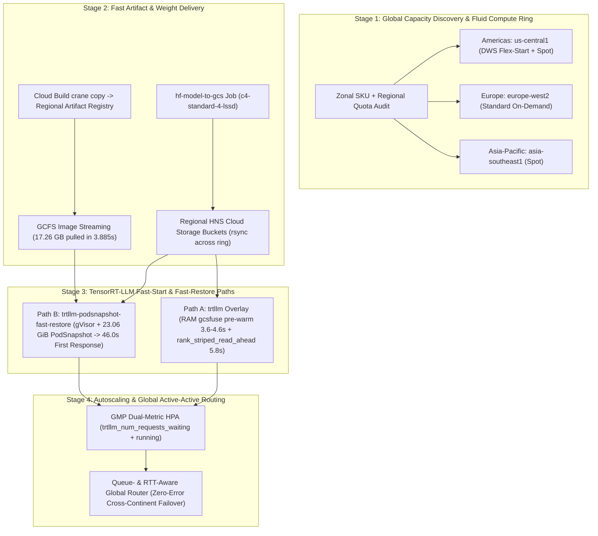

# Getting started quickly with open models and TensorRT-LLM on multi-region GKE clusters

> [!IMPORTANT]
>
> Dynamic Landscape: The field of AI inference is experiencing continuous, rapid
> evolution. This document is regularly updated to reflect the latest products,
> features, and architectural patterns, ensuring it remains current with the
> advancements in AI, Google Cloud, NVIDIA TensorRT-LLM, and Google Kubernetes
> Engine.
>
> Last Update: 2026-11-04 (YYYY-MM-DD)

This guide shows how to take **open-weight reasoning and agentic
models**—specifically the **NVIDIA Nemotron-3** family
(`Nemotron-3-Nano-30B-A3B` in `NVFP4`, `FP8`, and `BF16`, and
`Nemotron-3-Super-120B-A12B-NVFP4`)—from zero infrastructure to a
**multi-region, multi-cluster NVIDIA TensorRT-LLM (`trtllm-serve`)** serving
fleet on **Google Kubernetes Engine (GKE)** with **NVIDIA RTX PRO 6000 Blackwell
Server Edition (`g4-standard-48`, 96 GB GDDR7, `SM120`)** GPUs.

It extends the
[AI inference proof-of-concept (PoC) and capacity-finding guide](/docs/platforms/gke/base/use-cases/inference-ref-arch/poc-capacity-and-rapid-deployment-guide.md)
with a TensorRT-LLM well-lit path that pairs **pre-flight global capacity
farming** (`Reservation` / `On-Demand` / `DWS Flex-Start` / `Spot`) with **Cloud
Build Artifact Registry image streaming**, **Hierarchical Namespace (HNS) Cloud
Storage + RAM-backed Cloud Storage FUSE pre-warming**, **GKE Pod snapshots
(`runtimeClassName: gvisor`)**, **Google Cloud Managed Service for Prometheus
(GMP) queue-depth HPA**, and **multi-region queue- and RTT-aware routing**.

For a copy-paste presenter script and verbatim talk track that builds and demos
this stack live in 15 minutes, see the companion
[15-minute TensorRT-LLM live demo runbook](/docs/platforms/gke/base/use-cases/inference-ref-arch/trtllm-poc-15min-demo-runbook.md).

---

## Why TensorRT-LLM + NVIDIA Nemotron-3 + RTX PRO 6000 on multi-region GKE?

Running modern open models in production or high-velocity PoCs presents three
interlocking challenges that this pattern solves together:

1. **Blackwell `NVFP4` unlocks single-GPU (`TP=1`) serving up to 120B
   parameters**:
   - **NVIDIA RTX PRO 6000 Blackwell Server Edition (`g4-standard-48`)** pairs
     5th-generation Tensor Cores (`SM120`, native hardware `NVFP4` and `FP8`
     acceleration) with **96 GB of GDDR7 VRAM** (`94.97 GiB` usable).
   - **NVIDIA Nemotron-3** uses a **hybrid Mamba-2 + Grouped-Query Attention
     (GQA) + Mixture-of-Experts (MoE)** architecture (`nemotron_h`):
     - **`Nemotron-3-Nano-30B-A3B-NVFP4`** (`31.6B` total / `3.2B` active per
       token, `18.03 GiB` checkpoint) uses **`20.01 GiB` of VRAM** for weights
       and CUDA context, leaving **`63.71 GiB`** (`13.44M` attention KV tokens +
       Mamba state pools) on a single GPU and reaching **`3,568.1 tok/s`** at
       concurrency `64` (**`+30.9%` higher throughput** than `FP8`'s
       `2,726.0 tok/s`).
     - **`Nemotron-3-Super-120B-A12B-NVFP4`** (`120.6B` total / `12.6B` active
       LatentMoE, `74.80 GiB` checkpoint) peaks at **`84.19 GiB` of VRAM**
       during TensorRT-LLM memory profiling—which exceeds an `80 GB H100`'s
       `79.1 GiB` physical capacity by `5.1 GiB`, **but fits on a single 96 GB
       `RTX PRO 6000` (`TP=1`)** with **`13.36 GiB` (`972,704` attention KV
       tokens)** of cache headroom and delivers **`74.0 tok/s` single-stream**
       (`713.9 tok/s` at concurrency `32`) with zero inter-GPU communication.
2. **Single-GPU (`TP=1`) replicas maximize global GPU obtainability and unlock
   GKE Pod snapshots**:
   - Requesting 1-GPU `g4-standard-48` nodes across a **3-continent Fluid
     Compute ring** (`us-central1`, `europe-west2`, `asia-southeast1`) avoids
     8-GPU placement bottlenecks and lets each regional cluster consume
     whichever capacity pool is immediately available (`DWS Flex-Start`,
     `On-Demand`, or `Spot`).
   - Because GKE Pod snapshots support single-GPU (`TP=1`) workloads, keeping
     both `Nano-30B` and `Super-120B` at `TP=1` makes horizontal scale-out and
     Spot replacement eligible for snapshot restore.
3. **TensorRT-LLM's PyTorch backend compiles specialized Blackwell kernels on
   every cold start—unless you snapshot them**:
   - Even when weights load from RAM into VRAM in **`5.8–7.6 seconds`** via
     TensorRT-LLM's `rank_striped_read_ahead` loader, `trtllm-serve` spends
     **`~121–132 seconds`** running `sampling_module_prewarm` (`~46s`),
     `TRTLLM-Gen FMHA` `attention_jit` (`~16s`), `autotuner` (`~33s` across up
     to `90` `NVFP4`/MoE tactics), Mamba hybrid warmup (`~25s`), and CUDA graph
     capture (`[1..64]`).
   - Combining **regional Artifact Registry + GCFS Image Streaming (`3.885s`
     pull for a `17.26 GB` image)** with **GKE Pod snapshots (`23.06 GiB`
     checkpoint)** restores a brand-new `RTX PRO 6000` replica to `Ready` in
     **`23.0s`** and serves `/v1/chat/completions` in **`46.0s`** (`LOADING=0`,
     **`7.83×` faster** than an uncached `nvcr.io` cold start).



---

## Summary of measured end-to-end results on `NVIDIA RTX PRO 6000`

All timings and benchmarks in this guide were measured live across three GKE
Autopilot `v1.37` clusters in `us-central1`, `europe-west2`, and
`asia-southeast1` using
`nvcr.io/nvidia/tensorrt-llm/release:1.4.0rc2@sha256:93a3eaf1fa574813d608a7147735134bcfbd06d18d1aa98e8ee0d5da09e51e3a`
(`CUDA 13.4`, `PyTorch 2.14.0a0+b2c75dd062.nv26.09`) on `g4-standard-48` (`48`
vCPUs, `180 GB` DDR5 RAM,
`1× NVIDIA RTX PRO 6000 Blackwell Server Edition 96 GB GDDR7`):

| Lifecycle Stage / Metric                                        | Baseline (Unoptimized)                                                | Accelerated Platforms TensorRT-LLM Pattern                                                                                                                                        | Measured Speedup / Impact                                                                               |
| --------------------------------------------------------------- | --------------------------------------------------------------------- | --------------------------------------------------------------------------------------------------------------------------------------------------------------------------------- | ------------------------------------------------------------------------------------------------------- |
| **Container image pull (`17.26 GB` / `16.07 GiB` compressed)**  | Direct pull from `nvcr.io`: **`178.4s – 182.9s`** (`~3m03s`)          | Regional Artifact Registry (`crane copy` in `152s`) + **GCFS Image Streaming**: **`3.885s`** on new nodes                                                                         | **`47.1×` faster** image pull on scale-out nodes                                                        |
| **Model staging (`Hugging Face -> HNS GCS`)**                   | Workstation download + re-upload (`15–45 min`)                        | In-cluster `hf-model-to-gcs` Job on `c4-standard-4-lssd`: **`101s`** (`Nano-30B NVFP4`, `694.6 MiB/s`), **`171s`** (`FP8`), **`383s`** (`Super-120B NVFP4`)                       | Zero workstation bandwidth; `rsync` replicates globally at `50–214 MiB/s`                               |
| **Weight read into GPU VRAM (`Nano-30B NVFP4`, `18.03 GiB`)**   | Uncached sequential FUSE reads (`45–90s`)                             | Parallel RAM `gcsfuse` pre-warm (**`3.59s – 4.63s`**) + `rank_striped_read_ahead` (**`5.80s – 6.04s`**)                                                                           | **`~9.5s` end-to-end** from HNS Cloud Storage to GPU VRAM                                               |
| **Weight read into GPU VRAM (`Super-120B NVFP4`, `74.80 GiB`)** | Requires multi-GPU `TP=2` on 80 GB GPUs                               | Fits on **`1× RTX PRO 6000` (`TP=1`)**; `rank_striped_read_ahead` loads `80.32 GB` from RAM in **`43.40s` (`1.85 GB/s`)**                                                         | **`50%` fewer GPUs** vs. `TP=2` 80 GB deployments                                                       |
| **Horizontal scale-out (`PodScheduled -> First HTTP 200`)**     | Cold `nvcr.io` pull + stream + `144.9s` init = **`360.4s`** (`6m00s`) | **GKE Pod Snapshot (`23.06 GiB`) + GCFS (`3.885s`)**: `Ready` in **`23.0s`**, `PodRestored` in **`45.0s`**, `First Response` in **`46.0s`** (`LOADING=0`, `78.9 ms` steady-state) | **`7.83×` faster** than cold `nvcr.io` (`3.95×` faster than GCFS cold start); saves **`5m14s` per pod** |
| **Single-GPU serving throughput (`max_tokens=256`)**            | `Nano-30B FP8`: `2,726.0 tok/s` at `c=64` (`22.90 ms` TPOT)           | `Nano-30B NVFP4`: **`3,568.1 tok/s`** at `c=64` (`17.40 ms` TPOT; `239.4 tok/s` at `c=1`); `Super-120B NVFP4`: **`74.0 tok/s`** at `c=1`, **`713.9 tok/s`** at `c=32`             | **`+30.9%` higher throughput** with Blackwell `NVFP4` + **`13.44M` KV tokens**                          |
| **Global multi-cluster resilience**                             | Single-region outage drops traffic                                    | Queue- & RTT-aware router across `FLEX_START` (`us-central1`) + `STANDARD` (`europe-west2`) + `SPOT` (`asia-southeast1`)                                                          | **`100%` request success (`0` errors)** across single- and double-region failovers                      |

---

## Stage 1: Model selection & VRAM sizing on `NVIDIA RTX PRO 6000` (96 GB)

### Step 1.1: Choose the right NVIDIA Nemotron-3 variant for `g4-standard-48`

All overlays in this repository live under
[`kubernetes-manifests/online-inference-gpu/trtllm`](/platforms/gke/base/use-cases/inference-ref-arch/kubernetes-manifests/online-inference-gpu/trtllm)
(standard GKE Autopilot / Standard nodes with RAM-backed Cloud Storage FUSE) and
[`kubernetes-manifests/online-inference-gpu/trtllm-podsnapshot-fast-restore`](/platforms/gke/base/use-cases/inference-ref-arch/kubernetes-manifests/online-inference-gpu/trtllm-podsnapshot-fast-restore)
(GKE Sandbox `gVisor` nodes with cooperative `PodSnapshot` capture and restore):

| Hugging Face Model ID                                | Architecture & Active Params                                               | Precision                                           | Checkpoint Size               | Kustomize Overlay (`trtllm/` & `trtllm-podsnapshot-fast-restore/`)        | GPU SKU (`TP`)             | Weight + Context VRAM                                                         | `MambaHybridCacheManagerV2` Pool (`free_gpu_memory_fraction`)                                 | Default `MAX_SEQ_LEN` / `MAX_BATCH_SIZE` | Best For                                                                                                                |
| ---------------------------------------------------- | -------------------------------------------------------------------------- | --------------------------------------------------- | ----------------------------- | ------------------------------------------------------------------------- | -------------------------- | ----------------------------------------------------------------------------- | --------------------------------------------------------------------------------------------- | ---------------------------------------- | ----------------------------------------------------------------------------------------------------------------------- |
| **`nvidia/NVIDIA-Nemotron-3-Nano-30B-A3B-NVFP4`**    | Hybrid Mamba-2 + GQA + MoE (`31.6B` total / **`3.2B` active**)             | **Blackwell `NVFP4`** (`W4A4` GEMM + FP8/BF16 attn) | **`18.03 GiB`** (`5` shards)  | `rtx-pro-6000-nvidia-nemotron-3-nano-30b-a3b-nvfp4` _(both paths)_        | `1× RTX PRO 6000` (`TP=1`) | **`20.01 GiB`** (`18.63` Torch + `1.38` CUDA)                                 | **`63.71 GiB`** (`0.85` -> **`13,437,376` KV tokens**, `419,918` blocks)                      | `65536` / `64`                           | **Recommended default**: Peak throughput (`3,568 tok/s`), `3.9 ms` TPOT, massive concurrency, `46s` PodSnapshot restore |
| **`nvidia/NVIDIA-Nemotron-3-Nano-30B-A3B-FP8`**      | Hybrid Mamba-2 + GQA + MoE (`31.6B` total / **`3.2B` active**)             | **`FP8`** (`E4M3`)                                  | **`30.44 GiB`** (`10` shards) | `rtx-pro-6000-nvidia-nemotron-3-nano-30b-a3b-fp8` _(both paths)_          | `1× RTX PRO 6000` (`TP=1`) | `~32.0 GiB`                                                                   | `~51.7 GiB` (`0.85`)                                                                          | `65536` / `64`                           | Near-lossless `FP8` precision (`2,726 tok/s` at `c=64`) with large 64K context headroom                                 |
| **`nvidia/NVIDIA-Nemotron-3-Nano-30B-A3B-BF16`**     | Hybrid Mamba-2 + GQA + MoE (`31.6B` total / **`3.2B` active**)             | **`BF16`** (unquantized)                            | `~59.0 GiB`                   | `rtx-pro-6000-nvidia-nemotron-3-nano-30b-a3b-bf16` _(`trtllm/` only)_     | `1× RTX PRO 6000` (`TP=1`) | `~60.5 GiB`                                                                   | `~20.2 GiB` (`0.85`)                                                                          | `32768` / `64`                           | Unquantized accuracy baseline on a single 96 GB GPU                                                                     |
| **`nvidia/NVIDIA-Nemotron-3-Super-120B-A12B-NVFP4`** | Hybrid Mamba-2 + GQA + **LatentMoE** (`120.6B` total / **`12.6B` active**) | **Blackwell `NVFP4`**                               | **`74.80 GiB`** (`17` shards) | `rtx-pro-6000-nvidia-nemotron-3-super-120b-a12b-nvfp4` _(`trtllm/` only)_ | `1× RTX PRO 6000` (`TP=1`) | **`70.81 GiB`** (`69.39` Torch + `1.42` CUDA; **`84.19 GiB` peak** profiling) | **`13.36 GiB`** (`0.80` -> **`972,704` KV tokens**, `30,397` blocks + `5.23 GiB` Mamba state) | `32768` / `32`                           | **Frontier 120B reasoning & tool calling on 1 GPU** (`74.0 tok/s` at `c=1`, `713.9 tok/s` at `c=32`)                    |

> [!IMPORTANT]
>
> **Hybrid Mamba-2 + Attention cache configuration
> (`enable_block_reuse: false`)**: Nemotron-3 interleaves Mamba-2 state-space
> layers (`ssm_state` and `conv_state` pools) with GQA attention layers (`key`
> and `value` pools) inside TensorRT-LLM's `MambaHybridCacheManagerV2`. Prefix
> KV block reuse across requests is not supported for recurrent Mamba states in
> TensorRT-LLM `1.4.0rc2` and must remain disabled
> (`kv_cache_config.enable_block_reuse: false`), which all overlays in this
> repository pre-configure in `extra-llm-api-config.yaml`.

### Step 1.2: Why single-GPU `Super-120B-NVFP4` needs 96 GB (`RTX PRO 6000`) rather than 80 GB

During Pass 1 (`executor_creation/profiling_executor_creation`), TensorRT-LLM
loads all `74.80 GiB` of `Super-120B-A12B-NVFP4` weights (`70.81 GiB` resident
VRAM), allocates a `5.92 GiB` temporary profiling KV/Mamba cache, and profiles
`8192`-token prefill activations
(` Peak memory during memory usage profiling: 84.19 GiB`). On an `80 GB` GPU
(`79.1 GiB` usable), Pass 1 runs out of memory unless you split across 2 GPUs
(`TP=2`). On a single **96 GB `RTX PRO 6000` (`94.97 GiB` physical VRAM)**, Pass
1 completes with `10.78 GiB` to spare and Pass 2 (`final_kv_cache_allocation`)
allocates **`13.36 GiB`** (`30,397` paged blocks = `972,704` attention KV
tokens) at `free_gpu_memory_fraction: 0.80`.

---

## Stage 2: Pre-flight multi-region capacity discovery across consumption models

Before running Terraform, verify zonal `nvidia-rtx-pro-6000` (`g4-standard-48`)
availability and regional `G4` quotas across a 3-continent candidate ring so
each cluster can fall through `On-Demand`, `DWS Flex-Start`, and `Spot` pools:

```shell
export PROJECT_ID="<YOUR_PROJECT_ID>"

gcloud compute accelerator-types list \
  --project="${PROJECT_ID}" \
  --filter="name=nvidia-rtx-pro-6000 AND zone:(us-central1-* europe-west2-* europe-west4-* asia-southeast1-*)" \
  --format="table(name,zone.basename(),description)"
```

### Real-world example: One global ring, three distinct consumption models

In our live 3-continent validation, `g4-standard-48` exhibited three distinct
regional capacity profiles—and GKE's `gpu-rtx-pro-6000-96gb-x1` `ComputeClass`
adapted automatically to each region:

| Continent & Cluster           | Region / Zone                     | Observed GCE Capacity Behavior                                                           | Winning `ComputeClass` Consumption Model                                                           | GPU Node Bring-Up |
| ----------------------------- | --------------------------------- | ---------------------------------------------------------------------------------------- | -------------------------------------------------------------------------------------------------- | ----------------- |
| **Americas (`inf-americas`)** | `us-central1-b` / `us-central1-f` | On-Demand hit transient `ZONE_RESOURCE_POOL_EXHAUSTED` in `b`/`f`; Spot & DWS pools open | **DWS `FLEX_START`** (`cloud.google.com/gke-provisioning=flex-start`) + **`SPOT`** (`gVisor` pool) | `60–170s`         |
| **Europe (`inf-europe`)**     | `europe-west2-b`                  | Spot pool constrained in `europe-west2`; On-Demand pool open in `europe-west2-b`         | **`STANDARD` (On-Demand)**                                                                         | `123s`            |
| **Asia-Pacific (`inf-apac`)** | `asia-southeast1-b`               | Immediate Spot obtainability at lowest cost                                              | **`SPOT`** (`cloud.google.com/gke-spot=true`)                                                      | `~95s`            |

> [!TIP]
>
> **Prevent premature node migration on `FLEX_START` and `model-download`
> nodes**: Built-in `ComputeClass` manifests default to
> `activeMigration.optimizeRulePriority: true`, which instructs GKE Autopilot to
> replace lower-priority (`FLEX_START`, `Spot`, or `c3-standard-4-lssd`) nodes
> whenever a higher-priority pool opens. During benchmarks or one-shot
> `hf-model-to-gcs` Jobs (`backoffLimit: 0`), set
> `cluster_custom_compute_class_active_migration_enabled = false` in Terraform
> (or pass `ACTIVE_MIGRATION_ENABLED="false"` to
> [`terraform/multi-region/provision.sh`](/platforms/gke/base/use-cases/inference-ref-arch/terraform/multi-region/provision.sh),
> which defaults to `false`) so rendered `ComputeClass` manifests set
> `optimizeRulePriority: false` declaratively without out-of-band `kubectl`
> drift.

---

## Stage 3: Accelerate container startup with Cloud Build + Artifact Registry GCFS Image Streaming

### Why mirroring `nvcr.io/nvidia/tensorrt-llm/release:1.4.0rc2` matters

The official TensorRT-LLM `1.4.0rc2` container image is **`17.26 GB`
(`16.07 GiB` compressed)**. Pulling it directly from `nvcr.io` on every new GPU
node has two drawbacks:

1. **Cold pull time**: Direct `nvcr.io` pulls + extraction take
   **`2m58s – 3m03s`** per new node and consume `58%` (`55 GiB`) of the `95 GiB`
   boot disk.
2. **GKE Image Streaming (`GCFS`) eligibility**: GCFS streams container layers
   over the network in **seconds**, but **only from Artifact Registry in the
   same project/organization**—never from external registries like `nvcr.io`.

### One-command server-side mirror with Cloud Build + digest-pinned `crane copy`

You do not need Docker or `17 GB` of local disk space. `provision.sh` automates
this per region via `MIRROR_IMAGES` (using `mirror_image_to_ar` in
[`terraform/multi-region/helpers.sh`](/platforms/gke/base/use-cases/inference-ref-arch/terraform/multi-region/helpers.sh)),
or you can invoke `mirror_image_to_ar` directly against an existing regional
cluster (`~2m30s` / `152s`):

```shell
source "${ACP_REPO_DIR}/platforms/gke/base/use-cases/inference-ref-arch/terraform/multi-region/helpers.sh"

export TRTLLM_NGC_IMAGE="nvcr.io/nvidia/tensorrt-llm/release:1.4.0rc2@sha256:93a3eaf1fa574813d608a7147735134bcfbd06d18d1aa98e8ee0d5da09e51e3a"
mirror_image_to_ar "us-central1" "americas" "${TRTLLM_NGC_IMAGE}" "tensorrt-llm/release:1.4.0rc2"
```

Then export
`TF_VAR_ira_online_gpu_trtllm_image_url="us-central1-docker.pkg.dev/${PROJECT_ID}/inf-americas/tensorrt-llm/release:1.4.0rc2"`
and
`TF_VAR_ira_online_gpu_trtllm_podsnapshot_image_url="us-central1-docker.pkg.dev/${PROJECT_ID}/inf-americas/tensorrt-llm/release:1.4.0rc2"`
before deploying workloads (see Stage 5).

> [!NOTE]
>
> **First pull vs. subsequent scale-out nodes with GCFS**: When GKE pulls a
> newly mirrored `17.26 GB` image from Artifact Registry for the very first
> time, Artifact Registry asynchronously indexes the layers for GCFS (`~4m19s`
> on the first pod). Every **subsequent brand-new GPU node**—including
> `runtimeClassName: gvisor` nodes—streams the entire `17.26 GB` image in
> **`3.885 seconds` (`47.1×` faster than `nvcr.io`)**.

---

## Stage 4: Provision the GKE Inference Reference Architecture & stage Nemotron-3 to HNS Cloud Storage

### Step 4.1: Provision regional GKE Autopilot islands (`terraform/multi-region/provision.sh`)

[`terraform/multi-region/provision.sh`](/platforms/gke/base/use-cases/inference-ref-arch/terraform/multi-region/provision.sh)
provisions independent regional GKE Autopilot islands from a single checkout
without modifying tracked `*.auto.tfvars` or `${HOME}/.kube/config`. It assigns
deterministic, non-overlapping Node, Proxy, Master, Pod, and Service CIDRs
outside Google Cloud's `10.128.0.0/9` auto-mode space, deploys `online_gpu`,
stores `HF_TOKEN` in Secret Manager, enables GKE Pod snapshots when
`ENABLE_POD_SNAPSHOTS="true"`, and mirrors digest-pinned container images into
each region's Artifact Registry repository:

```shell
export PROJECT_ID="<YOUR_PROJECT_ID>"
export HF_TOKEN="<YOUR_HUGGINGFACE_READ_TOKEN>"
export ENABLE_POD_SNAPSHOTS="true"
export ACTIVE_MIGRATION_ENABLED="false"
export MIRROR_IMAGES="nvcr.io/nvidia/tensorrt-llm/release:1.4.0rc2@sha256:93a3eaf1fa574813d608a7147735134bcfbd06d18d1aa98e8ee0d5da09e51e3a=tensorrt-llm/release:1.4.0rc2"

"${ACP_REPO_DIR}/platforms/gke/base/use-cases/inference-ref-arch/terraform/multi-region/provision.sh" \
  "americas:us-central1" \
  "europe:europe-west2" \
  "apac:asia-southeast1"
```

### Step 4.2: Stage Nemotron-3 models once into HNS Cloud Storage and replicate across continents

Source
[`terraform/multi-region/helpers.sh`](/platforms/gke/base/use-cases/inference-ref-arch/terraform/multi-region/helpers.sh)
to run the canonical
`model-download/huggingface/download_{apply,wait,delete}.sh` workflow in your
anchor region (`americas` / `us-central1`) via `stage_hf_model`, then replicate
server-side to your European and Asia-Pacific HNS buckets with
`replicate_hf_model`:

```shell
source "${ACP_REPO_DIR}/platforms/gke/base/use-cases/inference-ref-arch/terraform/multi-region/helpers.sh"
use_region "americas" "us-central1"

stage_hf_model "nvidia/NVIDIA-Nemotron-3-Nano-30B-A3B-NVFP4"

# Replicate server-side to regional HNS buckets in Europe and Asia-Pacific
for DEST_PLATFORM in europe apac; do
  replicate_hf_model "americas" "${DEST_PLATFORM}" "nvidia/NVIDIA-Nemotron-3-Nano-30B-A3B-NVFP4" &
done
wait
```

#### Measured staging & replication durations

| Model Checkpoint                          | Size & File Count                     | `hf-model-to-gcs` Job Duration (`us-central1`)               | `gcloud storage rsync` to Europe (`europe-west2`) | `gcloud storage rsync` to APAC (`asia-southeast1`) |
| ----------------------------------------- | ------------------------------------- | ------------------------------------------------------------ | ------------------------------------------------- | -------------------------------------------------- |
| `NVIDIA-Nemotron-3-Nano-30B-A3B-NVFP4`    | `18.03 GiB` (`17` files, `5` shards)  | **`00:01:41`** (`101s` total; `33s` upload at `694.6 MiB/s`) | **`191s`** (`101.6 MiB/s`)                        | **`381s`** (`50.0 MiB/s`)                          |
| `NVIDIA-Nemotron-3-Nano-30B-A3B-FP8`      | `30.44 GiB` (`37` files, `10` shards) | **`00:02:51`** (`171s` total; `56s` upload)                  | **`156s`** (`214.4 MiB/s`)                        | —                                                  |
| `NVIDIA-Nemotron-3-Super-120B-A12B-NVFP4` | `74.80 GiB` (`17` safetensors shards) | **`00:06:23`** (`383s` total; `128s` upload at `598 MiB/s`)  | —                                                 | —                                                  |

---

## Stage 5: Deploy Path A (`trtllm` fast-start) or Path B (`trtllm-podsnapshot-fast-restore`)

### Path A: Standard `trtllm` deployment (RAM-backed Cloud Storage FUSE + `rank_striped_read_ahead`)

Path A mounts the regional HNS Cloud Storage bucket via
`gcsfuse.csi.storage.gke.io` backed by a **RAM `emptyDir` file cache**
(`medium: Memory`), runs parallel `dd` streams (`xargs -P 8`) to pull all
`.safetensors` shards from HNS Cloud Storage into RAM at **`4–5 GiB/s`**, and
launches `trtllm-serve` via OpenMPI:

```shell
use_region "americas" "us-central1"
export ACCELERATOR_TYPE="rtx-pro-6000"
export HF_MODEL_ID="nvidia/NVIDIA-Nemotron-3-Nano-30B-A3B-NVFP4"
export TF_VAR_ira_online_gpu_trtllm_image_url="us-central1-docker.pkg.dev/${PROJECT_ID}/inf-americas/tensorrt-llm/release:1.4.0rc2"

"${ACP_REPO_DIR}/test/scripts/platforms/gke/base/use-cases/inference-ref-arch/online-inference-gpu/trtllm/deployment_apply.sh"
"${ACP_REPO_DIR}/test/scripts/platforms/gke/base/use-cases/inference-ref-arch/online-inference-gpu/trtllm/deployment_test.sh"
```

#### Measured cold-start phase breakdown across continents & models (Path A)

| Deployment & Region                            | Consumption Model | RAM `gcsfuse` Pre-Warm              | `rank_striped_read_ahead` (RAM -> VRAM) | Pass 1: `profiling_executor_creation`                                                  | Pass 2: `final_executor_creation` | Total `workers_ready` |
| ---------------------------------------------- | ----------------- | ----------------------------------- | --------------------------------------- | -------------------------------------------------------------------------------------- | --------------------------------- | --------------------- |
| **`Nano-30B-NVFP4` (`us-central1`)**           | `FLEX_START`      | **`4.13s`**                         | **`5.89s`**                             | `121.50s` (`prewarm=45.7s`, `fmha_jit=16.0s`, `autotuner=33.5s`, `mamba+graphs=26.3s`) | `3.63s`                           | **`132.52s`**         |
| **`Nano-30B-NVFP4` (`europe-west2`)**          | `STANDARD`        | **`3.59s`**                         | **`5.80s`**                             | `120.72s`                                                                              | `3.68s`                           | **`131.74s`**         |
| **`Nano-30B-NVFP4` (`asia-southeast1`)**       | `SPOT`            | **`4.63s`**                         | **`6.04s`**                             | `121.71s`                                                                              | `3.59s`                           | **`132.84s`**         |
| **`Nano-30B-FP8` (`europe-west2`)**            | `STANDARD`        | **`15.41s`**                        | **`5.59s`**                             | `122.85s`                                                                              | `3.39s`                           | **`133.34s`**         |
| **`Super-120B-NVFP4` (`us-central1`, `TP=1`)** | `FLEX_START`      | `255.52s` _(incl. 1 GCS 503 retry)_ | **`43.40s`** (`1.85 GB/s`)              | `121.34s` (`prewarm=45.9s`, `fmha_jit=16.1s`, `autotuner=32.6s`, `mamba=26.7s`)        | `2.82s`                           | **`171.31s`**         |

### Path B: Sub-minute horizontal scale-out with GKE Pod snapshots (`trtllm-podsnapshot-fast-restore`)

GKE Pod snapshots run inside GKE Sandbox (`runtimeClassName: gvisor`), which
does not mount CSI volumes (`gcsfuse` or Secret Store CSI). Our
`trtllm-podsnapshot-fast-restore` overlay solves this cleanly:

1. **Cold start (`PodSnapshot` capture)**: A 16-worker Python streamer fetches a
   Workload Identity OAuth2 token from the GKE metadata server and streams the
   `18.03 GiB` checkpoint directly from `gs://${MODEL_BUCKET_NAME}` into a RAM
   `emptyDir` (`/model-cache`) in **`32.59s` (`0.55 GiB/s`)**.
2. **Pre-checkpoint warm-up & RAM cleanup**: Once `/health` returns `200 OK`,
   the entrypoint sends **one `/v1/chat/completions` warm-up request** (so all
   lazy FlashInfer/Triton decode kernels are compiled prior to capture), deletes
   all `.safetensors` files from `/model-cache` (shrinking the snapshot to
   **`23.06 GiB`** instead of `41+ GiB`), and writes `1` to
   `/proc/gvisor/checkpoint`. The snapshot replicates to HNS Cloud Storage and
   reaches `AllSnapshotsAvailable` in **`41 seconds` (`~576 MiB/s`)**.
3. **Fast horizontal restore**: Every subsequent scale-out replica
   (`1 -> 2 -> N`) or Spot replacement streams the container image via GCFS in
   **`3.885s`**, restores the `23.06 GiB` GPU + CPU state directly into
   `RTX PRO 6000` VRAM with **`LOADING=0`**, becomes `Ready` in **`23.0s`**, and
   serves `/v1/chat/completions` in **`46.0s`** (`78.9 ms` steady-state
   latency).

```shell
use_region "americas" "us-central1"
export ACCELERATOR_TYPE="rtx-pro-6000"
export HF_MODEL_ID="nvidia/NVIDIA-Nemotron-3-Nano-30B-A3B-NVFP4"
export TF_VAR_ira_online_gpu_trtllm_podsnapshot_image_url="us-central1-docker.pkg.dev/${PROJECT_ID}/inf-americas/tensorrt-llm/release:1.4.0rc2"

"${ACP_REPO_DIR}/test/scripts/platforms/gke/base/use-cases/inference-ref-arch/online-inference-gpu/trtllm-podsnapshot-fast-restore/deployment_apply.sh"

# Verify initial cold start + 41s checkpoint upload -> AllSnapshotsAvailable,
# then measure horizontal scale-out restore (1 -> 2) onto a new RTX PRO 6000 node
"${ACP_REPO_DIR}/test/scripts/platforms/gke/base/use-cases/inference-ref-arch/online-inference-gpu/trtllm-podsnapshot-fast-restore/deployment_test.sh"
```

#### Measured `measure_restore.sh 2` output on `RTX PRO 6000`

<!-- cspell:ignore plnwn -->

```text
POD (suffix)             NODE_AGE IMAGE                READY POD_RESTORED  FIRST_RESPONSE   LATENCY  LOADING
b-nvfp4-856985859d-plnwn    32.0s in 3.885s            23.0s        45.0s           46.0s     22.8s        0
```

> [!NOTE]
>
> Why does `FIRST_RESPONSE` (`46.0s`) include `LATENCY` (`22.8s`) while `READY`
> is `23.0s`? `measure_restore.sh` begins sending `/v1/chat/completions` probes
> the instant the restored Pod receives an IP (`23s`), while `gVisor` finishes
> restoring the remaining GPU memory pages (`pages.img`, `23.05 GiB`) between
> `23s` and `45.0s` (`POD_RESTORED`). Exactly `1.0s` after `POD_RESTORED`
> (`46.0s`), the first queued completion finishes, and every subsequent
> completion returns in **`78.9 ms`**.

---

## Stage 6: OpenAI API features, concurrency benchmarks, GMP HPA & global failover

### Step 6.1: Reasoning budget control (`nano-v3`) & structured tool calling (`qwen3_coder`)

All overlays enable `--reasoning_parser nano-v3` and `--tool_parser qwen3_coder`
out of the box (verified across `Nano-30B-NVFP4`, `Nano-30B-FP8`, and
`Super-120B-NVFP4`):

- **Reasoning ON (default)**: Returns chain-of-thought in
  `choices[0].message.reasoning_content` and the final answer in
  `choices[0].message.content`.
- **Instant non-thinking mode (`79–194 ms` latency)**: Pass
  `"chat_template_kwargs": {"enable_thinking": false}` in the request JSON to
  bypass chain-of-thought generation for low-latency classification, routing, or
  factual lookups.
- **Agentic tool calling**: Pass standard OpenAI `tools` definitions to receive
  structured `choices[0].message.tool_calls` arguments.

### Step 6.2: Measured single-GPU concurrency sweep on `NVIDIA RTX PRO 6000`

Measured in-cluster (`http://127.0.0.1:8000/v1/chat/completions`, streaming SSE
for exact TTFT/TPOT, `max_tokens=256`, **`0` failed requests at every
concurrency level**):

| Model (`TP=1` on `1× RTX PRO 6000 96GB`) | Concurrency | Output Throughput (`tok/s`) | Per-User Speed (`tok/s/user`) | p50 TTFT (`ms`) | p95 TTFT (`ms`) | p50 TPOT (`ms`) | p50 E2E (`s`) |
| ---------------------------------------- | ----------- | --------------------------- | ----------------------------- | --------------- | --------------- | --------------- | ------------- |
| **`Nemotron-3-Nano-30B-A3B-NVFP4`**      | `1`         | **`239.4`**                 | **`239.4`**                   | `73.7`          | `88.0`          | **`3.90`**      | `1.07`        |
| `Nemotron-3-Nano-30B-A3B-NVFP4`          | `4`         | **`619.6`**                 | `155.3`                       | `114.5`         | `116.2`         | `6.07`          | `1.64`        |
| `Nemotron-3-Nano-30B-A3B-NVFP4`          | `8`         | **`1,011.7`**               | `126.7`                       | `142.8`         | `143.7`         | `7.45`          | `2.04`        |
| `Nemotron-3-Nano-30B-A3B-NVFP4`          | `16`        | **`1,536.4`**               | `96.1`                        | `156.8`         | `161.0`         | `9.97`          | `2.66`        |
| `Nemotron-3-Nano-30B-A3B-NVFP4`          | `32`        | **`2,352.5`**               | `73.7`                        | `91.3`          | `95.0`          | `13.28`         | `3.48`        |
| **`Nemotron-3-Nano-30B-A3B-NVFP4`**      | **`64`**    | **`3,568.1`**               | **`55.9`**                    | `142.5`         | `149.4`         | **`17.40`**     | `4.58`        |
| **`Nemotron-3-Nano-30B-A3B-FP8`**        | `1`         | `230.9`                     | `231.0`                       | `71.2`          | `88.5`          | `4.05`          | `1.10`        |
| `Nemotron-3-Nano-30B-A3B-FP8`            | `8`         | `803.0`                     | `100.5`                       | `144.5`         | `145.3`         | `9.49`          | `2.56`        |
| `Nemotron-3-Nano-30B-A3B-FP8`            | `16`        | `1,184.6`                   | `74.1`                        | `159.1`         | `163.4`         | `12.99`         | `3.46`        |
| `Nemotron-3-Nano-30B-A3B-FP8`            | `32`        | `1,812.5`                   | `56.7`                        | `99.3`          | `102.3`         | `17.32`         | `4.51`        |
| **`Nemotron-3-Nano-30B-A3B-FP8`**        | **`64`**    | **`2,726.0`**               | `42.7`                        | `158.7`         | `165.0`         | `22.90`         | `6.00`        |
| **`Nemotron-3-Super-120B-A12B-NVFP4`**   | `1`         | **`74.0`**                  | **`74.0`**                    | `98.3`          | `120.2`         | **`13.11`**     | `3.44`        |
| `Nemotron-3-Super-120B-A12B-NVFP4`       | `4`         | **`204.3`**                 | `51.1`                        | `247.3`         | `249.9`         | `18.89`         | `5.04`        |
| `Nemotron-3-Super-120B-A12B-NVFP4`       | `8`         | **`318.4`**                 | `39.8`                        | `198.3`         | `199.5`         | `24.63`         | `6.43`        |
| `Nemotron-3-Super-120B-A12B-NVFP4`       | `16`        | **`476.6`**                 | `29.8`                        | `224.9`         | `228.9`         | `33.01`         | `8.59`        |
| **`Nemotron-3-Super-120B-A12B-NVFP4`**   | **`32`**    | **`713.9`**                 | **`22.3`**                    | `223.1`         | `226.2`         | **`44.10`**     | `11.47`       |

### Step 6.3: Dual-metric queue-depth HPA via Managed Service for Prometheus

Each `trtllm` overlay deploys a `PodMonitoring` CR scraping
`/prometheus/metrics` every `15s` and a `HorizontalPodAutoscaler` scaling on
**both** queued and in-flight requests (`trtllm_num_requests_waiting` target
`4`, `trtllm_num_requests_running` target `16`, fast `60s` scale-up, `300s`
scale-down stabilization). Under our `c=64` burst test in `us-central1`, GMP HPA
automatically emitted `SuccessfulRescale: 1 -> 2 -> 4` within `30s` and GKE
Autopilot provisioned additional `RTX PRO 6000` nodes in `60–90s`.

### Step 6.4: Multi-region queue- and RTT-aware global routing & failover

In environments where project-wide GKE Fleet Multi-Cluster Ingress is enabled,
you can front regional services with a global `MultiClusterService` and external
Application Load Balancer. When operating independent regional clusters—or in
shared GCP projects where Fleet Ingress is reserved—a lightweight health-,
queue-, and RTT-aware client/gateway router scraping `/health` and
`/prometheus/metrics`
(`score = rtt_ms + 40 * waiting + 15 * running + 100 * kv_util`) provides
zero-downtime global failover across consumption models:

| Failover Test Phase (`12` concurrent requests/phase, `96` tokens) | Active Regional Endpoints                                                                                                | Observed Routing Distribution    | Request Success Rate | End-to-End Latency (`s`) |
| ----------------------------------------------------------------- | ------------------------------------------------------------------------------------------------------------------------ | -------------------------------- | -------------------- | ------------------------ |
| **Phase 1: Global Steady State**                                  | `us-central1` (`FLEX_START`, score `200.2`) + `europe-west2` (`STANDARD`, `431.3`) + `asia-southeast1` (`SPOT`, `571.8`) | **`12/12` -> `us-central1`**     | **`12/12` (`100%`)** | `0.975s`                 |
| **Phase 2: Americas Regional Outage**                             | `us-central1` unreachable -> `europe-west2` (`445.3`) + `asia-southeast1` (`571.8`)                                      | **`12/12` -> `europe-west2`**    | **`12/12` (`100%`)** | `1.18s – 1.24s`          |
| **Phase 3: Double Outage (Americas + Europe)**                    | `us-central1` + `europe-west2` unreachable -> `asia-southeast1` (`SPOT`, `581.8`)                                        | **`12/12` -> `asia-southeast1`** | **`12/12` (`100%`)** | `1.38s – 1.43s`          |

<details>
<summary>Reference Python implementation: Multi-region queue- & RTT-aware OpenAI router</summary>

```python
#!/usr/bin/env python3
"""Health-, queue-, and RTT-aware multi-region router for TensorRT-LLM on GKE."""

import json, re, time, urllib.request
from concurrent.futures import ThreadPoolExecutor

ENDPOINTS = [
    {"region": "us-central1", "url": "http://127.0.0.1:18001"},
    {"region": "europe-west2", "url": "http://127.0.0.1:18002"},
    {"region": "asia-southeast1", "url": "http://127.0.0.1:18003"},
]

METRIC_RE = {
    "waiting": re.compile(r'^trtllm_num_requests_waiting\{[^}]*\}\s+([0-9.eE+-]+)', re.M),
    "running": re.compile(r'^trtllm_num_requests_running\{[^}]*\}\s+([0-9.eE+-]+)', re.M),
    "kv_util": re.compile(r'^trtllm_kv_cache_utilization\{[^}]*\}\s+([0-9.eE+-]+)', re.M),
}


def probe_endpoint(ep: dict) -> dict:
    t0 = time.perf_counter()
    try:
        with urllib.request.urlopen(f"{ep['url']}/health", timeout=2.0) as r:
            if r.status != 200:
                return {**ep, "healthy": False, "score": 1e9}
        rtt_ms = (time.perf_counter() - t0) * 1000.0
        with urllib.request.urlopen(f"{ep['url']}/prometheus/metrics", timeout=2.0) as r:
            body = r.read().decode("utf-8", errors="replace")
        vals = {
            k: float(m.group(1)) if (m := rx.search(body)) else 0.0
            for k, rx in METRIC_RE.items()
        }
        score = rtt_ms + 40.0 * vals["waiting"] + 15.0 * vals["running"] + 100.0 * vals["kv_util"]
        return {**ep, "healthy": True, "rtt_ms": round(rtt_ms, 1), **vals, "score": round(score, 1)}
    except Exception:
        return {**ep, "healthy": False, "score": 1e9}


def route_chat_completion(model: str, messages: list[dict], max_tokens: int = 128) -> dict:
    with ThreadPoolExecutor(max_workers=len(ENDPOINTS)) as pool:
        ranked = sorted(pool.map(probe_endpoint, ENDPOINTS), key=lambda x: x["score"])
    payload = json.dumps({"model": model, "messages": messages, "max_tokens": max_tokens, "temperature": 0}).encode()
    for candidate in ranked:
        if not candidate["healthy"]:
            continue
        req = urllib.request.Request(
            f"{candidate['url']}/v1/chat/completions",
            data=payload,
            headers={"Content-Type": "application/json"},
        )
        try:
            with urllib.request.urlopen(req, timeout=60.0) as resp:
                return {"routed_to": candidate["region"], "score": candidate["score"], "response": json.loads(resp.read())}
        except Exception:
            continue
    raise RuntimeError("All regional TensorRT-LLM endpoints are unreachable")
```

</details>

---

## Stage 7: Field-tested troubleshooting & architectural lessons learned

1. **Both `return_perf_metrics: true` AND `enable_iter_perf_stats: true` are
   mandatory for GMP HPA in TensorRT-LLM `1.4.0rc2`**:
   - Setting `return_perf_metrics: true` alone mounts `/prometheus/metrics` and
     exposes request latency histograms, **but leaves
     `trtllm_num_requests_waiting`, `trtllm_num_requests_running`, and
     `trtllm_kv_cache_utilization` unregistered** (`Error 404` in Cloud
     Monitoring Custom Metrics Adapter) because
     `TorchLlmArgs.enable_iter_perf_stats` defaults to `False`.
   - Always include both flags in `extra-llm-api-config.yaml` (already set in
     all overlays in this repository), and send at least one warm-up request so
     TensorRT-LLM's iteration stats collector initializes the labeled gauge
     series (`225–226` Prometheus series total).
2. **Launch `trtllm-serve` under OpenMPI `5.0` (`PRTE`) via
   `mpirun ... trtllm-llmapi-launch`**:
   - Running bare `trtllm-serve` as container PID 1 inside `1.4.0rc2` invokes
     `MPI.COMM_SELF.Spawn()`, which can fail with `MPI_ERR_UNKNOWN` under
     OpenMPI `5.0.10` (`PRTE`) inside Kubernetes/gVisor containers.
   - Launching with
     `mpirun --allow-run-as-root --oversubscribe -n "${TENSOR_PARALLEL_SIZE}" trtllm-llmapi-launch trtllm-serve ...`
     (alongside loopback MCA variables `OMPI_MCA_btl_tcp_if_include=lo`,
     `OMPI_MCA_oob_tcp_if_include=lo`, and
     `OMPI_MCA_btl_vader_single_copy_mechanism=none`) works deterministically
     across both standard `containerd` and `gVisor` (`PodSnapshot`) runtimes
     from `TP=1` to `TP=8`.
3. **Under `gVisor` (`PodSnapshot`), place `/usr/local/nvidia/lib64` ahead of
   `/usr/local/cuda/compat` and `unset BASH_ENV`**:
   - NGC containers ship CUDA forward-compatibility libraries under
     `/usr/local/cuda/compat/lib.real` and re-prepend them in `/etc/bash.bashrc`
     via `BASH_ENV`. Under `gVisor`'s `nvproxy`, the container must bind against
     `nvproxy`'s host-matched `/usr/local/nvidia/lib64/libcuda.so.1` (`580.x`).
   - `trtllm-podsnapshot-fast-restore/base/deployment.yaml` strips
     `/usr/local/cuda/compat/*` ahead of `/usr/local/nvidia/lib64` and runs
     `unset BASH_ENV` before `mpirun` so child `#!/bin/bash` wrappers never
     override `nvproxy`.
4. **Use `strategy: type: Recreate` on single-GPU deployments during rapid
   iteration**:
   - With `RollingUpdate` (`maxSurge: 25%`), editing a `ConfigMap` or flag
     forces GKE Autopilot to provision an extra GPU node (or fails if quota is
     pinned). `trtllm/base/deployment.yaml` uses `strategy: type: Recreate` so
     single-replica updates reuse the already-warm GPU node immediately.
5. **Benchmark in-cluster (`127.0.0.1:8000` or ClusterIP) rather than over
   `kubectl port-forward`**:
   - `kubectl port-forward` proxies TCP frames through the regional GKE control
     plane, adding `~180 ms` (`us-central1`) to `~550 ms` (`asia-southeast1`) of
     client RTT overhead. Measure true TTFT (`71–98 ms`) and TPOT
     (`3.9–13.1 ms`) from an in-cluster pod or `kubectl exec`.
