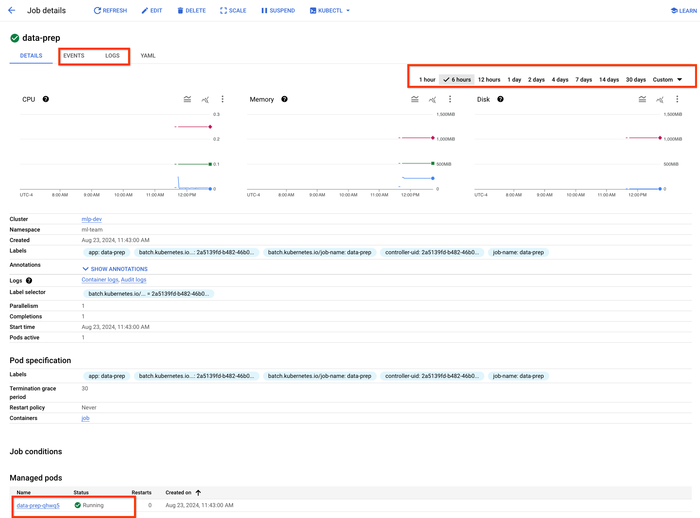
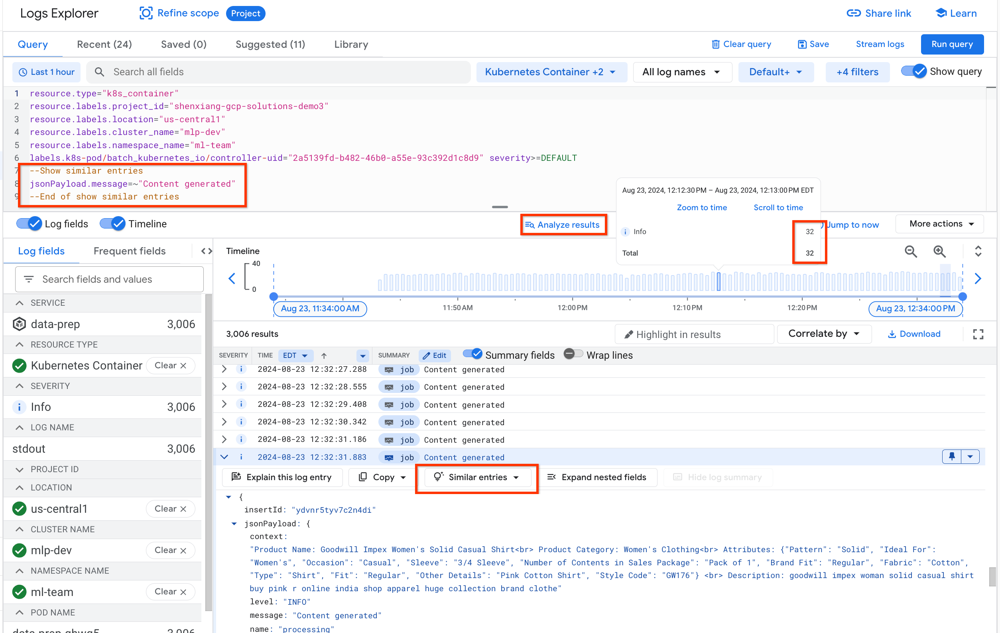
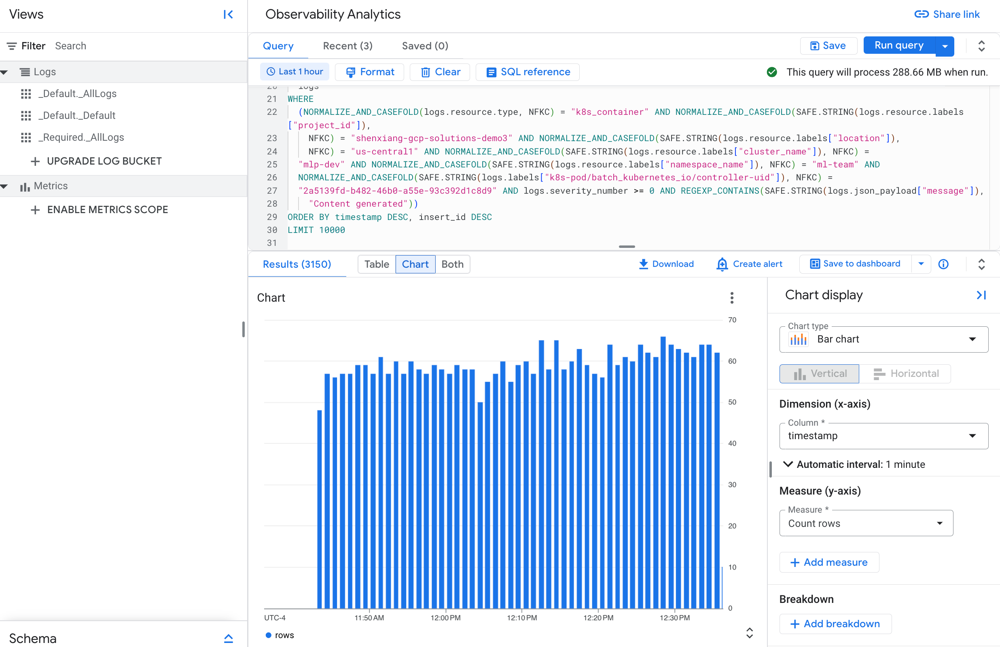

# Data Preparation

A processed Flipkart product catalog is used as input data to generate prompts
in preparation for fine-tuning. The prompts are generated from the product
catalog with question and answer templates, using
[Ray Data](https://docs.ray.io/en/latest/data/data.html) on the Ray cluster that
is also used for the data processing. The output is a data set that can be used
to fine-tune the base model.

The questions and answers are not generated by a large language model. The data
preparation step only depends on the product catalog, so it doesn't require
access to a model API or to accelerators, and running it again generates exactly
the same data set.

The data preparation step takes approximately 5 minutes when the Ray cluster can
start a worker for the job on an existing node, and a few minutes more when a
node has to be created for the worker first.

## Pre-requisites

- The
  [GKE Training reference implementation](/platforms/gke/base/use-cases/training-ref-arch/terraform/README.md)
  is deployed and configured in your repository.

  - The
    [model_fine_tuning](/platforms/gke/base/use-cases/training-ref-arch/terraform/model_fine_tuning/README.md)
    terraservice is deployed and configured.

## Before you begin

- A bucket containing the processed data from the
  [Distributed Data Processing with Ray on GKE](/docs/platforms/gke/base/use-cases/training-ref-arch/model-fine-tuning/data-processing.md)

  The processed data has to be created by the data processing of the same
  version of this repository. Run the data processing again if the processed
  data was created by an earlier version, which wrote different columns.

## How the data set is generated

The data preparation job submits a Ray job that runs a python script named
`dataprep.py`. The script does the following:

- Reads the processed product catalog from Cloud Storage
- Selects the clothing products for Women, Men, and Kids, and removes the
  products of the categories that have less than ten products. The products of a
  category are counted across all the selected products, regardless of how the
  catalog is split into batches.
- Keeps one listing of each product. The catalog lists some products several
  times with the same name and different specifications, for example once for
  each color, and a question only names the product. The listing with the most
  attributes is kept.
- Generates six questions and answers for each product. One question is about
  the product as a whole, the other questions are about attributes from the
  product specifications, for example the fabric, the pattern or the occasion.
  More questions about the product as a whole are used for the products that
  don't have enough attributes. The product details are appended to each answer.
- Formats each question and answer as a prompt for the Gemma instruction tuned
  model.
- Splits the prompts into training (80%), validation (10%) and test (10%) data
  sets and uploads them to Cloud Storage. Every product has at least one prompt
  in the training data set, because the model can only answer the questions of
  the validation and test data sets about products that it was trained on.

The questions are selected from the templates, and the prompts are assigned to
the data sets, based on a hash of the product data and a seed. The result
doesn't depend on the number of Ray workers or on the order the products are
processed in. Set the `SEED` environment variable of the Ray job to generate a
different data set, and the `NUM_QUESTIONS` environment variable to change the
number of questions for each product.

## Preparation

> [!NOTE]  
> This guide is designed to be run on
> [Cloud Shell](https://cloud.google.com/shell) as it has all of the most of the
> required tools preinstalled.

- Source the environment configuration.

  ```shell
  source "${ACP_REPO_DIR}/platforms/gke/base/use-cases/training-ref-arch/terraform/_shared_config/scripts/set_environment_variables.sh"
  ```

- Verify the processed dataset CSV file.

  ```shell
  gcloud storage ls --long "gs://${mft_data_bucket_name}/flipkart_preprocessed_dataset/flipkart.csv"
  ```

- Get credentials for the GKE cluster

  ```shell
  ${cluster_credentials_command}
  ```

## Build the container image

- Build the container image using Cloud Build and push the image to Artifact
  Registry

  ```shell
  export TF_PLUGIN_CACHE_DIR="${ACP_REPO_DIR}/.terraform.d/plugin-cache"
  cd ${ACP_REPO_DIR}/platforms/gke/base/use-cases/training-ref-arch/terraform/model_fine_tuning/images/data_preparation && \
  rm -rf .terraform/ terraform.tfstate* && \
  terraform init && \
  terraform plan -input=false -out=tfplan && \
  terraform apply -input=false tfplan && \
  rm tfplan
  ```

## Run the job

- Configure the job

  ```shell
  "${ACP_REPO_DIR}/platforms/gke/base/use-cases/training-ref-arch/kubernetes-manifests/model-fine-tuning/data-preparation/gemma-it/configure.sh"
  ```

- Create the job

  ```shell
  kubectl --namespace=${mft_kubernetes_namespace} apply --filename="${ACP_REPO_DIR}/platforms/gke/base/use-cases/training-ref-arch/kubernetes-manifests/model-fine-tuning/data-preparation/gemma-it/job.yaml"
  ```

- Wait for the job to complete

  ```shell
  kubectl --namespace=${mft_kubernetes_namespace} wait --for=condition=complete --timeout=900s job/data-prep
  ```

  When the job is complete, the logs of the job show the size of the data sets:

  ```shell
  kubectl --namespace=${mft_kubernetes_namespace} logs job/data-prep | grep "INFO - .* data size"
  ```

  The output should be similar to:

  ```output
  2026-11-22 09:55:48,265 - datapreparation.ray_data_pipeline - INFO - training data size: 12931
  2026-11-22 09:55:48,265 - datapreparation.ray_data_pipeline - INFO - validation data size: 1655
  2026-11-22 09:55:48,265 - datapreparation.ray_data_pipeline - INFO - test data size: 1695
  ```

- Once the Job is completed, the prepared datasets are stored in Google Cloud
  Storage.

  ```sh
  gcloud storage ls gs://${mft_data_bucket_name}/dataset/output
  ```

- Delete the job.

  ```sh
  kubectl --namespace=${mft_kubernetes_namespace} delete --filename="${ACP_REPO_DIR}/platforms/gke/base/use-cases/training-ref-arch/kubernetes-manifests/model-fine-tuning/data-preparation/gemma-it/job.yaml"
  ```

## Observability

By default, both GKE and the workloads you run expose metrics and logs in Google
Cloud's Observability suite. You can view this information from the Cloud
Observability console or the GKE Observability page.

For more information about infrastructure and application metrics, see
[View observability metrics](https://cloud.google.com/kubernetes-engine/docs/how-to/view-observability-metrics).

You may want to perform the following tasks specifically for the data
preparation use case described in this example.

### Monitor the job

In the Google Cloud console, go to the
[Kubernetes Engine](https://console.cloud.google.com/kubernetes) page. Under the
`Resource Management` menu on the left side, click `Workloads`. From there, you
can filter the workloads by cluster name and namespaces. The `Observability` tab
provides system level metric views such as `Overview`, `CPU`, and `Memory`. If
you click the job name like `data-prep`, you can see the job details like the
following page:



At the bottom of the page, you can see the status of the managed pods by the
job. If your job is having trouble running, the `EVENTS` and `LOGS` tabs will
provide more insight. You can also adjust the time windows or open the
`Container logs` and `Audit logs` for additional information.

The data preparation runs as a Ray job, so it can also be monitored in the Ray
Dashboard. See
[Ray Dashboard](/docs/platforms/gke/base/use-cases/training-ref-arch/model-fine-tuning/data-processing.md#ray-dashboard)
for how to access it. The `Jobs` tab shows the status and the logs of the job,
and the `Ray Data` tab shows the progress of the datasets of the job.

### View the logs

To gain insight into your workload quickly, you can filter and tweak the log
queries to view only the relevant logs. You can do so in the `Logs Explorer`.
One fast way to open the Logs Explorer and have the query pre-populated is to
click the `View in Logs Explorer` button on the right side of the `LOGS` tab
once you are on the `Job details` page.

When the link is opened, you should see something like the following:



The Logs Explorer provides many nice features besides tweaking your log query in
the `Query` field. For example, if you want to know which steps the job has
completed, you can run the following query:

```shell
resource.type="k8s_container"
labels."k8s-pod/app"="data-prep"
(
"***Job Start***" OR
"Reading the processed product catalog" OR
"Keeping the products of" OR
"Selected" OR
"Generated" OR
"Writing the dataset splits" OR
"data size" OR
"***Job End***"
)
```

As another example, if you want to know how many products were selected, how
many questions and answers were generated, and the size of the data sets, look
for the following log entries:

```output
Keeping the products of 23 of 35 'c2_name' categories with at least 10 products
Keeping the products of 72 of 240 'c3_name' categories with at least 10 products
Selected 2716 products from 5689 listings
Generated 16281 question and answer pairs
training data size: 12931
validation data size: 1655
test data size: 1695
```

### Log Analytics

You can also use
[Log Analytics](https://cloud.google.com/logging/docs/analyze/query-and-view) to
analyze your logs. After it is enabled, you can run SQL queries to gain insight
from the logs. The result can also be charted. For example, you can click the
`Analyze results` link on the Logs Explorer page and open the Log Analytics page
with a converted SQL query. The chart and table you view can also be added to a
dashboard.



## Notes

The raw
[pre-crawled public dataset](https://www.kaggle.com/datasets/PromptCloudHQ/flipkart-products),
[license](https://creativecommons.org/licenses/by-sa/4.0/).
