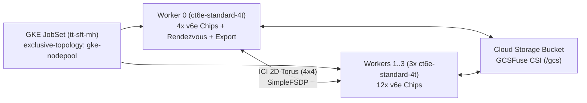

# Multi-host Supervised Fine-Tuning (SFT) with TPUs on Google Kubernetes Engine (GKE) using TorchTitan

This guide implements multi-host Supervised Fine-Tuning (SFT) across a 16-chip
**Cloud TPU v6e** slice (`tpu-v6e-4x4`, 4 `ct6e-standard-4t` hosts, 512 GiB
aggregate HBM) on Google Kubernetes Engine (GKE) using Kubernetes **`JobSet`**,
PyTorch (`torch_tpu`), and
[TorchTitan](https://github.com/google-pytorch/torchtitan).

Unlike JAX/MaxText multi-host SFT (which orchestrates workers via
`PathwaysJob`), PyTorch `torch_tpu` coordinates multi-host slices directly
through Kubernetes **`JobSet`** (`jobset.x-k8s.io/v1alpha2`) with exclusive
node-pool topology placement, GKE TPU webhook slice discovery
(`TPU_WORKER_HOSTNAMES`, `TPU_WORKER_ID`), `libtpu` `SliceBuilder` over ICI, and
distributed safetensors consolidation on Cloud Storage FUSE.

This example builds on the
[GKE Training Reference Architecture](/platforms/gke/base/use-cases/training-ref-arch/terraform/README.md).

## Architecture Overview



## Before you begin

- Ensure the
  [GKE Training Reference Architecture](/platforms/gke/base/use-cases/training-ref-arch/terraform/README.md)
  is deployed (`deploy-standard.sh`), which installs the `JobSet` controller and
  the `tpu-v6e-4x4` `ComputeClass`.
- If fine-tuning a gated model, add your
  [Hugging Face Hub **Read** access token](/platforms/gke/base/core/huggingface/initialize/README.md)
  to Secret Manager (`google/gemma-4-12B-it` is Apache 2.0 and ungated).
- Hardware and storage prerequisites:
  - **Hardware**: A 16-chip **TPU v6e** `4x4` slice (`4` × `ct6e-standard-4t`
    nodes). If targeting a specific GCE Aggregate Reservation, uncomment the
    `reservations` priority rule in
    `platforms/gke/base/core/custom_compute_class/templates/manifests/tpu/v6e/custom-compute-tpu-v6e-4x4.yaml`
    before applying `custom_compute_class`.
  - **Storage**: Cloud Storage bucket mounted across all 4 pods via GCSFuse CSI
    with `volumeAttributes.hostNetworkPodKSA: "true"` and
    `metadata-cache:ttl-secs:0` so rank-0 checkpoint consolidation immediately
    observes shard files written by peer hosts.

## Create the Google Cloud resources and build the container image

- Deploy the multi-host TorchTitan SFT Cloud Storage bucket, Kubernetes
  namespace, service account, and Workload Identity IAM bindings:

  ```shell
  export TF_PLUGIN_CACHE_DIR="${ACP_REPO_DIR}/.terraform.d/plugin-cache"
  cd "${ACP_REPO_DIR}/platforms/gke/base/use-cases/training-ref-arch/terraform/sft-tpu-torchtitan-multi-host" && \
  rm -rf .terraform/ terraform.tfstate* && \
  terraform init && \
  terraform plan -input=false -out=tfplan && \
  terraform apply -input=false tfplan && \
  rm tfplan
  ```

- Build and push the pinned TorchTitan TPU SFT container image via Cloud Build
  (skip if already built during the single-host guide):

  ```shell
  export TF_PLUGIN_CACHE_DIR="${ACP_REPO_DIR}/.terraform.d/plugin-cache"
  cd "${ACP_REPO_DIR}/platforms/gke/base/use-cases/training-ref-arch/terraform/images/tpu/torchtitan_sft" && \
  rm -rf .terraform/ terraform.tfstate* && \
  terraform init && \
  terraform plan -input=false -out=tfplan && \
  terraform apply -input=false tfplan && \
  rm tfplan
  ```

## Deploy the multi-host `JobSet` workload

- Select the Hugging Face model and source the environment configuration:

  ```shell
  export HF_MODEL_ID="google/gemma-4-12B-it"
  source "${ACP_REPO_DIR}/platforms/gke/base/use-cases/training-ref-arch/terraform/_shared_config/scripts/set_environment_variables.sh"
  ```

- Render the Kustomize runtime environment file:

  ```shell
  "${ACP_REPO_DIR}/platforms/gke/base/use-cases/training-ref-arch/kubernetes-manifests/sft-tpu-torchtitan-multi-host/configure_job.sh"
  ```

- Submit the 16-chip multi-host `JobSet` (`v6e-4x4`):

  ```shell
  kubectl apply --kustomize "${ACP_REPO_DIR}/platforms/gke/base/use-cases/training-ref-arch/kubernetes-manifests/sft-tpu-torchtitan-multi-host/v6e-4x4-gemma-4-12b-lora"
  ```

- Monitor the `JobSet` until all 4 slice workers complete:

  ```shell
  kubectl --namespace="${sft_tpu_torchtitan_multi_host_kubernetes_namespace_name}" \
    wait --for=condition=completed --timeout=45m jobset/tt-sft-mh-v6e-4x4-gemma-4-12b
  kubectl --namespace="${sft_tpu_torchtitan_multi_host_kubernetes_namespace_name}" \
    logs -l app=sft-torchtitan-trainer,batch.kubernetes.io/job-completion-index=0 \
    -c sft-trainer --tail=50
  ```

  Upon completion, worker 0 writes the consolidated PEFT adapter, merged BF16
  Hugging Face checkpoint, and held-out evaluation report to
  `gs://${sft_tpu_torchtitan_multi_host_dataset_bucket_name}/runs/${HF_MODEL_NAME}-lora-sft-v6e-mh/export/`.

## Reference Sizing on TPU v6e-16 (`tpu-v6e-4x4`, 4 Hosts)

Measured with `google/gemma-4-12B-it` across 16 TPU v6e chips (`4x4` ICI mesh),
`torch==2.15.0`, `torch_tpu==0.3.0`, and `libtpu==0.0.50`:

| Mode                  | Tokens / Chip / Step | Global Tokens / Step | Steady Step Time | Global Throughput | Peak HBM / Chip (`31.24 GiB` max) |
| :-------------------- | :------------------- | :------------------- | :--------------- | :---------------- | :-------------------------------- |
| LoRA SFT (`rank=16`)  | `2,048`              | `32,768`             | `0.69 s`         | `47,680 tok/s`    | `10.1–13.9 GiB`                   |
| LoRA SFT (`rank=16`)  | `8,192`              | `131,072`            | `2.17 s`         | `60,480 tok/s`    | `16.6–17.6 GiB`                   |
| Full SFT (`12.9B` FT) | `2,048`              | `32,768`             | `1.36 s`         | `24,032 tok/s`    | `18.1–24.5 GiB`                   |

## Key Multi-Host Design Choices

1. **`hostNetwork: true` + `volumeAttributes.hostNetworkPodKSA: "true"`**:
   `libtpu` `SliceBuilder` communicates across slice hosts on TCP ports
   `10000–10003` and ICI port `8471`, while
   `volumeAttributes.hostNetworkPodKSA: "true"` preserves pod-level GKE Workload
   Identity for Cloud Storage FUSE mounts without node-wide credentials.
2. **Static Rendezvous & Host-Local Dataset Cache**: `torchrun` uses
   `--rdzv_backend=static` with `--node_rank="${TPU_WORKER_ID}"` so PyTorch rank
   groups match the GKE TPU slice host order, while `HF_HOME="/tmp/hf-cache"`
   keeps Hugging Face dataset lock files host-local to avoid multi-host GCSFuse
   stale-handle generation conflicts.
3. **Kernel VMA Tuning (`vm.max_map_count=8388608`)**: An `initContainer` raises
   `vm.max_map_count` before `torchrun` starts so PjRt multi-host buffer mapping
   never hits the default `65530` Linux VMA ceiling.
4. **Coordinated Rank-0 Staging & Consolidation**: Worker 0 stages base model
   assets once on Cloud Storage before signaling peers with a per-`Job` UID
   marker, and GCSFuse `metadata-cache:ttl-secs:0` ensures rank 0 sees all 16
   distributed `HuggingFaceStorageWriter` shards immediately after the barrier.

## Clean up

- Delete the `JobSet` so GKE Node Auto-Provisioning scales down the 4-node TPU
  slice:

  ```shell
  kubectl delete --ignore-not-found --kustomize "${ACP_REPO_DIR}/platforms/gke/base/use-cases/training-ref-arch/kubernetes-manifests/sft-tpu-torchtitan-multi-host/v6e-4x4-gemma-4-12b-lora"
  ```

- Destroy the multi-host SFT Terraform resources:

  ```shell
  export TF_PLUGIN_CACHE_DIR="${ACP_REPO_DIR}/.terraform.d/plugin-cache"
  cd "${ACP_REPO_DIR}/platforms/gke/base/use-cases/training-ref-arch/terraform/sft-tpu-torchtitan-multi-host" && \
  rm -rf .terraform/ terraform.tfstate* && \
  terraform init && \
  terraform destroy -auto-approve
  ```
