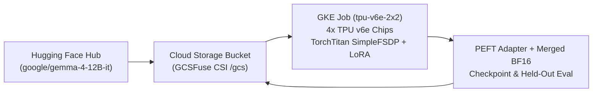

# Single-host Supervised Fine-Tuning (SFT) with TPUs on Google Kubernetes Engine (GKE) using TorchTitan

This guide implements Low-Rank Adaptation (LoRA) Supervised Fine-Tuning (SFT) on
Cloud TPU v6e (Trillium) in Google Kubernetes Engine (GKE) using PyTorch
(`torch_tpu`) and [TorchTitan](https://github.com/google-pytorch/torchtitan).

It uses TorchTitan's `SimpleFSDP` sharding, Pallas `SplashAttention`, and Pallas
fused cross-entropy on a single 4-chip **TPU v6e** node (`tpu-v6e-2x2`,
`ct6e-standard-4t`, 128 GiB total HBM) to fine-tune
[**google/gemma-4-12B-it**](https://huggingface.co/google/gemma-4-12B-it),
export both a PEFT adapter and a merged BF16 Hugging Face checkpoint to Cloud
Storage, and verify held-out cross-entropy reduction.

This example builds on the
[GKE Training Reference Architecture](/platforms/gke/base/use-cases/training-ref-arch/terraform/README.md).

## Architecture Overview



## Before you begin

- Ensure the
  [GKE Training Reference Architecture](/platforms/gke/base/use-cases/training-ref-arch/terraform/README.md)
  is deployed (`deploy-standard.sh`).
- If fine-tuning a gated model, add your
  [Hugging Face Hub **Read** access token](/platforms/gke/base/core/huggingface/initialize/README.md)
  to Secret Manager (`google/gemma-4-12B-it` is Apache 2.0 and ungated).
- Hardware and storage prerequisites:
  - **Hardware**: One **TPU v6e** `2x2` host (`ct6e-standard-4t`, 4 chips, 32
    GiB HBM per chip). If using a specific GCE Aggregate Reservation, uncomment
    the `reservations` priority rule in
    `platforms/gke/base/core/custom_compute_class/templates/manifests/tpu/v6e/custom-compute-tpu-v6e-2x2.yaml`
    before applying `custom_compute_class`.
  - **Storage**: Dedicated Cloud Storage bucket mounted via the GKE Cloud
    Storage FUSE CSI driver (`volumeAttributes.hostNetworkPodKSA: "true"`).

## Create the Google Cloud resources and build the container image

- Deploy the single-host TorchTitan SFT Cloud Storage bucket, Kubernetes
  namespace, service account, and Workload Identity IAM bindings:

  ```shell
  export TF_PLUGIN_CACHE_DIR="${ACP_REPO_DIR}/.terraform.d/plugin-cache"
  cd "${ACP_REPO_DIR}/platforms/gke/base/use-cases/training-ref-arch/terraform/sft-tpu-torchtitan-single-host" && \
  rm -rf .terraform/ terraform.tfstate* && \
  terraform init && \
  terraform plan -input=false -out=tfplan && \
  terraform apply -input=false tfplan && \
  rm tfplan
  ```

- Build and push the pinned TorchTitan TPU SFT container image via Cloud Build:

  ```shell
  export TF_PLUGIN_CACHE_DIR="${ACP_REPO_DIR}/.terraform.d/plugin-cache"
  cd "${ACP_REPO_DIR}/platforms/gke/base/use-cases/training-ref-arch/terraform/images/tpu/torchtitan_sft" && \
  rm -rf .terraform/ terraform.tfstate* && \
  terraform init && \
  terraform plan -input=false -out=tfplan && \
  terraform apply -input=false tfplan && \
  rm tfplan
  ```

## Deploy the single-host LoRA SFT job

- Select the Hugging Face model and source the environment configuration:

  ```shell
  export HF_MODEL_ID="google/gemma-4-12B-it"
  source "${ACP_REPO_DIR}/platforms/gke/base/use-cases/training-ref-arch/terraform/_shared_config/scripts/set_environment_variables.sh"
  ```

- Render the Kustomize runtime environment file:

  ```shell
  "${ACP_REPO_DIR}/platforms/gke/base/use-cases/training-ref-arch/kubernetes-manifests/sft-tpu-torchtitan-single-host/configure_job.sh"
  ```

- Submit the single-host LoRA SFT job on TPU v6e (`2x2`):

  ```shell
  kubectl apply --kustomize "${ACP_REPO_DIR}/platforms/gke/base/use-cases/training-ref-arch/kubernetes-manifests/sft-tpu-torchtitan-single-host/v6e-2x2-gemma-4-12b-lora"
  ```

- Monitor the training, checkpoint merge, and held-out evaluation logs:

  ```shell
  kubectl --namespace="${sft_tpu_torchtitan_single_host_kubernetes_namespace_name}" \
    wait --for=condition=complete --timeout=45m job/tt-sft-sh-v6e-2x2-gemma-4-12b
  kubectl --namespace="${sft_tpu_torchtitan_single_host_kubernetes_namespace_name}" \
    logs job/tt-sft-sh-v6e-2x2-gemma-4-12b -c sft-trainer --tail=40
  ```

  Upon completion, the Cloud Storage bucket
  `gs://${sft_tpu_torchtitan_single_host_dataset_bucket_name}/runs/${HF_MODEL_NAME}-lora-sft-v6e-sh/`
  contains:

  - `tb/`: TensorBoard event logs.
  - `export/adapter/`: PEFT-compatible LoRA adapter (`adapter_model.safetensors`
    and `adapter_config.json`).
  - `export/merged/`: Standalone BF16 Hugging Face checkpoint ready for serving
    with `vllm-torchtpu` (`--language-model-only`).
  - `export/eval.json`: Cross-entropy and next-token accuracy before and after
    LoRA adaptation on unseen held-out instruction rows.

## Reference Sizing on TPU v6e-4 (`tpu-v6e-2x2`)

Measured with `google/gemma-4-12B-it` (`11.96B` total parameters, `65.57M`
trainable rank-16 LoRA parameters across `wq, wkv, wo, w1, w2, w3`),
`torch==2.15.0`, `torch_tpu==0.3.0`, and `libtpu==0.0.50`:

| Tokens / Chip / Step | Global Tokens / Step | Steady Step Time | Throughput / Chip | Peak HBM / Chip (`31.24 GiB` max) |
| :------------------- | :------------------- | :--------------- | :---------------- | :-------------------------------- |
| `2,048`              | `8,192`              | `0.63 s`         | `3,246 tok/s`     | `22.5 GiB`                        |
| `8,192`              | `32,768`             | `2.11 s`         | `3,881 tok/s`     | `24.9 GiB`                        |

## Clean up

- Delete the training job so GKE Node Auto-Provisioning scales down the TPU
  node:

  ```shell
  kubectl delete --ignore-not-found --kustomize "${ACP_REPO_DIR}/platforms/gke/base/use-cases/training-ref-arch/kubernetes-manifests/sft-tpu-torchtitan-single-host/v6e-2x2-gemma-4-12b-lora"
  ```

- Destroy the single-host SFT Terraform resources:

  ```shell
  export TF_PLUGIN_CACHE_DIR="${ACP_REPO_DIR}/.terraform.d/plugin-cache"
  cd "${ACP_REPO_DIR}/platforms/gke/base/use-cases/training-ref-arch/terraform/sft-tpu-torchtitan-single-host" && \
  rm -rf .terraform/ terraform.tfstate* && \
  terraform init && \
  terraform destroy -auto-approve
  ```
