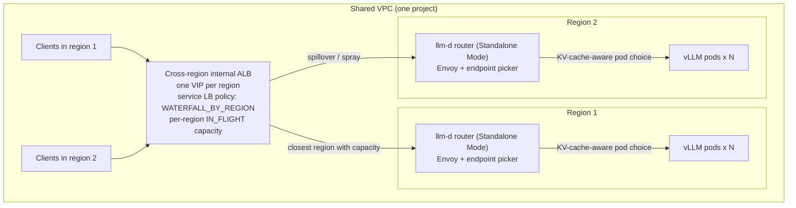

# Multi-region llm-d behind one cross-region load balancer

This example deploys optimized [llm-d](https://llm-d.ai) inference pools in
several regions behind **one** cross-region internal Application Load Balancer,
and measures them against plain vLLM deployments in the same regions: setup from
scratch, spin-up and ready time, and the golden signals.

It builds on the shared
[Multi-region GKE inference foundation](/docs/platforms/gke/base/use-cases/inference-ref-arch/multi-region-gke-inference-foundation.md)
and consumes
[`terraform/multi-region`](/platforms/gke/base/use-cases/inference-ref-arch/terraform/multi-region/README.md)
(`provision.sh`, `teardown.sh`, `global_lb.sh`, and `helpers.sh`) for parallel
regional cluster provisioning, Shared VPC networking, GKE standalone NEG
exposure, and the cross-region internal Application Load Balancer.

For the full guide, including architecture, results, and analysis, see
[Multi-region llm-d with a global load balancer](/docs/platforms/gke/base/use-cases/inference-ref-arch/llmd/llmd-multi-region-global-load-balancing.md).

## Architecture



- **Cross-region choice (load balancer).** `terraform/multi-region/global_lb`
  (`global_lb.sh`, driven by `scripts/set-route.sh`) creates one global backend
  service per experiment arm. Its backends are the GKE standalone zonal NEGs
  (`<prefix>-<key>-<backend>`, exposed via `expose_service_neg` / `mr_neg_name`)
  of that arm in every region. A service load balancing policy selects the
  cross-region behavior:
  - `locality`: `WATERFALL_BY_REGION`. Traffic goes to the closest region until
    it reaches its capacity (`MR_LB_REGION_CAPACITY_INFLIGHT=32` under the
    default `MR_LB_BALANCING_MODE=IN_FLIGHT`, or `MR_LB_REGION_CAPACITY_QPS=6`
    when `MR_LB_BALANCING_MODE=RATE`), then spills over.
  - `capacity`: `WATERFALL_BY_REGION` with a low region capacity
    (`MR_LB_CAPACITY_MODE_INFLIGHT=8` under `IN_FLIGHT`, or
    `MR_LB_CAPACITY_MODE_QPS=1` under `RATE`). Intended to spill over early, so
    the load of one region is spread over every region's GPUs, trading
    cross-region latency for utilization (in our tests, the internal ALB kept
    80–90% of requests local regardless of target capacity; see the guide).
  - `zone-spray`: `SPRAY_TO_REGION`. Like `locality`, but each proxy spreads
    requests over every zone of the chosen region. Despite its name, it does not
    spread traffic across regions.
  - `preferred`: one region's backends are `PREFERRED`, so that region is used
    to capacity first.
- **Pod choice (llm-d).** In each region, the llm-d router runs in Standalone
  Mode as a single Envoy + endpoint picker (`EPP`) pod (`replicas: 1`,
  `cluster-autoscaler.kubernetes.io/safe-to-evict: "false"`) so ZMQ KV-cache
  state stays unified per region. The EPP selects the vLLM pod using KV cache
  events (precise prefix cache routing, `ppcr`) or an approximate prefix index
  (optimized baseline, `ob`), together with load. One router pod per region is a
  single point of failure for that region's llm-d arm: while it restarts (node
  upgrade, preemption, crash), the region's NEG has no healthy endpoint, the
  load balancer health check (`/ready`, port 19001) sends traffic to the other
  regions, and active streams through that pod are cut (`safe-to-evict: "false"`
  prevents cluster autoscaler consolidation, not node upgrades). When
  `MR_HPA_ENABLED=true`, `set-route.sh` multiplies the router's per-endpoint
  capacity by `MR_HPA_MAX_REPLICAS / MR_REPLICAS_PER_REGION`: the router is the
  region's only NEG endpoint, so at full scale-out an llm-d region's capacity
  equals the baseline's (64 in-progress requests by default), while below full
  scale-out it accepts up to that factor more in-progress requests before
  spilling over. The router keeps the upstream chart's Envoy timeouts: 86400 s
  route timeout and 1000 s `ext_proc` `message_timeout` per endpoint picker
  exchange, so long streams are bounded by the load balancer's
  `MR_BACKEND_TIMEOUT_SEC` (3600 s).
- **Baseline.** The load balancer sends traffic straight to the plain vLLM pods'
  NEGs (`locality_lb_policy = "LEAST_REQUEST"` within each chosen region;
  `MR_BASELINE_LOCALITY_LB_POLICY=ROUND_ROBIN` reproduces the October 2026
  baseline runs), with the same cross-region policy and capacity but without an
  EPP. Both arms deploy a `PodDisruptionBudget` (`minAvailable: 1`) for the
  model servers.

> [!WARNING]
>
> The Terraform load balancer uses the zonal NEGs that exist when `set-route.sh`
> runs. GKE creates a standalone NEG in a zone only when the cluster has nodes
> there. A Pod that the HPA or the GPU ComputeClass later places in a new zone
> is Ready but gets no traffic until you re-run `set-route.sh` with the same
> arguments. For `llmd` this only matters if the router Pod moves; the router
> reaches model servers in every zone.

- **Alternative: GKE multi-cluster Inference Gateway**
  (`MR_GLOBAL_LB=mc-gateway`). Regional InferencePools are exported to the fleet
  and imported in the config cluster as `GCPInferencePoolImport`s behind a
  `gke-l7-cross-regional-internal-managed-mc` Gateway (`deploy-fleet.sh`,
  `deploy-gateway.sh`, `manifests/gateway`). See the guide for its prerequisites
  and current status.

Both arms use the **same** pod spec, which is the pinned llm-d model server
recipe, along with the same vLLM image, accelerator, model, vLLM arguments, and
replica count. The only differences are the two vLLM flags that llm-d needs
(`--enable-scale-out` and `--kv-events-config`) and how requests reach the pods.

## Security and isolation

- No public endpoints. The cluster nodes and control planes are private, and
  `kubectl` uses the IAM-authenticated DNS endpoint. The only load balancer is
  internal and is reachable only from inside the VPC network.
- No secrets in the repository or in the cluster. The Hugging Face token is read
  from a local file and stored in Secret Manager. Weights, configuration, and
  the tokenizer are streamed from the regional Cloud Storage bucket with
  Workload Identity.
- Everything is pinned:
  - the llm-d commit (Kustomize bases, router values),
  - the router Helm chart (with OCI digest verification),
  - the endpoint picker, vLLM, inference-perf, and curl images (by digest).
    `main` branches are never referenced, because upstream changes such as
    `Deployment` → `DisaggregatedSet` silently break overlays.
- Clusters are labelled `created_by`, `acp_environment`, and `acp_example` for
  attribution in shared projects.
- Fleet features (multi-cluster Services and multi-cluster Gateway) are
  project-wide. `teardown-all.sh` deletes the Gateway first, and waits for the
  load balancer to be deleted before it disables the features, so that no load
  balancer resources leak.

## Prerequisites

- `gcloud`, `kubectl`, `kustomize`, `helm` (v3), `terraform` (>= 1.8), `jq`,
  `python3` (with `PyYAML`), `git`, `envsubst`, `sponge`, `flock`, and `curl`.
- A Hugging Face read token in `~/hftoken`, or set `MR_HF_TOKEN_FILE`.
- GPU capacity for `MR_ACCELERATOR_TYPE` in every region: up to
  `MR_HPA_MAX_REPLICAS` × `MR_GPU_COUNT` GPUs per region and arm. The GPU
  compute class falls back from on-demand to flex-start (which uses preemptible
  quota) when a region has no on-demand quota or capacity.

All settings are in [`mr.env`](mr.env). The defaults are 3 regions
(`us-central1`, `europe-west2`, `asia-southeast1`), RTX PRO 6000,
`Qwen/Qwen3-32B`, and 2 replicas per region that a Horizontal Pod Autoscaler
scales up to 4 on vLLM queue depth (`vllm:num_requests_waiting`) and active
request concurrency (`vllm:num_requests_running`). Fixed-replica A/B sweeps
(`run-experiment.sh` and `run-skew-experiment.sh`) automatically set
`MR_HPA_ENABLED=false` unless `--with-hpa` is passed; to reproduce the
two-region guide, also `export MR_REGION_KEYS="usc1 euw2"`.

## Run

```bash
cd platforms/gke/base/use-cases/inference-ref-arch/examples/llmd-multi-region
export MR_PROJECT_ID="<project>"
export MR_RUN_ID="setup-$(date -u +%Y%m%dT%H%M%SZ)"

# 1. Set up from scratch (timed): network, regional clusters (parallel),
#    benchmark infrastructure, and model staging (parallel).
scripts/deploy-all.sh

# 2. Measure each arm, back to back: baseline and llm-d (ppcr, ob), locality
#    and capacity modes (fixed replicas by default; pass --with-hpa to autoscale).
#    Placeholder pods keep the GPU nodes between the arms
#    (delete-arm.sh --hold-gpus); the last arm releases them.
export MR_RUN_ID="exp-$(date -u +%Y%m%dT%H%M%SZ)"
scripts/run-experiment.sh

# 3. Optional: all load from one region (defaults to first region in MR_REGION_KEYS,
#    usc1), locality vs capacity (the published skew table used
#    MR_LB_BALANCING_MODE=RATE --region-capacity-qps 3 --modes "locality zone-spray").
export MR_RUN_ID="skew-$(date -u +%Y%m%dT%H%M%SZ)"
scripts/run-skew-experiment.sh --modes "locality capacity"

# 4. Optional: scale-out. Load from every region at about twice the capacity
#    of MR_REPLICAS_PER_REGION, so that the HPA scales each region out to
#    MR_HPA_MAX_REPLICAS, then a cool-down; records the autoscaling timeline.
export MR_RUN_ID="scale-$(date -u +%Y%m%dT%H%M%SZ)"
MR_PYTHON=<python with matplotlib> scripts/run-scale-experiment.sh

# 5. Tear everything down.
scripts/teardown-all.sh
```

Each step can also be run individually:

- `scripts/deploy-all.sh [--dry-run] [--regions-only]` (delegates regional
  provisioning to `../../terraform/multi-region/provision.sh --parallel`)
- `scripts/stage-model.sh <key>`
- `scripts/deploy-arm.sh <baseline|llmd>`
- `scripts/set-route.sh --backend <baseline|ppcr|ob> --lb-mode <locality|capacity|zone-spray|preferred>`
- `scripts/run-benchmark.sh --arm <label> --workload <shared-prefix|chat>`
- `scripts/delete-arm.sh <arm> [--hold-gpus]`
- `bench/record_scaling.py`: records HPA, Deployment, pod, and GPU node state
  per region every 15 s (used by `run-scale-experiment.sh`).
- `bench/scale_report.py`: client-side golden signals per stage, the autoscaling
  timeline, per-pod scale-out latency, and server-side signals from Managed
  Service for Prometheus.

To add a region to a running environment, add its key to `MR_REGION_KEYS`,
`MR_REGION`, and `MR_CIDR_INDEX` in `mr.env`, then run
`scripts/deploy-all.sh --regions-only` and `scripts/stage-model.sh <key>`. The
next `scripts/deploy-arm.sh` deploys the arm in the new region and adds its NEGs
and VIP to the global load balancer. Until then, `scripts/set-route.sh` fails
because the active arm has no NEGs in that region.

Don't edit the scripts while a run is in progress: bash reads scripts
incrementally.

Results are written under `${MR_WORK_DIR}/results`, outside the repository:

- `timings/<run>.jsonl`: one record per stage, written by `mr_stage`.
- `startup/<run>/<arm>/<region>/`: pods, nodes, events, vLLM logs, and markers,
  for the spin-up timeline.
- `runs/<run>/<arm>/<workload>/<client-region>/`: inference-perf reports.
- `gateway/*.json`: the Gateway VIPs, the active backend, and the load balancing
  mode.
- `scale/<run>/`: the autoscaling recording and the final HPA, Deployment, pod,
  and event state per region.

## Optional: GKE Pod snapshots

With `MR_POD_SNAPSHOTS_ENABLED=true`, the first llm-d model server pod of each
region is checkpointed once vLLM is healthy. Every later pod, for example the
ones the HPA adds, is restored from that snapshot instead of loading and
compiling the model. In the scale-out test, a restored replica was Ready 26–41 s
after it was scheduled; a cold one took 3:10–5:01.

```bash
export MR_POD_SNAPSHOTS_ENABLED=true
# Snapshot bucket and IAM (online_gpu), and the cluster feature, across regions:
ACP_DEPLOY_CORE_PLATFORM=false scripts/deploy-all.sh --regions-only
# Bootstrap (one cold replica per region, then the HPA's replicas restored):
scripts/deploy-arm.sh llmd --backend ob
```

- Model servers run in GKE Sandbox (gVisor). The container spec can't contain
  pod-specific values (GKE restores a container only into identical arguments),
  so the KV events argument is removed. Use the optimized baseline router
  (`--backend ob`): precise prefix cache routing needs KV events with a per-pod
  identity.
- `deploy-arm.sh` records a hash of the pod template on the `PodSnapshotPolicy`,
  and deletes the old snapshots when the pod spec changes.
- Snapshots stay in the regional bucket for the next deployment. They're about
  66 GiB per region; `teardown-all.sh` deletes them.

See the
[three-region scale-out guide](/docs/platforms/gke/base/use-cases/inference-ref-arch/llmd/llmd-multi-region-scale-out.md)
for the measurements and the pitfalls.

## Optional: IAP-protected external front door (prototype)

The environment is internal only. For demos, `scripts/deploy-front-door.sh` can
add an HTTPS endpoint that is reachable from the internet, but only by allowed
Google identities through Identity-Aware Proxy: a global external Application
Load Balancer (Google-managed certificate, Cloud Endpoints DNS name, optional
Cloud Armor allowlist) in front of a small Envoy relay in the config cluster,
which forwards to the internal Gateway VIP. It's off by default: no other script
deploys it, and `teardown-all.sh` removes it if it exists.

```bash
scripts/deploy-front-door.sh apply    # after the load balancer exists; ~15 minutes (certificate)
scripts/deploy-front-door.sh destroy
```

Read [manifests/front-door/README.md](manifests/front-door/README.md) for the
architecture, security posture, caveats, and cost before you use it.
