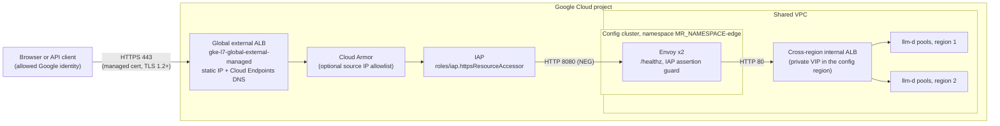

# Optional IAP-protected external front door (prototype)

The multi-region example is **internal only**: the cross-region internal
Application Load Balancer (Terraform-managed by default, or the multi-cluster
Inference Gateway with `MR_GLOBAL_LB=mc-gateway`) has a private VIP in each
region. For demos, this prototype adds an optional HTTPS front door that is
reachable from the internet, but only by allowed Google identities, through
Identity-Aware Proxy (IAP).

It is **off by default**: `deploy-all.sh` and `run-experiment.sh` never deploy
it, and benchmarks never use it. `teardown-all.sh` removes it if it exists.

> [!WARNING] This is a prototype for demos, not a production entry point. Review
> the security posture and caveats below, and your organization's policies,
> before you deploy it.

## Architecture



| Component                                                                          | Created by             | Notes                                                                                                                                                                                                                                                               |
| ---------------------------------------------------------------------------------- | ---------------------- | ------------------------------------------------------------------------------------------------------------------------------------------------------------------------------------------------------------------------------------------------------------------- |
| Global static IPv4 address `<MR_FRONT_DOOR_NAME>-ip`                               | `terraform/front_door` | Referenced by the Gateway as a `NamedAddress`.                                                                                                                                                                                                                      |
| Cloud Endpoints service `MR_FRONT_DOOR_HOSTNAME`                                   | `terraform/front_door` | DNS only: `<name>.endpoints.<project>.cloud.goog` → static IP. Same approach as `examples/llmd/initialize/external_gateway.tf`, including the `undelete` step for re-deployments.                                                                                   |
| Google-managed certificate `<MR_FRONT_DOOR_NAME>-cert`                             | `terraform/front_door` | Classic `google_compute_managed_ssl_certificate`, referenced with `networking.gke.io/pre-shared-certs` (the same as the llmd example). Certificate Manager (`networking.gke.io/certmap`) is also supported by the GatewayClass, but isn't needed for one host name. |
| SSL policy `<MR_FRONT_DOOR_NAME>-ssl`                                              | `terraform/front_door` | TLS 1.2+, `RESTRICTED` profile, attached with a `GCPGatewayPolicy`.                                                                                                                                                                                                 |
| Cloud Armor policy `<MR_FRONT_DOOR_NAME>-armor`                                    | `terraform/front_door` | Optional (`MR_FRONT_DOOR_CLOUD_ARMOR=true`): allows `MR_FRONT_DOOR_ALLOWED_CIDRS`, denies everything else (403).                                                                                                                                                    |
| Envoy `Deployment` (2 replicas), `Service`, `PodDisruptionBudget`, `NetworkPolicy` | `manifests/front-door` | Forwards everything to `http://<internal Gateway VIP in the config region>:80`.                                                                                                                                                                                     |
| `Gateway`, `HTTPRoute`, `HealthCheckPolicy`, `GCPBackendPolicy`                    | `manifests/front-door` | HTTPS listener only; route only for `MR_FRONT_DOOR_HOSTNAME`; IAP enabled; 3600 s backend timeout; request logging.                                                                                                                                                 |

Envoy is the only way to bridge the two load balancers: the external Gateway
can't reference the internal Gateway, and the internal VIP isn't routable from
outside the VPC.

## Deploy, call, and remove

Prerequisites: the environment is deployed (`deploy-all.sh`) and the internal
load balancer serves an arm (`deploy-arm.sh` or `set-route.sh`).

```bash
cd platforms/gke/base/use-cases/inference-ref-arch/examples/llmd-multi-region
export MR_PROJECT_ID="<project>"

# Optional: who can call it (default: only your gcloud account).
export MR_FRONT_DOOR_IAP_MEMBERS="user:alice@example.com group:llm-demo@example.com"
# Optional: also restrict source IP ranges with Cloud Armor.
# export MR_FRONT_DOOR_CLOUD_ARMOR=true MR_FRONT_DOOR_ALLOWED_CIDRS="203.0.113.0/24"

scripts/deploy-front-door.sh apply     # idempotent; ~15 minutes, up to 60+ (certificate)
scripts/deploy-front-door.sh destroy
```

`apply` runs `terraform/front_door`, renders and applies the manifests to the
config cluster, waits until the Gateway is programmed, grants IAP access, checks
that IAP is enabled on the backend service, waits until the certificate is
`ACTIVE`, checks that an unauthenticated request is redirected to Google
sign-in, and prints the URL and example commands. Every stage is timed with
`mr_stage`.

- **Browser:** open `https://<MR_FRONT_DOOR_HOSTNAME>/v1/models` and sign in.
- **Programmatic, default (Google-managed OAuth client):** use a service account
  that is in `MR_FRONT_DOOR_IAP_MEMBERS` (`serviceAccount:...`) and on which you
  have `roles/iam.serviceAccountTokenCreator`:

  ```bash
  TOKEN="$(gcloud auth print-access-token --impersonate-service-account="${SA}" \
    --scopes=openid,https://www.googleapis.com/auth/userinfo.email)"
  curl -N -H "Authorization: Bearer ${TOKEN}" -H 'Content-Type: application/json' \
    -d '{"model":"Qwen/Qwen3-32B","messages":[{"role":"user","content":"Hi"}],"stream":true}' \
    "https://${MR_FRONT_DOOR_HOSTNAME}/v1/chat/completions"
  ```

  A service account JWT signed with `gcloud iam service-accounts sign-jwt` (with
  `aud` set to `https://<host>/*`) also works.

- **Programmatic, custom OAuth client** (`MR_IAP_OAUTH_CLIENT_ID` and
  `MR_IAP_OAUTH_CLIENT_SECRET_FILE`): additionally, an OIDC ID token whose
  audience is the client ID is accepted, for example
  `gcloud auth print-identity-token --impersonate-service-account="${SA}" --audiences="${MR_IAP_OAUTH_CLIENT_ID}" --include-email`.
  `gcloud auth print-identity-token --audiences=...` only works with service
  account credentials; it fails for user accounts ("Invalid account type for
  `--audiences`").
- **Programmatic, as a human user:** create a Desktop OAuth client, allowlist it
  for programmatic access in the IAP settings (`programmatic_clients`), and get
  an ID token for it, as described in
  [Programmatic authentication](https://cloud.google.com/iap/docs/authentication-howto#authenticate_from_a_desktop_app).
  The script doesn't automate this.

## Validation (2026-10-30)

Tested once in a test project, in front of the Terraform-managed cross-region
internal load balancer (`MR_GLOBAL_LB=terraform`, upstream: the europe-west2
VIP):

| Stage                                                                                       |  Duration |
| ------------------------------------------------------------------------------------------- | --------: |
| `terraform/front_door` (APIs, static IP, Cloud Endpoints DNS name, certificate, SSL policy) |      3:27 |
| Manifests applied, Envoy rollout                                                            |      0:36 |
| Gateway programmed (global external ALB)                                                    |      3:14 |
| IAP access granted and IAP enabled on the backend service                                   |      0:08 |
| Google-managed certificate `ACTIVE`                                                         |      5:47 |
| IAP enforcement check                                                                       |      1:01 |
| **`apply` total**                                                                           | **14:19** |

| Request                                                                                           | Result                                                                                                                                      |
| ------------------------------------------------------------------------------------------------- | ------------------------------------------------------------------------------------------------------------------------------------------- |
| No credentials                                                                                    | `302` to `accounts.google.com` (IAP sign-in)                                                                                                |
| Forged `x-goog-iap-jwt-assertion` header, no credentials                                          | `302` (IAP rejects it before Envoy)                                                                                                         |
| User access token or gcloud ID token of an allowed **user**                                       | `401` (error code 900 / invalid audience): human users need the browser, or an allowlisted OAuth client for programmatic access (see below) |
| Access token of an allowed **service account** (impersonated, `openid` + `userinfo.email` scopes) | `/v1/models` `200`; `/v1/chat/completions` `200` (1.8 s for 25 tokens); streaming works                                                     |

The service account was temporary: it was removed from
`MR_FRONT_DOOR_IAP_MEMBERS` (`apply` replaces the IAP policy) and deleted after
the test. The `organization policies` in the test project allowed global
external load balancers and IAP; check yours (see [Caveats](#caveats)).

## Security posture

- **Authentication and authorization at the edge.** IAP is enabled on the only
  backend service. Access requires `roles/iap.httpsResourceAccessor`, which the
  script sets on that backend service to **exactly** `MR_FRONT_DOOR_IAP_MEMBERS`
  (default: only the deploying account). Grants made out of band are removed on
  the next `apply`. `MR_FRONT_DOOR_IAP_SCOPE=project` grants the role on the
  project instead, which also opens every other IAP-secured app in the project,
  so it isn't the default. Existing project-level IAP grants in the project also
  apply to the front door.
- **Never public.** `allUsers` and `allAuthenticatedUsers` are rejected by the
  script and by a Terraform variable validation.
- **TLS only.** The Gateway has only an HTTPS listener (no port 80), a
  Google-managed certificate, and an SSL policy with TLS 1.2+ and the
  `RESTRICTED` profile. The route matches only `MR_FRONT_DOOR_HOSTNAME`.
- **Single, private upstream.** Envoy has one static upstream, the internal
  Gateway VIP in the config region (the script refuses non-private addresses).
  It has no admin interface, no dynamic configuration, and no Kubernetes service
  account token. A `NetworkPolicy` only allows ingress from the load balancer
  ranges (`35.191.0.0/16`, `130.211.0.0/22`) and egress to the VIP.
- **Fail closed.** Envoy only forwards requests that carry IAP's
  `x-goog-iap-jwt-assertion` header, and answers 403 otherwise. If IAP isn't
  actually enabled (for example, the `GCPBackendPolicy` isn't attached),
  requests are rejected instead of reaching the models. This is a guard against
  misconfiguration, not authentication: the header isn't cryptographically
  verified by Envoy. For full verification, validate the JWT
  ([signed headers](https://cloud.google.com/iap/docs/signed-headers-howto)),
  for example with Envoy's `jwt_authn` filter, which requires egress to the IAP
  public keys.
- **No credentials to the models.** Envoy removes `Authorization`,
  `Proxy-Authorization`, `Cookie`, and the IAP assertion before forwarding.
- **Hardened pods.** Non-root (UID 65532), read-only root file system, no
  privilege escalation, all capabilities dropped, `RuntimeDefault` seccomp, the
  `restricted` Pod Security Standard enforced on the namespace, and the Envoy
  image pinned by digest.
- **Optional Cloud Armor allowlist,** evaluated before IAP.
- **Auditability.** Load balancer request logging is enabled (100 %), and Envoy
  logs every request (except `/healthz`) as JSON with the IAP user email.
- **No secrets in the repository.** The optional OAuth client secret is read
  from a local file into a Kubernetes Secret.

## IAP OAuth client: research notes

- **The IAP OAuth Admin API is shut down.** It was deprecated on January 22,
  2025, turned down for new projects on January 19, 2026, and shut down on March
  19, 2026, so `google_iap_brand`, `google_iap_client`, and
  `gcloud iap oauth-brands|oauth-clients` can't be used to create OAuth clients
  ([IAP deprecations](https://cloud.google.com/iap/docs/deprecations)). This
  prototype doesn't use them.
- **By default, IAP uses a Google-managed OAuth client,** which only allows
  users in the resource's organization, and only the browser flow. IAP-secured
  apps that use it can still be called programmatically with service account
  credentials (access token with the `openid` and `email` scopes, or a service
  account JWT), or with a separate OAuth client allowlisted through
  `programmatic_clients`. A custom OAuth client is needed for external users and
  for custom branding
  ([Use custom OAuth clients](https://cloud.google.com/iap/docs/custom-oauth-configuration),
  [Google-managed OAuth client](https://cloud.google.com/iap/docs/managed-oauth-client),
  [Programmatic authentication](https://cloud.google.com/iap/docs/authentication-howto),
  [Share OAuth clients](https://cloud.google.com/iap/docs/sharing-oauth-clients)).
- **GKE Gateway.** The GKE Gateway documentation only shows `GCPBackendPolicy`
  with `iap.clientID` and `iap.oauth2ClientSecret`
  ([Configure IAP](https://cloud.google.com/kubernetes-engine/docs/how-to/configure-gateway-resources#configure_iap)),
  while
  [Enabling IAP for GKE](https://cloud.google.com/iap/docs/enabling-kubernetes-howto)
  states that IAP uses a Google-managed OAuth client. The existing `llmd` and
  `comfyui` examples in this repository set only `iap.enabled: true`, and this
  prototype does the same by default. Because the documentation doesn't state it
  explicitly for Gateway, `apply` verifies `iap.enabled` on the generated
  backend service, and Envoy fails closed. If your GKE version requires a
  client, set `MR_IAP_OAUTH_CLIENT_ID` and `MR_IAP_OAUTH_CLIENT_SECRET_FILE`.
  Create the client in the Google Cloud console (Google Auth Platform, Web
  application) with the redirect URI
  `https://iap.googleapis.com/v1/oauth/clientIds/<CLIENT_ID>:handleRedirect`.
  The secret is stored under the `key` key of the `llm-front-door-iap-oauth`
  Secret.

## Caveats

- **Extra hops.** Requests go through the external load balancer, IAP, Envoy,
  and the internal load balancer. This adds latency, and every request enters
  the internal Gateway in the **config cluster's region**, so the internal load
  balancer's "closest region" is always the config region (spillover still
  works). Use it for demos, not for latency or locality measurements.
- **Stale upstream.** The VIP is resolved when `apply` runs. Re-run `apply` if
  the internal Gateway is re-created (the VIP is ephemeral).
- **API clients and IAP.** Clients must send a Google-issued credential; plain
  OpenAI-compatible clients need a custom header (`Authorization: Bearer ...`)
  or a token-refreshing wrapper. Access tokens expire after about one hour.
  Envoy strips the credentials before forwarding.
- **Certificate provisioning** takes 15-60 minutes (sometimes longer) after the
  host name resolves to the IP and the load balancer serves the certificate.
  Until then, HTTPS fails. `MR_FRONT_DOOR_CERT_TIMEOUT_S` controls the wait.
- **Organization policies** can block this design, for example
  `constraints/compute.restrictLoadBalancerCreationForTypes` without
  `GLOBAL_EXTERNAL_MANAGED_HTTP_HTTPS`
  ([load balancing constraints](https://cloud.google.com/load-balancing/docs/org-policy-constraints)),
  restrictions on IAP or on external IP addresses, or company policies about
  exposing internal services. Check with your organization before deploying.
- **Domain-scoped project IDs** (`example.com:project`) need an explicit
  `MR_FRONT_DOOR_HOSTNAME`.
- **Cloud Armor changes.** To turn off Cloud Armor after it was enabled, run
  `destroy` and then `apply`, so that the policy is detached before Terraform
  deletes it.
- **Cloud Endpoints names** stay reserved for 30 days after deletion;
  `terraform/front_door` undeletes them on re-deployment.

## Cost

Approximate (US pricing, see the pricing pages for current numbers):

- Global external Application Load Balancer: forwarding rule at $0.025/hour (up
  to 5 rules), plus $0.008/GiB of inbound and outbound data processed, plus
  internet egress
  ([network pricing](https://cloud.google.com/vpc/network-pricing#lb)). A static
  IP address attached to a forwarding rule isn't charged.
- Envoy: 2 × (250m CPU, 128 MiB) requests on existing system nodes.
- Cloud Armor (optional): per policy, per rule, and per request charges
  ([Cloud Armor pricing](https://cloud.google.com/armor/pricing)).
- IAP, the Google-managed certificate, the SSL policy, and the DNS-only Cloud
  Endpoints service have no separate charges for this use.

## Troubleshooting

- **`IAP is not enabled on the front door backend service`:** run
  `kubectl describe gcpbackendpolicy llm-front-door -n <namespace>` on the
  config cluster. If the policy isn't attached because a client ID is required,
  set `MR_IAP_OAUTH_CLIENT_ID` and `MR_IAP_OAUTH_CLIENT_SECRET_FILE` and re-run
  `apply`.
- **HTTP 403 `front door: request did not pass IAP`:** the request reached Envoy
  without IAP. Check the previous item.
- **HTTP 403 from IAP:** the identity doesn't have
  `roles/iap.httpsResourceAccessor` on the backend service. Add it to
  `MR_FRONT_DOOR_IAP_MEMBERS` and re-run `apply` (IAM changes can take a few
  minutes).
- **HTTP 502/503/504 after sign-in:** Envoy can't reach the internal Gateway.
  Check that the internal Gateway is programmed, that the VIP printed by `apply`
  is current, and the Envoy logs
  (`kubectl logs deploy/llm-front-door -n <namespace>`).
- **Certificate stuck in `PROVISIONING` or `FAILED_NOT_VISIBLE`:** check that
  `MR_FRONT_DOOR_HOSTNAME` resolves to the static IP, and that the Gateway is
  programmed with the certificate.
